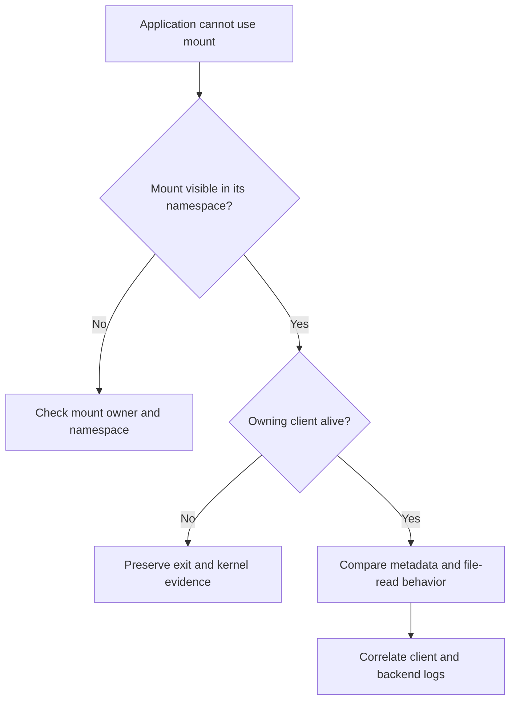

# Diagnose JuiceFS Mount Hangs with Foreground Logs and Bounded Probes

Author: [nawazdhandala](https://www.github.com/nawazdhandala)

Tags: JuiceFS, Linux, Troubleshooting

Description: Separate a missing JuiceFS mount from slow metadata or object storage, capture useful client evidence, and reproduce safely with foreground debug logs.

A directory that hangs when opened and a mount that disappears require different investigations. Restarting the client immediately can hide the reason it exited, interrupt writers, and leave you with a new process attached to an old problem.

Start with three questions: is the mount visible to the affected application, is its owning client alive, and which operation fails? This guide uses **JuiceFS Community Edition 1.4.2** on Linux. It focuses on evidence collection and a controlled reproduction, rather than changing boot configuration or tuning storage blindly.

## Verify the command before following a debugging recipe

JuiceFS 1.4.2 runs `mount` in the foreground by default. `-d` or `--background` requests a background daemon. There is no `mount --foreground` option in this release. The global `--verbose` option enables debug logging; `--debug` and `-v` are aliases.

Check the installed executable rather than assuming that flags from another FUSE tool apply:

```bash
juicefs --version
juicefs --help
juicefs mount --help
```

FUSE is the kernel interface through which the JuiceFS process supplies filesystem operations. A live directory entry alone does not prove that this process is serving requests. The command syntax above was checked against the official 1.4.2 binary. [Pinned global options](https://github.com/juicedata/juicefs/blob/v1.4.2/cmd/main.go), [mount implementation](https://github.com/juicedata/juicefs/blob/v1.4.2/cmd/mount.go).

## Classify the failure without walking the whole filesystem

Record the first failure time, affected host, application identity, mount path, and one reproducible operation. Avoid recursive listings or checksums across a distressed mount: they add work and blur the original symptom.



A mount namespace is a process's view of mounted filesystems. A host shell and a container may see different views. Run the initial visibility check in the same environment as the failing application, using your normal container or host access procedure.

With util-linux installed, inspect the exact mount point:

```bash
mountpoint /mnt/jfs
```

Replace `/mnt/jfs` throughout with the verified application mount. Exit status zero means the path is a mount point; it does not identify the correct volume or establish its health. [mountpoint manual](https://man7.org/linux/man-pages/man1/mountpoint.1.html).

For a systemd-managed client, substitute its actual unit name:

```bash
systemctl show juicefs-data.service -p MainPID -p SubState -p Result
journalctl -u juicefs-data.service -b -n 200 --no-pager
journalctl -k -b -n 200 --no-pager
```

These inspect service state, recent current-boot service logs, and kernel messages. Use an account allowed to read the journal. Look for a recorded exit, supervisor stop, or kernel out-of-memory event at the failure time; do not infer an out-of-memory kill from a vanished process alone. [systemctl reference](https://www.freedesktop.org/software/systemd/man/257/systemctl.html), [journalctl reference](https://www.freedesktop.org/software/systemd/man/257/journalctl.html).

## Preserve the right logs

For a background Linux mount, the default local log is `/var/log/juicefs.log` for root or `$HOME/.juicefs/juicefs.log` for a non-root user. An explicit `--log` changes that location. Foreground output may instead be captured by the terminal or service manager.

Read a short recent section from the actual configured file. Do not assume a quiet default file belongs to the affected client. Correlate timestamps with application errors, and keep a few preceding successful operations as context. [JuiceFS client-log guide](https://github.com/juicedata/juicefs/blob/v1.4.2/docs/en/administration/fault_diagnosis_and_analysis.md#client-log).

| Evidence | Useful next investigation |
| --- | --- |
| Client exited before the application failure | Supervisor decision, kernel events, crash details |
| Authentication or certificate error | The named endpoint, credential source, and certificate trust |
| Metadata operations are slow | Metadata-service availability and latency from this client |
| Directory lookup works but a particular read stalls | Object request, local cache, and the affected file's blocks |
| Repeated upload or flush failures | Object-storage reachability, capacity, and client staging state |

These are hypotheses, not automatic diagnoses. Cached metadata or data can make a partial outage look healthy. Compare the same operation from another existing client when available, without treating that comparison as proof that every network path works.

## Reproduce in the foreground without adding a second owner

Use a staging volume or an approved maintenance window. If replacing an existing mount process, coordinate writers and stop its normal supervisor first. Confirm that the old mount is gone. Do not stack a debug mount over an active one.

Provision the metadata password file securely beforehand. Replace the URL and paths with the tested volume settings, including any required object-storage trust configuration:

```bash
export META_PASSWORD_FILE=/etc/juicefs/meta-password
juicefs --verbose mount \
  --cache-dir /var/cache/juicefs-debug \
  rediss://juicefs@metadata.example.internal:6379/1 \
  /mnt/jfs-debug
```

Prepare the empty mount directory and writable cache directory for the intended account. This uses Redis over TLS and keeps its password out of the command line. It mounts an existing volume; it does not format one. The terminal remains occupied by the foreground client, with debug output visible. [Metadata password-file support](https://github.com/juicedata/juicefs/blob/v1.4.2/docs/en/reference/how_to_set_up_metadata_engine.md).

From a second session, reproduce one known safe operation as the affected application user. Record its start time and result. Do not add writeback, change timeout settings, or change credentials simultaneously: that would make it harder to identify which condition mattered.

## Sample a responsive client, then stop collecting

When the mount can still serve its diagnostic interface, collect a finite sample:

```bash
juicefs stats --count 5 --interval 1 /mnt/jfs
```

This requests five updates rather than an indefinite display. Compare metadata and object activity with the failing request. The count limits updates, not the wall-clock duration of a blocked filesystem access. [Pinned stats command](https://github.com/juicedata/juicefs/blob/v1.4.2/cmd/stats.go).

For a support bundle, choose a protected local directory outside JuiceFS with enough space:

```bash
umask 077
out=$(mktemp -d /var/tmp/juicefs-debug.XXXXXX)
juicefs debug --out-dir "$out" --limit 1000 \
  --stats-sec 5 --trace-sec 5 --profile-sec 10 /mnt/jfs
```

The bundle can contain configuration, logs, metrics, and runtime profiling information. Sampling has overhead. Review the result for sensitive paths, identifiers, and credentials before sharing it, and check warnings for missing evidence. A bundle command that finishes is not a health certificate. [Pinned debug collection implementation](https://github.com/juicedata/juicefs/blob/v1.4.2/cmd/debug.go).

Do not expose the client's diagnostic HTTP listener publicly to make collection convenient. If the client has already exited, preserve the existing logs and supervisor evidence instead of repeatedly requesting live profiles.

## Recover only after identifying the failure boundary

An object-storage `NoSuchKey` warning alone does not establish permanent loss: concurrent compaction or pending writeback uploads can produce transient misses. Repeated application I/O errors warrant investigation of the exact objects and metadata relationship. Do not delete cache or staging directories as a generic repair. [JuiceFS read/write troubleshooting](https://github.com/juicedata/juicefs/blob/v1.4.2/docs/en/administration/troubleshooting.md#read-write-error).

After correcting the cause, stop diagnostic activity, coordinate a normal unmount where needed, and return ownership to the intended supervisor. Verify application reads and an approved write/read/delete probe, then confirm that errors do not recur under representative traffic. Preserve the incident evidence even when restarting appears to help.

The examples were checked against pinned source and executable help, with local shell syntax checks. No Linux FUSE mount, live hang, systemd incident, or backend outage was reproduced here. Treat the sequence as a controlled investigation plan, not a claim that a particular failure was tested successfully.
