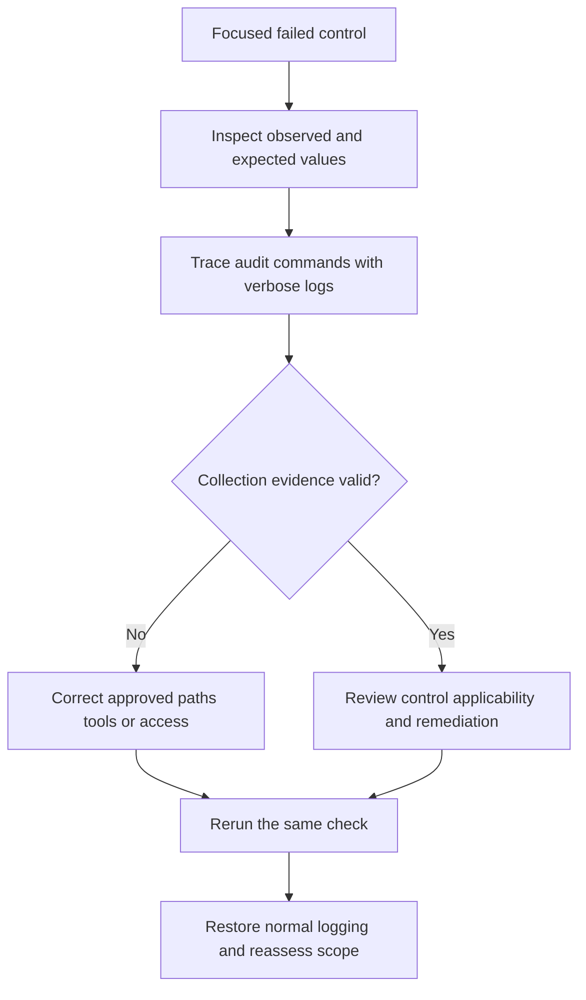

# Debug kube-bench Checks with Test Output and Verbose Logs

Author: [nawazdhandala](https://www.github.com/nawazdhandala)

Tags: Kubernetes, Security, Troubleshooting

Description: Diagnose kube-bench failures by separating observed test values, verbose collection logs, and control definitions before changing cluster settings.

A failed kube-bench control tells you that the check did not pass. It does not always tell you whether the node has an insecure setting, the scanner read the wrong file, or an audit command could not run. Debugging starts by distinguishing those possibilities.

Two flags help, but they expose different information. `--include-test-output` adds an observed value to some human-readable failures. Verbosity level 3 shows the commands and execution details behind the assessment. Use them on a small, reproducible selection rather than turning every cluster assessment into a permanent debug log.

This guide pins **kube-bench v0.14.0**. Its output behavior was tested locally with synthetic controls. The Kubernetes examples are commands for an authorized scanner environment, not claims of a live cluster test.

## Keep the original failure reproducible

Record the node identity, kube-bench image or binary version, benchmark, target, configuration revision, and exact control ID. Preserve the first report before changing mounts, permissions, filters, or the node configuration.

For this example, the intended assessment is an approved `cis-1.11` worker-node scan, and the control is `4.1.1`. Use the ID and profile from your own finding. The same number in another benchmark may describe a different requirement.

Start with one control. That reduces unrelated diagnostics and makes it easier to connect an audit command with its result. Keep the same node placement and host visibility as the original scan; running the binary on an administrator’s laptop would investigate a different environment.

## Add the observed value to human-readable output

Run the following from the directory containing the pinned binary and matching configuration tree:

```bash
bundle_dir="$PWD"
scan_status=0
./kube-bench run --benchmark cis-1.11 --targets node \
  --config "$bundle_dir/cfg/config.yaml" \
  --config-dir "$bundle_dir/cfg" --check 4.1.1 \
  --include-test-output --exit-code 3 \
  > focused.txt 2> focused.log || scan_status=$?
printf 'Scanner exit: %s\n' "$scan_status"
```

This performs a real assessment of the selected control. An explicit exit code preserves the distinction between an automated FAIL and a zero exit from a run with no failed controls. Keep both output files even when the scanner exits nonzero.

In v0.14.0, the [human-readable printer](https://github.com/aquasecurity/kube-bench/blob/v0.14.0/cmd/common.go) adds `ActualValue` only when a check is FAIL and that field is nonempty. It does not print every audit command’s complete output, and it does not add the same detail to PASS, WARN, or INFO lines.

For a file-permission control, the extra line might show the mode observed by the test. That is evidence to investigate, not an instruction to apply a permission change immediately. First confirm the path refers to the intended host file and that the selected control actually applies to it.

If no extra line appears, do not assume the flag was ignored. The check may have no observed value, may not have executed, or may have a different status. The [output flag documentation](https://github.com/aquasecurity/kube-bench/blob/v0.14.0/docs/flags-and-commands.md) also explains that this option does not change JSON output.

## Use verbosity to trace collection and evaluation

When the observed value is insufficient, rerun that same selection with level 3 logging:

```bash
bundle_dir="$PWD"
scan_status=0
./kube-bench run --benchmark cis-1.11 --targets node \
  --config "$bundle_dir/cfg/config.yaml" \
  --config-dir "$bundle_dir/cfg" --check 4.1.1 \
  --include-test-output --v 3 --logtostderr=true --exit-code 3 \
  > verbose-results.txt 2> verbose-debug.log || scan_status=$?
printf 'Verbose scan exit: %s\n' "$scan_status"
```

The [check runner](https://github.com/aquasecurity/kube-bench/blob/v0.14.0/check/check.go) logs the selected check, audit commands, command output, and evaluation details at this verbosity. Read the sequence around the intended control rather than treating any warning anywhere in the file as its cause.

Debug output can contain command arguments, host paths, configuration values, and environment-derived settings. Keep it in the restricted assessment evidence store. Review and redact a copy before sharing it outside the team; retain the original under appropriate access controls.

For a Kubernetes Job, add the flags to the existing container command or arguments without removing its benchmark, target, or mounts. Create a fresh diagnostic Job from the reviewed template rather than assuming an existing Job’s Pod template can be rewritten. Confirm the new Pod ran on the same intended node.

## Read the JSON fields when text is ambiguous

If the original assessment already produced default-format JSON, use jq to inspect one result:

```bash
jq --arg id '4.1.1' '
  [.Controls[] | select(.node_type == "node") |
   .tests[] | .results[] | select(.test_number == $id) |
   {test_number, status, type, scored, reason,
    actual_value, expected_result, audit, remediation}]
' report.json
```

The expected output is an array containing the matching result. An empty array means the control was not found in that report; it is not a passing result. Check the selected target, profile, and filters before investigating its alleged remediation.

The [result structure](https://github.com/aquasecurity/kube-bench/blob/v0.14.0/check/check.go) exposes `actual_value` and `expected_result`, but internal raw audit-output fields are not serialized into JSON. Verbose logs can therefore add collection context that the saved JSON lacks. Keep stderr separate from JSON rather than redirecting both streams into a file that a parser expects to contain one JSON document.

## Locate the layer where the evidence went wrong

| Observation | Next investigation |
|---|---|
| Referenced host file is absent | Verify node layout, hostPath mount, and configured path |
| Audit command is unavailable | Confirm the image includes the tool and the expected executable search path |
| Permission denied | Review scanner identity and approved access to the specific evidence |
| Value is present but comparison fails | Inspect the pinned control’s parsing and comparison rule |
| WARN with a manual type | Gather human assessment evidence instead of forcing an automated result |
| Selected check absent | Correct selection or report provenance before changing the node |

For path problems, follow the complete mapping: host path, container mount path, kube-bench configuration candidate, and any substituted variable in the audit command. Correcting only one layer can leave the check inspecting a different location.

For parsing problems, inspect the exact control YAML from the pinned release. A test can read a process argument, fall back to a configuration file, or inspect an environment-derived value. The [test implementation](https://github.com/aquasecurity/kube-bench/blob/v0.14.0/check/test.go) defines how values and comparison operators are interpreted. A similar-looking manual command is not proof that the scanner evaluated identical input.



Avoid making the test pass by broadening permissions, disabling verification, or changing its expected value without a reviewed reason. A scanner correction and a node-security remediation are different changes and should be recorded separately.

## Close the investigation with before-and-after evidence

After correcting the identified cause, rerun the same control with the same profile. Preserve the original failure, the diagnostic evidence, and the result after the change. Then reassess related controls or the full applicable target before treating the broader remediation as complete.

Return recurring scans to normal verbosity once diagnosis is finished. The local fixture for this article confirmed that test-output mode added a failing observed value to text, left JSON unchanged, and that level 3 emitted command/output details to stderr. Those checks validate reporting behavior only; your final conclusion must be based on the intended node and its actual evidence.
