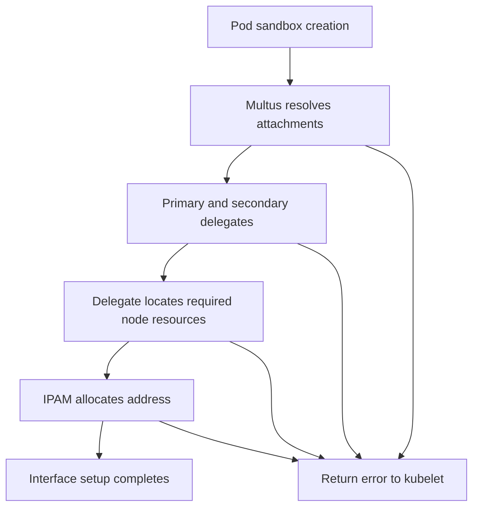

# Debug Multus Secondary-Network Failures in ContainerCreating Pods

Author: [nawazdhandala](https://www.github.com/nawazdhandala)

Tags: Multus, Kubernetes, Troubleshooting

Description: Trace a Multus sandbox failure from Pod events to its network attachment, delegated plugin, node prerequisites, and IP address allocation.

A Pod stuck in `ContainerCreating` has not necessarily reached your application. If its events contain `FailedCreatePodSandBox` and a Multus network-add error, restarting the application or changing its readiness probe will not repair the failed network setup.

Multus is a CNI meta-plugin: it delegates interface creation to other Container Network Interface plugins. A secondary network can fail after the primary network has already been configured. The useful question is therefore not simply “Is Multus running?” but “Which delegate failed on this node, and at which step?”

This guide uses Multus **v4.3.1**, commit `d61706810cc8be60381dcb66e6a2428d5eb2795a`, as its source reference. Adapt resource names and paths to the installed distribution. The commands are inspections; no live cluster failure was reproduced for this article.

## Keep the original failure evidence

Start with the affected Pod and preserve its node, UID, and event message before deleting anything. Replace the context, namespace, and Pod placeholders:

```bash
kubectl --context REPLACE_CONTEXT -n REPLACE_NAMESPACE \
  get pod REPLACE_POD -o wide
kubectl --context REPLACE_CONTEXT -n REPLACE_NAMESPACE \
  describe pod REPLACE_POD
```

The node matters because secondary networking often depends on node-local interfaces, plugin binaries, sockets, and address-allocation state. The UID distinguishes the current Pod from an earlier object with the same name. Kubernetes recommends Pod status and events as the starting point for this kind of investigation. [Debug Pods](https://kubernetes.io/docs/tasks/debug/debug-application/debug-pods/).

Read the complete nested error. The outer message may name `multus` or `multus-shim`, while the inner error identifies `macvlan`, an IPAM plugin, or an inaccessible Kubernetes resource. IPAM means IP address management, the component that allocates the interface's address.



The first failing boundary determines the next inspection. Do not jump to packet captures when the requested interface has not been created.

## Match the annotation to the actual attachment

Inspect the Pod's `k8s.v1.cni.cncf.io/networks` annotation and resolve each requested NetworkAttachmentDefinition, usually abbreviated NAD. A NAD describes the delegated network configuration. An unqualified attachment name normally refers to the Pod's namespace; cross-namespace selection must identify the intended namespace and satisfy the deployment's isolation policy. [Pinned Multus usage](https://github.com/k8snetworkplumbingwg/multus-cni/blob/v4.3.1/docs/how-to-use.md).

```bash
kubectl --context REPLACE_CONTEXT -n REPLACE_NAMESPACE \
  get pod REPLACE_POD \
  -o 'jsonpath={.metadata.annotations.k8s\.v1\.cni\.cncf\.io/networks}{"\n"}'
kubectl --context REPLACE_CONTEXT -n REPLACE_NAD_NAMESPACE \
  get network-attachment-definition REPLACE_NAD -o json > nad.json
```

Confirm that the retrieved NAD is the one named in the error, not a similarly named object in another namespace. Keep `nad.json` in a restricted workspace; network configuration may contain infrastructure details.

For an inline configuration, the NAD's `spec.config` is itself a JSON string inside the Kubernetes object. This original Python check decodes both layers and reports the delegate types without printing the whole configuration:

```python
import json

nad = json.load(open('nad.json'))
raw = nad.get('spec', {}).get('config')
if not raw:
    raise SystemExit('No inline config; inspect the configured node-side network file')
config = json.loads(raw)
if not isinstance(config, dict):
    raise ValueError('CNI configuration must be an object')
plugins = config.get('plugins', [config])
if not isinstance(plugins, list) or not plugins:
    raise ValueError('Expected a plugin or nonempty plugins list')
for plugin in plugins:
    if not isinstance(plugin, dict) or not isinstance(plugin.get('type'), str):
        raise ValueError('Each delegate needs a plugin type')
    if not plugin['type']:
        raise ValueError('Plugin type cannot be empty')
    print('delegate:', plugin['type'])
    ipam = plugin.get('ipam', {})
    if ipam:
        if not isinstance(ipam, dict) or not ipam.get('type'):
            raise ValueError('IPAM configuration needs a type')
        print('ipam:', ipam['type'])
```

This detects malformed JSON and missing basic structure. It is not a CNI schema validator and does not establish that a plugin supports the requested options or CNI version. If the NAD intentionally has no inline configuration, Multus can resolve a node-side configuration file; inspect that installed path instead of declaring the NAD invalid.

## Follow the failure to the scheduled node

For a thick-plugin deployment, locate the Multus daemon on the affected node. The upstream manifest uses namespace `kube-system`, label `app=multus`, and container `kube-multus`; verify these names in your distribution first.

```bash
kubectl --context REPLACE_CONTEXT -n kube-system get pods \
  -l app=multus --field-selector spec.nodeName=REPLACE_NODE -o wide
kubectl --context REPLACE_CONTEXT -n kube-system \
  logs REPLACE_MULTUS_POD -c kube-multus --since=10m --tail=150
```

Correlate the application Pod UID and failure time. A daemon on a different node may be perfectly healthy while this node has the problem. Thin-plugin deployments have a different execution arrangement; use the configured Multus log location and runtime/kubelet logs rather than assuming a daemon Pod exists. [Pinned thick-plugin manifest](https://github.com/k8snetworkplumbingwg/multus-cni/blob/v4.3.1/deployments/multus-daemonset-thick.yml).

| Inner error points to | Inspect next | Avoid assuming |
| --- | --- | --- |
| Missing NAD or API authorization | Namespace, spelling, API connectivity, Multus identity | Every failure is an interface problem |
| Plugin executable not found | Configured CNI binary path on this node | Installing Multus installs every delegate |
| Link or parent interface not found | Actual node interface name and availability | All nodes use the same NIC name |
| Address allocation failure | Selected IPAM range, allocator state, overlapping use | Deleting all lease files is safe |
| Thick-plugin socket connection | Daemon readiness and matching socket mounts | The application container owns that socket |

For macvlan, `master` identifies the parent interface; if omitted, the plugin uses the default-route interface. Compare that choice with the real node configuration. A network named `storage` does not create a physical interface with that name. [Macvlan configuration](https://www.cni.dev/plugins/current/main/macvlan/).

## Investigate IPAM without damaging active leases

Separate address exhaustion from stale state and address overlap. Determine which allocator the NAD actually selects before using its diagnostic tools. For example, host-local persists allocation state on the node and guarantees uniqueness there, not across the entire cluster. Giving every node the same host-local pool is not a cluster-wide allocator. [Host-local behavior](https://www.cni.dev/plugins/current/ipam/host-local/).

Compare allocator records with current Pod UIDs, sandbox identifiers, and interfaces through the supported operational procedure. Preserve the records before any approved cleanup. Do not remove `/var/lib/cni` or flush interfaces merely because the latest Pod cannot start; those objects may belong to healthy workloads.

Multus v4.3.1 attempts to tear down networks already added when a later delegate fails. That cleanup attempt is not proof that every delegate successfully released its resources. Keep the original ADD failure separate from any subsequent DEL cleanup errors. [Pinned add/cleanup implementation](https://github.com/k8snetworkplumbingwg/multus-cni/blob/v4.3.1/pkg/multus/multus.go).

## Verify the correction on a controlled workload

Change the smallest confirmed cause: the attachment reference, delegated configuration, missing node prerequisite, or allocator issue. If node preparation differs, use the cluster's approved scheduling controls so the workload reaches a compatible node. Do not silently strip a required network annotation just to obtain a Running Pod.

Use a disposable workload with the same attachment and placement constraints, then observe a fresh sandbox attempt. Require the expected secondary interface and address, successful primary networking, and the application's actual connectivity test. Finally, delete the disposable workload normally and confirm allocation cleanup through the allocator's supported checks. A successful CNI ADD establishes setup; traffic flow and clean teardown establish that the repaired configuration is usable.
