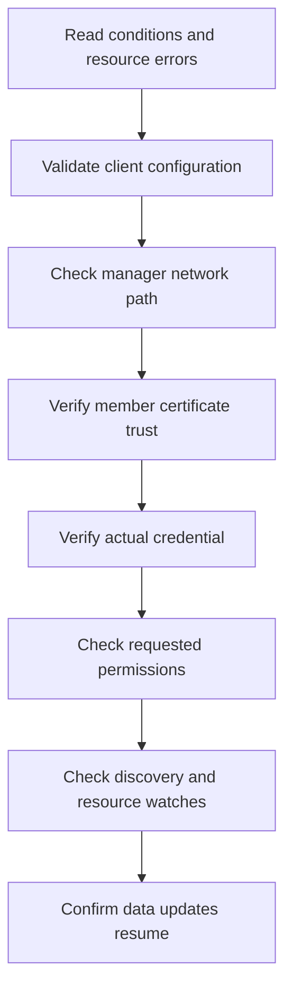

# Debug an Unhealthy PediaCluster from Connection to Discovery

Author: [nawazdhandala](https://www.github.com/nawazdhandala)

Tags: Kubernetes, Troubleshooting, Multi-Cluster

Description: Diagnose PediaCluster failures by separating configuration, network reachability, CA trust, token authentication, permissions and resource discovery.

An unhealthy PediaCluster is a symptom, not a diagnosis. The synchronization manager might be unable to construct a client, reach the member API, trust its certificate, authenticate, discover resources or watch one selected resource type. These failures need different repairs.

Work through the layers in order and keep the original error. This walkthrough follows **Clusterpedia v0.9.0** source behavior and uses read-only inspection commands. Replace `HOST_CONTEXT`, `member-a` and local configuration filenames with your reviewed environment values. The jq example was tested locally; no live cluster was contacted for this article.

## Read status without dumping the credential fields

PediaCluster specifications can contain encoded tokens or kubeconfigs. Start by exporting only status rather than sharing the entire resource:

```bash
set -euo pipefail
umask 077
kubectl --context=HOST_CONTEXT get pediacluster member-a \
  -o jsonpath='{.status}' > status.json
```

This uses [kubectl's output selection](https://kubernetes.io/docs/reference/kubectl/generated/kubectl_get/) to avoid printing the specification. Keep the result local while reviewing it; status messages can still contain internal endpoints and operational details.

Save this filter as `status.jq` and run it with **jq 1.6**:

```jq
if type != "object" then error("Expected a status object") else
{
  conditions: [.conditions[]? | {type, status, reason, message, lastTransitionTime}],
  resources: [.syncResources[]? as $group |
    $group.resources[]? as $resource |
    $resource.syncConditions[]? |
    {group: $group.group, resource: $resource.name,
     version, status, reason, message, lastTransitionTime}]
}
end
```

```bash
jq -e -f status.jq status.json
```

The filter shows overall conditions and per-resource synchronization conditions together, following the [v0.9.0 status types](https://github.com/clusterpedia-io/clusterpedia/blob/v0.9.0/staging/src/github.com/clusterpedia-io/api/cluster/v1alpha2/types.go). A `ClusterHealthy` condition of `True` can coexist with a resource error. Empty arrays mean there is no corresponding reported status, not that checks passed. `lastTransitionTime` records a condition transition; do not treat it as the timestamp of the latest synchronized object.

## Find the first failing layer

| Evidence | Investigate first |
| --- | --- |
| `Validated` reports `InvalidConfig` | Endpoint, credential fields and credential-source configuration |
| `InvalidSyncResources` | Selected resource groups, versions and shared configuration |
| Timeout, refused connection or DNS failure | Network path from the synchronization manager |
| Certificate verification error | CA chain, hostname, expiry and clock |
| HTTP 401 | Credential validity, expiry, audience and authentication configuration |
| HTTP 403 | Identity, effective RBAC and requested resource or non-resource path |
| Healthy connection but resource errors | Discovery, list/watch permissions and resource-specific synchronization |

The [manager's validation path](https://github.com/clusterpedia-io/clusterpedia/blob/v0.9.0/pkg/synchromanager/clustersynchro_manager.go) distinguishes configuration failures from invalid synchronization resources. Keep the exact reason and message when deciding which layer to test.



## Test from the relevant network path

A successful request from a laptop does not establish reachability from a synchronization Pod. Compare DNS resolution, routing, egress policy, proxy configuration and firewall rules from an approved diagnostic environment that follows the manager's network path.

Confirm the configured member endpoint is the member Kubernetes API, not Clusterpedia's aggregated search path or an internal address reachable only from another network. A private API address can be perfectly valid but unavailable from the host cluster.

Use a bounded request rather than a test that can hang indefinitely. With a protected `member-reader.json` kubeconfig containing the same endpoint, CA and credential as the registration:

```bash
kubectl --kubeconfig=member-reader.json --request-timeout=10s \
  get --raw='/readyz'
```

This performs a read-only request. Preserve the response and HTTP error classification. Do not infer network failure merely from a non-success response: receiving a 403 demonstrates that an HTTP server was reached, although you still need to confirm it is the intended server.

The [v0.9.0 health checker](https://github.com/clusterpedia-io/clusterpedia/blob/v0.9.0/pkg/synchromanager/clustersynchro/cluster_monitor.go) calls `/readyz` and falls back to `/healthz` only when the former is not found. It does not use that fallback for every authentication or permission error. A label such as `ClusterNotReachable` can therefore contain an authorization error; read its message rather than assuming a broken route.

## Repair certificate trust instead of bypassing it

When TLS fails, compare the configured endpoint hostname with the API server certificate's names. Confirm the provided CA chain belongs to that member and check whether a recent certificate rotation changed the issuer. Also check system time where the client runs.

Inspect a retained CA certificate without printing private keys:

```bash
openssl x509 -in member-ca.crt -noout -subject -issuer -dates
```

The [OpenSSL x509 reference](https://docs.openssl.org/3.6/man1/openssl-x509/) documents these inspection options. This displays certificate metadata; it does not perform a server handshake or prove the endpoint trusts that certificate. If the file is a bundle, this command's first-certificate output is not a complete chain audit.

Check encoding at the API boundary. `caData` expects base64-encoded certificate bytes in the serialized resource. Encoding an already encoded value produces different bytes. Likewise, an empty CA is not a safe fallback: the [v0.9.0 connection builder](https://github.com/clusterpedia-io/clusterpedia/blob/v0.9.0/pkg/utils/rest.go) enables insecure TLS when direct CA data is missing.

## Distinguish authentication from authorization

For a 401, verify that the credential was issued for the intended API server and is still valid. ServiceAccount tokens can expire or have an audience that the API server does not accept. A token pasted into a PediaCluster is not automatically renewed. Kubernetes describes token validation and authentication behavior in its [authentication reference](https://kubernetes.io/docs/reference/access-authn-authz/authentication/).

For a 403, identify the actual user or ServiceAccount and the denied operation. Discovery endpoints, health paths and resource list/watch requests are separate permissions. Granting Pod reads does not grant `/readyz`, and granting health access does not grant Deployment watches.

Test with the integration's real credential in the protected diagnostic configuration. A successful administrator request proves little about a restricted reader. Likewise, an impersonation-based permission check does not validate the token's signature, expiry, audience or client TLS configuration.

## Check discovery after basic connectivity works

Use the same protected client to inspect relevant API discovery:

```bash
kubectl --kubeconfig=member-reader.json --request-timeout=10s \
  get --raw='/api/v1'
kubectl --kubeconfig=member-reader.json --request-timeout=10s \
  get --raw='/apis/apps/v1'
```

Confirm the selected group/version exists and advertises the expected resource. Clusterpedia v0.9.0 also watches custom resource definitions and APIService objects through its [dynamic discovery manager](https://github.com/clusterpedia-io/clusterpedia/blob/v0.9.0/pkg/runtime/discovery/dynamic_discovery.go). Missing access there can interfere with discovery even when ordinary Pod reads succeed.

If only one resource fails, inspect its synchronization condition and the corresponding manager log entries. Check list and watch separately, selected API versions, aggregated API availability and storage errors. Avoid replacing the reader with cluster-admin as the permanent repair; it hides the permission requirement you need to understand.

After fixing the identified cause, confirm both condition recovery and a real data change. Select an approved test object, observe its updated state in the member, then verify the synchronized result advances. A green health check is the beginning of that acceptance test, not its completion.
