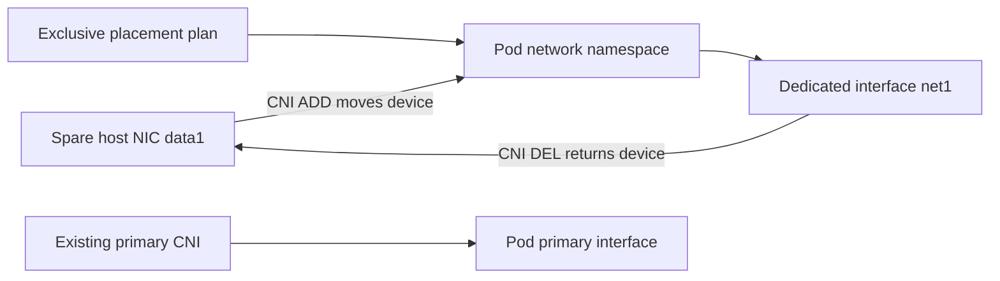

# Give a Multus Pod a Dedicated NIC with Host-Device CNI

Author: [nawazdhandala](https://www.github.com/nawazdhandala)

Tags: Multus, Kubernetes, Networking

Description: Move a dedicated kernel-managed NIC into one Multus Pod, verify device identity and addressing, and plan exclusive ownership, scheduling, and cleanup before rollout.

Some workloads need a dedicated network interface rather than a virtual interface layered over a shared parent. The host-device CNI plugin can move an existing Linux network device from the host network namespace into a Pod's network namespace.

That move is the central operational fact. The host no longer has the interface available under its original name while the Pod owns it. Use a spare data NIC with an explicit lifecycle plan, never a node's management or storage interface.

This staging example reviews **CNI plugins v1.8.0** and **Multus v4.3.1**. It covers a NIC managed by a normal kernel network driver. It does not cover DPDK, driver rebinding, or SR-IOV virtual-function provisioning. Examples were parsed and source-reviewed; no physical device was moved during validation.

## Choose exclusive ownership before writing YAML

Host-device is not a sharing plugin. Two Pods cannot independently own the same host interface at the same time. A network definition that names a device does not advertise that device's availability to the Kubernetes scheduler.



For the initial experiment, reserve one staging node and one NIC for one manually managed test Pod. Do not put this definition into a default network list. A Deployment's replacement Pod or a rolling-update surge can compete with the old Pod even when the steady-state replica count is one.

For production allocation, use a compatible device-management design that exposes capacity and assigns the correct device to each Pod. Kubernetes [device plugins](https://kubernetes.io/docs/concepts/extend-kubernetes/compute-storage-net/device-plugins/) provide resource advertisement and allocation mechanisms, but installing host-device alone does not create that integration. Validate the chosen device plugin and Multus integration separately rather than inventing a resource name and expecting allocation to happen.

## Record the device's identity and dependencies

Before attaching anything, inspect the intended NIC on the selected host:

```bash
ip -d link show dev REPLACE_SPARE_NIC
ip address show dev REPLACE_SPARE_NIC
ip route show dev REPLACE_SPARE_NIC
```

Run these read-only commands through your approved host access. Record its name, MAC address, driver or PCI identity where applicable, link state, addresses and routes. The [ip-link manual](https://man7.org/linux/man-pages/man8/ip-link.8.html) describes detailed device inspection.

The test NIC should have no node-management dependency, active storage traffic, bridge or bond membership, or other workload owner. Arrange for the host's network manager not to compete for it while it is assigned to the Pod. Confirm the external switch port and intended subnet too: moving a NIC does not configure the switch.

Host-device v1.8.0 accepts selectors such as `device`, `hwaddr`, `kernelpath`, and `pciBusID`. This example uses the interface name for clarity on one reserved node. Hardware identifiers can be more stable across renaming, but they still need node-specific ownership and placement. The [pinned configuration structure](https://github.com/containernetworking/plugins/blob/v1.8.0/plugins/main/host-device/host-device.go) is the authority for these version-specific fields.

## Define the dedicated attachment

Use an existing staging namespace named `network-lab`. Replace `REPLACE_SPARE_NIC` and reserve a real staging address in place of the documentation address before applying this definition:

```yaml
apiVersion: k8s.cni.cncf.io/v1
kind: NetworkAttachmentDefinition
metadata:
  name: dedicated-nic-lab
  namespace: network-lab
spec:
  config: |
    {
      "cniVersion": "0.3.1",
      "name": "dedicated-nic-lab",
      "type": "host-device",
      "device": "REPLACE_SPARE_NIC",
      "ipam": {
        "type": "static",
        "addresses": [{"address": "192.0.2.50/24"}]
      }
    }
```

Both `host-device` and `static` must be installed for the node architecture in the effective CNI binary directory. The [static IPAM reference](https://cni.dev/plugins/current/ipam/static/) documents this address format. This address is for one test owner only; do not scale the example or reuse it elsewhere on the LAN.

There is no added gateway or default route in the example. Retain the established primary network for cluster DNS and API access. If the data network needs remote destinations, design its routes and return paths explicitly instead of assuming the moved device inherits a complete usable host configuration.

Add these fields to a controlled test Pod:

```yaml
metadata:
  annotations:
    k8s.v1.cni.cncf.io/networks: '[{"name":"dedicated-nic-lab","interface":"net1"}]'
spec:
  nodeSelector:
    kubernetes.io/hostname: REPLACE_RESERVED_NODE_LABEL
```

This is a Pod fragment, not a complete workload. Replace the selector value with the actual hostname label on the reserved node. A selector constrains placement but does not reserve a NIC or prevent a second consumer. Kubernetes documents selector behavior in its [node assignment guide](https://kubernetes.io/docs/concepts/scheduling-eviction/assign-pod-node/).

For this pinned plugin version, the implementation passes the requested interface name to `moveLinkIn` and renames the moved device accordingly. It stores the original host name in the device alias for return handling. Inspect the actual interface instead of relying on unversioned documentation that may describe different behavior. Do not overwrite that alias from the application.

## Verify the move and the network independently

After creating the one test Pod, inspect its events and interfaces. The diagnostic image needs iproute2:

```bash
kubectl -n network-lab describe pod REPLACE_TEST_POD
kubectl -n network-lab exec REPLACE_TEST_POD -- ip -d link show dev net1
kubectl -n network-lab exec REPLACE_TEST_POD -- ip address show dev net1
kubectl -n network-lab exec REPLACE_TEST_POD -- ip route show
```

Expect the dedicated NIC's identity under `net1`, the reserved address, and the intended primary routing. On the host, the original interface name should no longer identify the moved device. That disappearance is expected during ownership, not a reason to restart networking blindly.

Test a known listener on the data network, then test primary DNS and cluster access. Verify both request and return paths. A successful CNI operation proves attachment setup reached completion; it does not prove the switch, firewall or remote application accepts traffic.

If another Pod reports that the host device cannot be found, check whether the first Pod owns it. If the move fails, capture the full error and inspect the device's current namespace before retrying. Do not substitute another NIC merely because its name looks similar.

## Test return and recovery before production use

Delete the controlled test Pod through Kubernetes and wait for its sandbox cleanup. The plugin's DEL implementation attempts to move the device back and restore its original name. Verify that the intended device reappears on the host and is available for the next controlled allocation.

Device return is not a promise to restore every previous host address, route or network-manager state. Reconcile the host through its configuration owner. Also distinguish a normal cleanup from a failed node or interrupted operation: in those cases, inspect current ownership and logs before any manual intervention.

Repeat the full attach, traffic, delete and return sequence in staging. If the application needs uninterrupted replacement, provide another independently allocatable NIC or a different sharing design. A single dedicated device has an ownership transition that the rollout strategy must respect.
