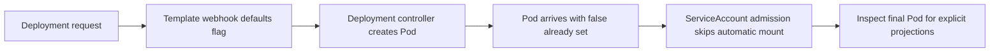

# Default ServiceAccount Token Mounts Without Breaking API Clients

Author: [nawazdhandala](https://www.github.com/nawazdhandala)

Tags: Kubernetes, Security, DevOps

Description: Set token-mount defaults before Pod admission, preserve deliberate API access, and distinguish automatic mounts from explicit token projections.

Setting `automountServiceAccountToken: false` sounds like a straightforward webhook hardening rule. There are two problems with applying it indiscriminately: some containers need the Kubernetes API, and a Pod webhook may run after automatic token volumes have already been added.

The safer design sets the intended default in the workload template or ServiceAccount before the Pod reaches ServiceAccount admission. It also preserves reviewed exceptions and checks the resulting Pod, rather than assuming that one Boolean field proves credentials are absent.

## Understand what the flag controls

The flag controls automatic mounting of ServiceAccount credentials. It is not an API authorization policy, a credential revocation mechanism, or a prohibition on every possible token source.

The [ServiceAccount configuration guide](https://kubernetes.io/docs/tasks/configure-pod-container/configure-service-account/#opt-out-of-api-credential-automounting) describes precedence: an explicit Pod value takes priority over the ServiceAccount value. When neither supplies a value, the upstream default is to mount credentials. A template-level `false` therefore overrides a ServiceAccount-level `true`; make that an intentional platform decision.

An application that does not call Kubernetes may not need the automatic mount. A controller, leader-election participant, discovery component, or injected sidecar might need it. Classify the whole Pod, including init containers and injected components, instead of judging only the main process.

In [client-go v0.35.0](https://github.com/kubernetes/client-go/blob/v0.35.0/rest/config.go), `InClusterConfig` reads the token from the conventional mounted location and returns an error if that read fails. Removing the mount can therefore break startup before the first API request. Other clients may fail differently, so exercise the actual application's API-dependent behavior.

## Account for admission ordering

Upstream Kubernetes v1.35 places ServiceAccount admission before the mutating webhook stage in its [ordered plugin list](https://github.com/kubernetes/kubernetes/blob/v1.35.0/pkg/kubeapiserver/options/plugins.go). The [ServiceAccount plugin](https://github.com/kubernetes/kubernetes/blob/v1.35.0/plugin/pkg/admission/serviceaccount/admission.go) adds the projected volume and container mounts when automatic mounting is enabled.

A later webhook patch that changes only `spec.automountServiceAccountToken` to false does not remove those already-added fields. The stored flag can therefore be false while a token projection remains in the Pod. This follows from the source's mounting behavior and the patch's limited effect; do not treat the flag alone as an absence check.

Prefer changing a Deployment's Pod template before the controller creates Pods:



For direct Pod submissions, require the desired flag in the submitted configuration or establish a suitable ServiceAccount default. Avoid blindly deleting every volume whose name resembles the automatic token volume; explicit projections and other components may have their own ownership and dependency requirements.

## Make the default visible in the template

This fragment uses Kubernetes v1.35 fields and belongs in a Deployment. It assumes a reviewed workload that does not require default-mounted API credentials. Merge it into the maintained application manifest rather than replacing the rest of the Pod template:

```yaml
spec:
  template:
    spec:
      serviceAccountName: application
      automountServiceAccountToken: false
```

The named ServiceAccount must exist in the workload namespace. Setting this flag does not remove the ServiceAccount identity from the Pod and does not change its RBAC grants. [RBAC](https://kubernetes.io/docs/reference/access-authn-authz/rbac/) controls permitted API actions; it remains necessary for workloads that use credentials.

A reviewed application that requires the default mount can explicitly set the template field to `true`. An application using a deliberately configured token projection may correctly keep it false. “Uses the API” and “requires automatic mounting” are not identical classifications.

## Default only an absent value

The following Python 3.11 helper operates on an `apps/v1` Deployment object. The handler must already have selected a workload profile approved for disabling automatic mounting. It must not infer that approval merely because the field is missing.

```python
def default_template_token_patch(deployment):
    if deployment.get("apiVersion") != "apps/v1" or deployment.get("kind") != "Deployment":
        raise ValueError("expected apps/v1 Deployment")
    try:
        pod_spec = deployment["spec"]["template"]["spec"]
    except (KeyError, TypeError):
        raise ValueError("Deployment needs a Pod template spec")
    if not isinstance(pod_spec, dict):
        raise ValueError("Pod template spec must be an object")
    current = pod_spec.get("automountServiceAccountToken")
    if current is not None:
        if not isinstance(current, bool):
            raise ValueError("automountServiceAccountToken must be Boolean")
        return []
    return [{
        "op": "add",
        "path": "/spec/template/spec/automountServiceAccountToken",
        "value": False,
    }]
```

Absent or null values receive the default. Explicit true and false values are preserved. Repeating the helper after applying its patch produces no change. The helper does not inspect or remove volumes, modify permissions, select ServiceAccounts, or implement the AdmissionReview envelope.

Match Deployment CREATE and UPDATE requests in the surrounding webhook configuration, and test that your workload profile remains stable across updates. Other workload types have different template paths; a CronJob, for example, cannot use this path unchanged. Direct Pods do not have a `spec.template` at all.

A defaulting policy that preserves explicit true is not a mandatory token prohibition. If your security requirement forbids credentials for a workload class, use separately reviewed validation that examines the relevant credential paths and exceptions. Do not advertise this helper as that stronger control.

## Inspect explicit token projections separately

Kubernetes supports [explicit ServiceAccount token projections](https://kubernetes.io/docs/concepts/storage/projected-volumes/#serviceaccounttoken). They can specify an audience and requested expiration independently of automatic mounting. Audience identifies the intended token recipient; it must match the service that validates the token.

Inspect a sanitized Pod JSON file with this local Python snippet. It prints only projected-volume names and token audiences, not token values:

```python
import json

with open("pod.json") as stream:
    pod = json.load(stream)
for volume in pod.get("spec", {}).get("volumes", []):
    for source in volume.get("projected", {}).get("sources", []):
        token = source.get("serviceAccountToken")
        if token is not None:
            print(volume["name"], token.get("audience", "<API default>"))
```

A reported projection needs an ownership review, not automatic deletion. No output means only that this inspection found no projected ServiceAccount token sources. It does not prove the absence of Secret-backed credentials, environment-provided credentials, or externally obtained tokens.

Modern bound tokens are managed through the [projected token mechanism](https://kubernetes.io/docs/reference/access-authn-authz/service-accounts-admin/#bound-service-account-token-volume-mechanism). Applications using them must handle rotation correctly. Do not replace a missing mount with a manually distributed long-lived token as an unreviewed workaround.

## Roll out with application evidence

Test the template helper locally for absent, null, explicit true, explicit false, malformed values, and unrelated-field preservation. In staging, inspect newly created Pods after the complete admission chain and run the application's actual API-dependent operations. A successful Deployment dry run does not create its child Pods or verify their credential layout.

Roll out to a small reviewed workload group first. Watch startup errors, leader election, discovery, and sidecar behavior. Keep the previous template configuration available for recovery, and replace Pods through their owning controller when a credential-layout change requires it. The acceptance criterion is the intended access behavior and final Pod configuration together, not merely a false flag in the object.
