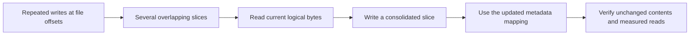

# Compact Randomly Rewritten JuiceFS Files Without Guessing at Gains

Author: [nawazdhandala](https://www.github.com/nawazdhandala)

Tags: JuiceFS, Performance, Storage

Description: Inspect JuiceFS slice fragmentation, run scoped compaction on a mounted file, and verify content and read performance while preserving retention guarantees.

A file can keep the same size while its storage representation becomes more complicated. Repeated small writes at different offsets leave JuiceFS with multiple slices describing which bytes are current. Reading the file may require resolving those slices and fetching several underlying blocks.

Compaction combines that representation into fewer slices. It can help a fragmented workload, but it also reads and writes data and competes for backend resources. Treat it as a measured maintenance operation, not a universal response to slow reads.

This guide uses **JuiceFS Community Edition 1.4.2**. Its `compact` command operates on paths through an existing JuiceFS mount. The command examples require a healthy staging mount and an application-owned file whose contents and writer activity you understand.

## Know which fragmentation you are addressing

JuiceFS divides a file's address space into chunks. Writes produce slices within those chunks, and slices are stored as object-storage blocks. Later writes can overlap earlier slices; the file's logical contents follow the current metadata mapping.

The [storage architecture](https://github.com/juicedata/juicefs/blob/v1.4.2/docs/en/introduction/architecture.md#how-juicefs-store-files) explains this distinction and the client's automatic background compaction. Manual compaction can therefore find little work if automatic compaction has already simplified the file.



This is not local-disk defragmentation. Moving files around the host disk or changing an object key manually does not simplify the JuiceFS metadata mapping. It is also different from combining many independent small files into an archive.

## Decide whether compaction matches the symptom

Start with one representative file and a repeatable application read. Record its size, write pattern, read range, concurrency, client host, and mount options. Identify whether the slow operation is a sequential read, random reads, or simply opening and checking many files.

If metadata transactions are slow across unrelated files, investigate the metadata service. If cached reads are fast but all remote object requests are slow, investigate the object backend and network. Neither symptom alone proves that overlapping slices are the main cost.

For a selected file:

```bash
juicefs --version
juicefs info --raw /mnt/jfs/staging/rewrite-test.bin
```

Replace the path with the real staging file. `info --raw` reports internal slice details, including chunk index, slice ID, size, offset, and length in this release. Preserve the output outside the tested filesystem for comparison. The [info implementation](https://github.com/juicedata/juicefs/blob/v1.4.2/cmd/info.go) defines these fields.

A high slice count is evidence to investigate, not a universal threshold requiring compaction. Compare files with similar access patterns and inspect whether the slices overlap the range your application reads. Do not confuse raw historical layout information with an application's logical file size.

## Establish a content baseline with writers paused

For an interpretable experiment, pause writes to the selected staging file and wait for the application to close it successfully. A checksum taken while another process changes the file cannot serve as a stable before-and-after reference.

Save this read-only helper outside JuiceFS as `file_digest.py`. It requires Python 3.11 or later:

```python
import argparse
import hashlib

parser = argparse.ArgumentParser()
parser.add_argument("path")
args = parser.parse_args()
with open(args.path, "rb") as stream:
    print(hashlib.file_digest(stream, "sha256").hexdigest())
```

It reads the file and prints a SHA-256 digest. Python's [hashing documentation](https://docs.python.org/3/library/hashlib.html#hashlib.file_digest) describes the binary-stream interface. Store the output in the maintenance record:

```bash
python3 file_digest.py /mnt/jfs/staging/rewrite-test.bin
```

This full read warms caches. Record that fact and apply the same measurement sequence after compaction; do not call the next read a cold-read benchmark. For cold-client comparisons, use an isolated test client with a controlled cache state rather than dropping host-wide caches on a shared server.

Also record the application's own elapsed time and result checks. A checksum protects the byte-content comparison, while the application test establishes whether the workload became faster or remained correct at its own level.

## Compact one known path at low concurrency

Run the mounted-path command:

```bash
juicefs compact --threads 1 /mnt/jfs/staging/rewrite-test.bin
```

The argument is a host-visible path through JuiceFS, unlike administrative commands that take a metadata URL. Do not substitute `META_URL` or a provider bucket path. Starting with one worker limits the initial maintenance concurrency; it is not a recommendation that all production workloads should use one worker permanently.

The command sends a compaction request through the mounted client's control interface. The [pinned command implementation](https://github.com/juicedata/juicefs/blob/v1.4.2/cmd/compact.go) checks progress and reports unsupported clients. Updating the executable on disk alone does not upgrade the process already serving the mount.

Retain progress, warnings, and client logs. Some per-path errors are logged while command processing continues, so inspect those messages rather than treating exit status alone as proof that the requested file was compacted.

During the operation, watch client CPU and memory, object request rates and latency, and application impact on the shared backend. The [compaction implementation](https://github.com/juicedata/juicefs/blob/v1.4.2/pkg/vfs/compact.go) reads source slices and writes consolidated data. Extra network traffic is expected; a busy backend may make a maintenance window more appropriate than immediate action.

## Compare layout, contents, and workload results separately

After successful completion, rerun the inspections:

```bash
juicefs info --raw /mnt/jfs/staging/rewrite-test.bin
python3 file_digest.py /mnt/jfs/staging/rewrite-test.bin
```

Confirm that the digest matches the pre-compaction value while writers remain paused. Compare the raw layout to see whether the relevant chunk representation changed. Then repeat the application read with the same cache procedure, read range, and concurrency.

Keep three outcomes separate:

| Evidence | What it answers |
| --- | --- |
| Same digest | Did the observed logical bytes stay unchanged? |
| Changed slice layout | Did compaction change the internal representation? |
| Repeated workload timing | Did the application benefit under these conditions? |

A smaller slice representation with no measurable speedup is a valid result. The workload may be dominated by another layer, or the cache may already hide remote-read costs. Avoid repeatedly compacting the same file just because the performance graph did not move.

## Preserve recovery coverage and control recurring work

Compaction does not promise an immediate drop in billed object storage. Older data can remain subject to retained-slice and Trash policies. Do not disable retention or follow compaction with broad deletion simply to force the bucket's size downward.

If repeated random rewrites recreate the same problem, examine the application's write batching and flush pattern. Any change must preserve its durability requirements. Use the measured benefit and maintenance cost to decide whether occasional targeted compaction is worthwhile.

The code and command options here were checked against the 1.4.2 source and CLI. The digest helper was tested on local files; no live FUSE compaction or performance improvement was measured. Rehearse the mounted-client operation and its failure reporting in staging before adding it to a maintenance runbook.
