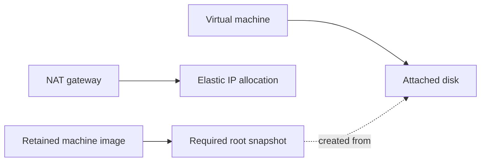

# Delete Cloud Environments Without Orphaned Disks, IPs, or Snapshots

Author: [nawazdhandala](https://www.github.com/nawazdhandala)

Tags: AWS, Cloud Automation, Reliability

Description: Build a dependency-aware deletion plan, protect retained resources, and verify that disks, IP addresses, and snapshots have an explicit final disposition.

Deleting the virtual machines is often the easiest part of retiring a cloud environment. The harder part is proving that its disks, addresses, and backups are either gone or deliberately retained. A green deployment-tool result does not answer that question by itself.

A dependable teardown has three outputs: a reviewed resource inventory, a deletion plan that respects dependencies, and a final ledger explaining every remaining resource. This tutorial uses AWS examples and a small, locally tested Python planner. It does not execute any cloud deletion.

## Start with ownership and retention

Give the environment an immutable identifier, such as `preview-481-generation-3`. Names alone are weak identifiers when environments are repeatedly recreated. Record account, Region, resource type, physical ID, and creation generation in the provisioning journal.

Before planning deletion, combine that journal with infrastructure-as-code state and fresh service inventory. Search by environment tags too, but investigate untagged resources associated with recorded IDs. A tag-only sweep cannot establish that everything was found.

Each discovered resource needs a disposition:

| Disposition | Meaning | Required evidence |
| --- | --- | --- |
| Delete | Environment-owned and no longer needed | Owner approval and current dependency checks |
| Retain | Intentionally survives teardown | Owner, reason, review date, and cost responsibility |
| Shared | Used outside this environment | Owning system and confirmed consumers |
| Unresolved | Ownership or dependency is uncertain | Investigation before destructive action |

Do not treat unresolved resources as disposable. Freeze new environment provisioning, stop scheduled producers, drain application writes, and establish a maintenance window before taking the final recovery copy. A completed snapshot alone does not prove application consistency or a successful restore.

## Model current dependencies, not historical ancestry

In the following diagram, an arrow means “must remain available while this consumer exists.” Deletion proceeds from the consumer toward its dependency. The dotted line records history only.



The distinction changes the plan. AWS prevents deletion of an attached EBS volume, so remove its attachment through the chosen teardown path before deleting the volume. Terminating an instance may already delete volumes whose `DeleteOnTermination` setting is enabled. Inspect those settings before termination; do not discover an unintended data deletion afterward. See the [EBS deletion rules](https://docs.aws.amazon.com/ebs/latest/userguide/ebs-deleting-volume.html) and [EC2 termination behavior](https://docs.aws.amazon.com/AWSEC2/latest/UserGuide/terminating-instances.html).

A snapshot is different. Deleting its source volume does not delete the snapshot. A root-device snapshot required by a registered Amazon Machine Image (AMI) cannot simply be deleted first. Retaining that AMI therefore requires retaining its necessary snapshot. This is a live dependency; the snapshot's relationship to its original volume is historical. AWS documents both distinctions in its [snapshot deletion guidance](https://docs.aws.amazon.com/ebs/latest/userguide/ebs-deleting-snapshot.html).

For networking, deleting a NAT gateway disassociates its Elastic IP but does not release the allocation. Its routes also remain as blackholes until updated or removed. Include those follow-up actions explicitly rather than assuming gateway deletion cleans up everything around it. See [NAT gateway deletion](https://docs.aws.amazon.com/vpc/latest/userguide/nat-gateway-working-with.html#nat-gateway-deleting).

## Calculate candidates without touching the cloud

Save this example as `plan.py` and run it with Python 3.11. It uses only the standard library. The IDs are local labels, not real AWS identifiers. In a production inventory, use account- and Region-qualified IDs and include shared dependencies as retained entries.

`TopologicalSorter` orders dependencies before their consumers. Reversing that order gives teardown candidates. The additional retention walk protects everything a retained resource still needs. Python documents the ordering and cycle detection in [graphlib](https://docs.python.org/3.11/library/graphlib.html).

```python
from graphlib import TopologicalSorter


def deletion_plan(resources):
    by_id = {r['id']: r for r in resources}
    if len(by_id) != len(resources):
        raise ValueError('Duplicate resource ID')
    graph = {}
    for resource_id, item in by_id.items():
        if type(item['retain']) is not bool:
            raise ValueError('retain must be an explicit boolean')
        dependencies = set(item['live_dependencies'])
        if not dependencies <= by_id.keys():
            raise ValueError(f'Unresolved dependency for {resource_id}')
        graph[resource_id] = dependencies
    creation_order = list(TopologicalSorter(graph).static_order())
    protected = set()
    pending = [key for key, item in by_id.items() if item['retain']]
    while pending:
        key = pending.pop()
        if key not in protected:
            protected.add(key)
            pending.extend(graph[key])
    candidates = [key for key in reversed(creation_order)
                  if key not in protected]
    return candidates, sorted(protected)


resources = [
    {'id': 'disk', 'live_dependencies': [], 'retain': False},
    {'id': 'vm', 'live_dependencies': ['disk'], 'retain': False},
    {'id': 'address', 'live_dependencies': [], 'retain': False},
    {'id': 'nat', 'live_dependencies': ['address'], 'retain': False},
    {'id': 'snapshot', 'live_dependencies': [], 'retain': False,
     'origin_volume_id': 'disk'},
    {'id': 'image', 'live_dependencies': ['snapshot'], 'retain': True},
]

if __name__ == '__main__':
    candidates, protected = deletion_plan(resources)
    print('Deletion candidates:', candidates)
    print('Retained dependency closure:', protected)
```

The output retains `image` and `snapshot`. It proposes deleting `vm` before `disk`, and `nat` before `address`. Independent branches need no particular relative order. The historical `origin_volume_id` field does not protect the disk.

Changing `vm` to retained also protects its disk. Unknown dependencies, duplicate IDs, invalid retention flags, and dependency cycles stop planning. A cycle needs investigation: it may represent an association that should be removed separately rather than a resource that must remain forever.

This example assumes a reviewed inventory. It cannot discover missing consumers or verify ownership. It also does not model every AWS resource type. Extend the inventory through service-specific adapters; do not turn these candidate labels directly into unconditional delete calls.

## Execute one verified transition at a time

Persist the plan and its inventory revision before starting. For each candidate, record the intended action, request result, observed state, and last check time. Re-read dependencies immediately before the action. If an unexpected consumer appeared, pause that branch and rebuild the plan.

A useful execution sequence for this example is:

1. Drain and terminate the approved instance, observing its terminal state.
2. Re-read each recorded disk. Account for automatic termination deletion; delete only approved surviving disks after verifying they are detached.
3. Remove or update environment-owned routes as appropriate, delete the NAT gateway, and observe completion.
4. Confirm the recorded Elastic IP is no longer associated and is approved for release, then release that allocation.
5. Apply the separate snapshot and image retention decisions.

These steps are a protocol, not a universal order for every application. A shared route table, external image consumer, or retained network appliance changes the graph. Keep recovery tooling and its credentials outside the environment being removed.

An accepted API request is not a completed deletion. Use service-specific state checks, with bounded retries and a durable checkpoint. After a timeout, reconcile the recorded resource ID before trying another action. An authorization error or an incomplete inventory page must never count as proof of absence.

Where infrastructure-as-code owns a resource, use its lifecycle controls instead of silently deleting resources behind its back. For CloudFormation, `DeletionPolicy: Retain` deliberately leaves resources after stack deletion; `Snapshot` creates a snapshot for supported resource types. Those survivors belong in the final ledger. See [CloudFormation deletion policies](https://docs.aws.amazon.com/AWSCloudFormation/latest/TemplateReference/aws-attribute-deletionpolicy.html).

## Sweep for leftovers and explain every survivor

Run a fresh inventory after teardown, across the exact accounts and Regions in scope. Compare the union of recorded IDs, currently tagged resources, and related service objects. Include disks, address allocations, snapshots, images, network interfaces, and the services your environment actually provisioned.

Do not delete every unattached disk or unassociated address in the account. Those states describe technical attachment, not ownership or business intent. Elastic IP allocations continue to belong to the account until released and can incur charges while idle. See [Elastic IP behavior and pricing](https://docs.aws.amazon.com/AWSEC2/latest/UserGuide/elastic-ip-addresses-eip.html).

Backups need their own lifecycle. Snapshot deletion is independent of volume deletion, and snapshots managed by AWS Backup must be handled through that service. Retention protections and recovery requirements are reasons to keep an explicit survivor, not reasons to bypass the owning service.

Close the operation only when every inventoried resource is confirmed deleted, explicitly retained, or assigned an unresolved exception with an owner. Record observation time and scope so the result is auditable. A later reconciliation sweep catches delayed cleanup and newly discovered leftovers; a billing review provides additional evidence, but does not replace resource inventory.

The practical success criterion is simple: nothing survives by accident, and nothing required by an approved survivor disappears underneath it.
