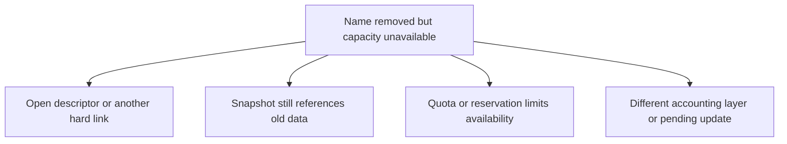

# Deleted Files but Space Did Not Return? Trace What Still Holds It

Author: [nawazdhandala](https://www.github.com/nawazdhandala)

Tags: File Storage, Linux, Troubleshooting

Description: Trace missing capacity after deletion through open descriptors, hard links, snapshots, quotas, and reservations using safe inspection commands.

You remove a large directory, confirm the names are gone, and refresh the capacity dashboard. Available space barely changes. Deleting more files is tempting, but it may destroy useful data without addressing the object that still holds the capacity.

A directory entry, an open file, a snapshot, and a storage allocation are related but different things. Start by identifying which layer reports the shortage, then look for the reference or policy that explains it.

## Compare the same filesystem and the same unit

A directory tree's size is not the same measurement as a filesystem's available capacity. GNU `du` estimates usage by walking names; `df` reports filesystem usage. Apparent file size can also differ from allocated space, especially for sparse files. Do not compare a logical file-size total with a physical-capacity figure as if they were interchangeable. [GNU du](https://man7.org/linux/man-pages/man1/du.1.html), [GNU df](https://man7.org/linux/man-pages/man1/df.1.html).

On Linux with util-linux and GNU coreutils, inspect a known healthy mount. Replace `/srv/data` with the actual path:

```bash
findmnt --target /srv/data --output TARGET,SOURCE,FSTYPE,OPTIONS
df -h /srv/data
df -i /srv/data
```

The first command identifies the filesystem containing the path. The next two report block capacity and inode availability. An inode is a filesystem record used to describe a file; on filesystems with a limited inode supply, creating files can fail even when data blocks remain available. These commands are read-only, but a failed network filesystem can still make filesystem queries wait. [findmnt documentation](https://man7.org/linux/man-pages/man8/findmnt.8.html).

Record the time, mount identity, free space, and exact error the application sees. Check whether the alert refers to a client share, a server dataset, or the underlying storage pool. They may have different limits. Avoid a broad recursive scan during an outage; use a targeted `du` investigation later if the filesystem is responsive and the extra load is acceptable.

The investigation branches because several independent things can retain space or restrict its use:



## A deleted name can leave an open file alive

On Linux, unlinking removes a name. If it was the last hard link but a process still has the file open, the file remains until the last referring file descriptor closes. This is common when a long-running process keeps writing to a log that an operator deleted. [Linux unlink semantics](https://man7.org/linux/man-pages/man2/unlink.2.html).

Inspect open, unlinked files with `lsof`, using appropriate administrative visibility:

```bash
sudo lsof -nP +L1
```

`+L1` selects open files with a link count below one. The output identifies processes and descriptors to investigate. It is not a list of processes to kill. Check the device and file identity against the affected filesystem, and remember that several rows may describe the same object. Summing the displayed sizes can double-count it. Visibility is limited to what this host and your privileges expose. [lsof selection and output](https://man7.org/linux/man-pages/man8/lsof.8.html).

For a network share, inspection may be needed on the client that holds the handle and on the storage service. A clean result from one application host does not rule out another client retaining access. Follow the product's handle-management procedure rather than assuming local process output sees the whole share.

Ask the service owner to close or reopen the file through the application's supported mechanism. A controlled restart may be appropriate, but only after checking service impact and data handling. Writing into a process's descriptor through an administrative path can discard data or disrupt the application; it is not a general capacity-recovery technique.

## Observe the distinction in a tiny disposable example

This Python 3.11 example is for a Unix-like local filesystem. It creates its own temporary file, opens a descriptor, removes the name, and reads through the descriptor. It does not allocate a large file or modify existing data.

```python
import os
import tempfile
from pathlib import Path

with tempfile.TemporaryDirectory(prefix='unlink-demo-') as name:
    path = Path(name) / 'demo.bin'
    payload = b'retained through an open descriptor\n'
    path.write_bytes(payload)
    descriptor = os.open(path, os.O_RDONLY)
    try:
        path.unlink()
        assert not path.exists()
        metadata = os.fstat(descriptor)
        assert metadata.st_nlink == 0
        assert os.read(descriptor, len(payload)) == payload
        print('Name exists:', path.exists())
        print('Remaining hard links:', metadata.st_nlink)
        print('Open descriptor still reads the original payload')
    finally:
        os.close(descriptor)
```

Expected output shows that the name no longer exists, the link count is zero, and the descriptor can still read the original bytes. The `finally` block closes it even if an assertion fails. This was executed successfully with Python 3.11.13 on local macOS storage. It demonstrates descriptor lifetime, not a measured increase in free capacity. It is not a Windows deletion example or an NFS server test. [Python unlink and descriptor APIs](https://docs.python.org/3.11/library/os.html#os.unlink).

Hard links are another branch of the investigation. If another name still references the same file, removing one name does not remove the underlying object. Check link counts and identities before concluding that a vanished path should have released all of its storage.

## Check snapshots before blaming the live directory

A snapshot preserves an earlier view of data. Deleting a file from the live view need not release blocks that a retained snapshot still needs. A directory walk of current files therefore cannot fully explain snapshot-backed storage use.

For an OpenZFS 2.3 deployment, this read-only example separates major accounting categories. Replace `tank/projects` with the verified dataset name and run it on the storage host with permission to inspect that dataset:

```bash
zfs get -p -o name,property,value,source   used,available,usedbydataset,usedbysnapshots,usedbychildren,usedbyrefreservation,quota,refquota,reservation,refreservation   tank/projects
```

`-p` requests exact numeric values. The output is property data, not a deletion plan. The `usedby*` properties divide usage into the dataset, snapshots, child datasets, and refreservation accounting. Snapshot usage is not simply the sum of every snapshot's individually reported usage because snapshots can share blocks. Pending changes also need time to appear in accounting. [OpenZFS 2.3 properties](https://openzfs.github.io/openzfs-docs/man/v2.3/7/zfsprops.7.html), [OpenZFS 2.3 get syntax](https://openzfs.github.io/openzfs-docs/man/v2.3/8/zfs-get.8.html).

Use the equivalent supported view on other storage systems. Review snapshot ownership, retention, replication dependencies, and recovery requirements with the storage owner before changing policy. Deleting recovery points solely to make a dashboard turn green can trade a capacity incident for an unrecoverable data-loss incident.

## Separate reservations and limits from retained file data

A reservation protects capacity for a particular purpose; a quota limits how much a dataset or identity may consume. Neither is simply a hidden directory waiting to be deleted. If a user hits a quota while the pool has room, investigate that user's allocation rather than deleting unrelated files.

Some filesystems also reserve blocks for privileged use. On an ext2, ext3, or ext4 filesystem, the storage administrator can inspect current superblock settings with the read-only listing form below. Replace the device with the one verified for the filesystem; do not use an NFS mount path:

```bash
sudo tune2fs -l /dev/REPLACE_WITH_VERIFIED_EXT_DEVICE
```

Review reserved-block and inode information. This command is specific to the ext filesystem family. Do not reduce reserved space automatically: understand why it exists and whether changing it would remove headroom needed for recovery. [tune2fs listing and reserved blocks](https://man7.org/linux/man-pages/man8/tune2fs.8.html).

If the platform reports a separate metadata allocation limit, inspect that product's metadata accounting too. Payload bytes, inode/object limits, and reserved capacity are different constraints. A file-count-heavy workload can require a different expansion plan from one dominated by large files.

## Verify the explanation before declaring recovery

Keep a short evidence record: the affected layer, the object or policy holding capacity, the approved action, and the before/after measurements. After the action, wait for the platform's accounting to settle and recheck the same dataset or filesystem.

Then perform the application's normal small write operation through its actual identity, in an approved location. Confirm that the original capacity error is gone without bypassing a quota or using administrator privileges that conceal the user's problem.

The goal is to explain where the capacity went. Once the evidence points to an open handle, retained snapshot, remaining link, or allocation limit, recovery can be specific and reviewable instead of another round of blind deletion.
