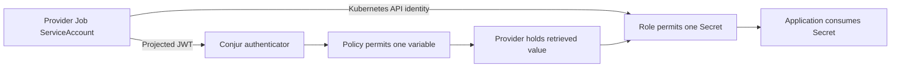

# Deploy CyberArk Secrets Provider with Narrow Conjur and Kubernetes Access

Author: [nawazdhandala](https://www.github.com/nawazdhandala)

Tags: CyberArk, Kubernetes, RBAC

Description: Deploy a source-pinned CyberArk Secrets Provider Job that reads one Conjur variable and updates one Kubernetes Secret with explicitly scoped permissions.

A secrets integration has two permission boundaries. Conjur controls which values the provider can retrieve. Kubernetes controls where the provider can write them. Restricting only one boundary leaves the other open: a narrow Kubernetes Role does not prevent retrieving unrelated Conjur variables, and a narrow Conjur policy does not prevent overwriting unrelated Kubernetes Secrets.

This example uses **Secrets Provider and Helm chart 1.11.1**, commit `7c137f495e7e9ec5bebc12c849fc2b64460e254c`. It runs once as a Job, populating one pre-created Secret in namespace `payments`. The chart was rendered locally with **Helm 3.12.3**; no live cluster or Conjur deployment was exercised. [Pinned chart values](https://github.com/cyberark/secrets-provider-for-k8s/blob/v1.11.1/helm/secrets-provider/values.yaml).

## Establish the authentication prerequisite

Have the Conjur administrator configure and enable a JWT authenticator named `k8s`. JWT means JSON Web Token: a signed identity assertion. The authenticator must trust this cluster's issuer and signing keys, validate the intended audience `conjur`, and bind the host identity to namespace `payments` and ServiceAccount `payments-secret-sync`.

For this example, assume that the existing, tested Conjur host is `conjur/authn-jwt/k8s/apps/payments-sync`. Configure its identity mapping and enforced claims before deployment. Merely naming that host in a Pod does not prove its identity. The provider repository includes authenticator and host-policy examples, but their test identities and broad grants should not be copied wholesale. [Pinned authenticator examples](https://github.com/cyberark/secrets-provider-for-k8s/blob/v1.11.1/deploy/policy/templates/conjur-authn.template.sh.yml).

Prepare a `conjur-connect` ConfigMap in `payments` containing the approved `CONJUR_ACCOUNT`, `CONJUR_APPLIANCE_URL`, `CONJUR_AUTHN_URL`, and `CONJUR_SSL_CERTIFICATE`. The authentication URL must select `authn-jwt/k8s` on your deployment; the certificate value is the PEM trust material for the Conjur HTTPS server. These are connection settings, not a place for an API key or private key.

Keep the Kubernetes API credential separate. The provider needs it to update the destination Secret, while the audience-limited projected token is used for Conjur authentication. Disabling all service-account token mounts without replacing the Kubernetes API credential breaks this mode. [Kubernetes token projection](https://kubernetes.io/docs/tasks/configure-pod-container/configure-service-account/).



## Limit Conjur access to the actual variable

Assume `apps/payments/db-password` already exists and contains a value provisioned through your approved secret workflow. A Conjur administrator can review these root-policy additions for the existing host:

```yaml
- !permit
  role: !host /conjur/authn-jwt/k8s/apps/payments-sync
  privileges: [read, authenticate]
  resource: !webservice /conjur/authn-jwt/k8s

- !permit
  role: !host /conjur/authn-jwt/k8s/apps/payments-sync
  privileges: [read, execute]
  resource: !variable /apps/payments/db-password
```

Authentication permission and variable permission serve different purposes. Do not grant variable-update authority or membership in a global secrets-reader group. Existing inherited grants still matter: this addition does not revoke broader access that the host already possesses. Review the effective policy and test denial against an unrelated variable. [Official variable-permission example](https://github.com/cyberark/secrets-provider-for-k8s/blob/v1.11.1/deploy/policy/templates/conjur-secrets.template.sh.yml).

## Pre-create the destination and exact Kubernetes Role

Save the following as `provider-access.yaml`. Use an existing staging namespace named `payments`, or consistently rename it throughout the example. The Secret initially contains only a mapping from a Kubernetes key to a Conjur variable ID, not a password.

```yaml
apiVersion: v1
kind: ServiceAccount
metadata:
  name: payments-secret-sync
  namespace: payments
---
apiVersion: v1
kind: Secret
metadata:
  name: payments-db
  namespace: payments
type: Opaque
stringData:
  conjur-map: |
    password: apps/payments/db-password
---
apiVersion: rbac.authorization.k8s.io/v1
kind: Role
metadata:
  name: payments-secret-sync
  namespace: payments
rules:
  - apiGroups: [""]
    resources: [secrets]
    resourceNames: [payments-db]
    verbs: [get, update]
---
apiVersion: rbac.authorization.k8s.io/v1
kind: RoleBinding
metadata:
  name: payments-secret-sync
  namespace: payments
subjects:
  - kind: ServiceAccount
    name: payments-secret-sync
    namespace: payments
roleRef:
  apiGroup: rbac.authorization.k8s.io
  kind: Role
  name: payments-secret-sync
```

For an explicit Secret list, the pinned provider retrieves named Secrets and updates them. It does not need Secret creation authority for this pre-created destination. Label discovery is a different path requiring broader listing behavior, so keep the explicit list below. [Provider storage implementation](https://github.com/cyberark/secrets-provider-for-k8s/blob/v1.11.1/pkg/secrets/k8s_secrets_storage/provide_conjur_secrets.go), [Kubernetes client operations](https://github.com/cyberark/secrets-provider-for-k8s/blob/v1.11.1/pkg/secrets/clients/k8s/k8s_secrets_client.go).

`resourceNames` limits this Role to one object. Kubernetes authorization is additive, so check other bindings too. Also control who may create Pods using this ServiceAccount or edit this Job: they may be able to use its identity. [RBAC guidance](https://kubernetes.io/docs/reference/access-authn-authz/rbac/).

## Render the pinned Job before applying it

Save this as `provider-values.yaml`:

```yaml
containerMode: application
rbac:
  create: false
  serviceAccount:
    name: payments-secret-sync
secretsProvider:
  image: docker.io/cyberark/secrets-provider-for-k8s
  tag: "1.11.1"
  workloadName: payments-secret-sync
  imagePullPolicy: IfNotPresent
autoReload:
  enabled: false
environment:
  k8sSecrets: [payments-db]
  conjur:
    conjurConnConfigMap: conjur-connect
    authnLogin: host/conjur/authn-jwt/k8s/apps/payments-sync
    retryCountLimit: 3
    retryIntervalSec: 5
    authnJWT:
      projectToken: true
      projectedFilename: jwt
      audience: conjur
      expiration: 600
```

Disabling chart-created RBAC prevents its general Role from bypassing the named-object restriction. The Job has its own ServiceAccount; the consuming application should use a different account without this write permission. The bounded provider retry setting makes failed staging authentication easier to detect.

In a connected preparation directory with Git and Helm installed:

```bash
git clone --depth 1 --branch v1.11.1 \
  https://github.com/cyberark/secrets-provider-for-k8s.git provider-source
helm repo add stakater https://stakater.github.io/stakater-charts
helm dependency build provider-source/helm/secrets-provider
helm template payments-sync provider-source/helm/secrets-provider \
  --namespace payments -f provider-values.yaml > provider-rendered.yaml
```

The locked chart dependency is downloaded even though the optional Reloader is disabled. Inspect the output: expect one Job, image tag `1.11.1`, the selected ServiceAccount, `K8S_SECRETS=payments-db`, and the `conjur` token projection. Expect no chart-created Role or Reloader workload. Record an approved image digest in your release process if immutable image selection is required. [Dependency build](https://helm.sh/docs/helm/helm_dependency_build/), [local rendering limits](https://helm.sh/docs/helm/helm_template/).

After review, use an explicitly selected staging context to validate and deploy:

```bash
kubectl --context REPLACE_STAGING_CONTEXT apply --dry-run=server -f provider-access.yaml
kubectl --context REPLACE_STAGING_CONTEXT apply --dry-run=server -f provider-rendered.yaml
kubectl --context REPLACE_STAGING_CONTEXT apply -f provider-access.yaml
kubectl --context REPLACE_STAGING_CONTEXT apply -f provider-rendered.yaml
```

Server dry-run checks admission and API handling, not whether Conjur will accept the identity. The final two commands create resources and start retrieval. Keep this separate from production rollout. [Apply and dry-run options](https://kubernetes.io/docs/reference/kubectl/generated/kubectl_apply/).

## Verify both allowed and denied actions

An administrator with impersonation permission can inspect effective Kubernetes authorization without printing secret values:

```bash
kubectl --context REPLACE_STAGING_CONTEXT auth can-i update secret/payments-db \
  --namespace payments --as system:serviceaccount:payments:payments-secret-sync
kubectl --context REPLACE_STAGING_CONTEXT auth can-i get secret/unrelated \
  --namespace payments --as system:serviceaccount:payments:payments-secret-sync
```

Expect `yes` then `no`; investigate unexpected access rather than trusting the Role file alone. [Command reference](https://kubernetes.io/docs/reference/kubectl/generated/kubectl_auth/kubectl_auth_can-i/).

Require Job completion, presence of the expected Secret key without dumping its value, and a successful staging application connection. Test a wrong ServiceAccount and an unauthorized Conjur variable separately. A successful authentication test does not establish variable authorization.

This Job synchronizes once. It does not continuously refresh rotated values or restart applications. Plan a separate refresh and application-reload workflow before relying on it for rotation. Kubernetes Secret storage also becomes part of the security boundary: protect API access, storage encryption, backups, and workloads that can mount the Secret.
