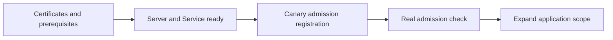

# Deploy Webhooks in a Safe Helm or GitOps Order

Author: [nawazdhandala](https://www.github.com/nawazdhandala)

Tags: Kubernetes, Helm, GitOps

Description: Separate webhook startup from admission activation, use a two-stage Helm install or Argo CD sync waves, and verify the control-plane request path before expansion.

Creating a webhook Deployment and creating its admission registration are different milestones. The Deployment starts a server. The `MutatingWebhookConfiguration` tells the API server to depend on that server for matching requests.

If registration becomes active before the endpoint is usable, ordinary workload creation can fail. A manifest appearing later in a directory does not establish a readiness dependency, and a successful template render says nothing about network reachability.

This walkthrough uses **Helm 3.17.3** for local rendering and **Argo CD 3.2.0** documentation for sync behavior. These are explicit example versions, not a recommendation to downgrade an existing installation or a claim that a particular cluster combination was deployed.

## Separate four deployment milestones



Certificate readiness means more than the existence of a Secret. The serving certificate must match the webhook Service's DNS name, the server must load the corresponding private key, and the registration's CA bundle must trust that certificate chain. The [Kubernetes webhook client configuration reference](https://kubernetes.io/docs/reference/access-authn-authz/extensible-admission-controllers/#service-reference) defines the Service name and trust requirements.

Exclude the webhook's own namespace and necessary recovery dependencies from its mutation scope. Otherwise, admission activation can prevent the server's next replacement Pod from starting even if the first installation succeeds.

## Why a single Helm wait is insufficient

In Helm 3.17.3, installation creates ordinary resources and then performs its readiness wait. It does not wait for each Deployment to become ready before creating every later ordinary resource. The tagged [installation implementation](https://github.com/helm/helm/blob/v3.17.3/pkg/action/install.go) makes that sequence visible.

Consequently, `--wait` is useful but is not a barrier placed immediately before webhook registration. Helm's [kind ordering](https://github.com/helm/helm/blob/v3.17.3/pkg/releaseutil/kind_sorter.go) also does not establish application-specific TLS or admission health.

For a chart you maintain, make initial registration an explicit switch. The following is a complete registration template for `templates/admission.yaml`; it assumes your chart already supplies the backend Deployment, Service, serving certificate, and permissions.

```yaml
{{- if .Values.admission.enabled }}
apiVersion: admissionregistration.k8s.io/v1
kind: MutatingWebhookConfiguration
metadata:
  name: {{ .Release.Name }}-admission
webhooks:
  - name: profile.example.com
    admissionReviewVersions: ["v1"]
    sideEffects: None
    failurePolicy: Fail
    timeoutSeconds: 3
    clientConfig:
      service:
        name: profile-webhook
        namespace: {{ .Release.Namespace }}
        path: /mutate
        port: 443
      caBundle: {{ required "admission.caBundle is required" .Values.admission.caBundle | quote }}
    namespaceSelector:
      matchLabels:
        platform.example.com/admission: canary
      matchExpressions:
        - key: kubernetes.io/metadata.name
          operator: NotIn
          values: [{{ .Release.Namespace | quote }}]
    rules:
      - operations: ["CREATE"]
        apiGroups: [""]
        apiVersions: ["v1"]
        resources: ["pods"]
        scope: Namespaced
{{- end }}
```

`admission.enabled` and `admission.caBundle` are **custom values defined for this example**, not universal Helm chart options. Define the `admission` map in your values file, default `enabled` to `false`, and supply the base64-encoded PEM CA bundle through your reviewed configuration process. The template's `required` check catches an empty value; it does not validate a certificate.

Replace the fixed Service name, path, webhook name, and mutation scope with your implementation's contract. The server must genuinely have no side effects to declare `None`. The three-second timeout is illustrative and needs to fit measured latency.

## Bootstrap once, then activate deliberately

For an initial installation, these commands assume `./profile-webhook` is your pinned local chart and `reviewed-values.yaml` contains its complete reviewed configuration:

```bash
helm install profile ./profile-webhook \
  --namespace admission-system \
  --create-namespace \
  -f reviewed-values.yaml \
  --set admission.enabled=false \
  --wait --timeout 5m
```

Do not run this as a generic upgrade procedure. It intentionally installs without admission registration. Verify the Service endpoints, serving certificate, server readiness, and expected `/mutate` handler before proceeding.

Then activate registration for the canary namespace cohort:

```bash
helm upgrade profile ./profile-webhook \
  --namespace admission-system \
  -f reviewed-values.yaml \
  --set admission.enabled=true \
  --wait --timeout 5m
```

The command flags and values precedence are documented in the tagged [install command](https://github.com/helm/helm/blob/v3.17.3/cmd/helm/install.go) and [upgrade command](https://github.com/helm/helm/blob/v3.17.3/cmd/helm/upgrade.go). Keep chart content and backend values unchanged between these stages unless the change has been separately reviewed.

A successful second command does not demonstrate a successful webhook invocation. Submit a matching server-side dry-run Pod request in a pre-enrolled canary namespace, inspect the expected mutation, and confirm the server handled the request. A Pod outside the selector must remain unaffected by this webhook. Only then expand the reviewed scope.

## Express the same dependencies in Argo CD

Argo CD uses Helm to render templates; it owns the application lifecycle rather than running a normal Helm release lifecycle. Do not assume Helm CLI flags become Argo CD readiness gates. This distinction is documented in the [Argo CD 3.2.0 Helm integration guide](https://github.com/argoproj/argo-cd/blob/v3.2.0/docs/user-guide/helm.md).

Within one Application and a normal full sync, use explicit waves such as:

| Wave | Resources or check |
|---|---|
| `-20` | Namespace and certificate prerequisites |
| `-10` | Backend Service and Deployment |
| `0` | A Sync hook Job checking backend TLS and protocol readiness |
| `10` | Canary-scoped webhook registration |
| `20` | A Sync hook Job submitting and checking a matching dry-run request |

An ordinary registration resource can carry this annotation:

```yaml
metadata:
  annotations:
    argocd.argoproj.io/sync-wave: "10"
```

This is an annotation fragment. The check Jobs need actual reviewed images, scripts, permissions, timeouts, and failure behavior; wave numbers alone do not perform those checks.

Argo CD orders by phase before wave and advances based on sync and health state. A `PreSync` Job cannot wait for a backend that is only created later in the normal Sync phase. Use the intended phase consistently, and remember that selective sync does not run hooks. See the [tagged sync-wave documentation](https://github.com/argoproj/argo-cd/blob/v3.2.0/docs/user-guide/sync-waves.md).

The backend check runs from a Pod, so it still does not establish the API server's network path. That is why the post-registration admission check is a separate gate. Also, resource waves inside one Application are not a general dependency mechanism between independently syncing Applications.

## Preserve coverage during upgrades and removal

After bootstrap, keep registration active during compatible rolling upgrades. Do not routinely toggle it off, because requests admitted during that interval can miss required mutations. Maintain certificate overlap where necessary and ensure the new server accepts the registered request versions before old replicas disappear.

For deliberate removal, plan the admission scope change before removing the backend. Otherwise, the API server can retain a registration pointing at a deleted Service. Review pruning and hook cleanup behavior in your chosen deployment tool rather than relying on filename order.

Local checks here validate template gating and rendered resource shape. They do not verify a running webhook, Argo CD health progression, or an API-server request. Those acceptance checks are the evidence that turns a deployment order into a working rollout.
