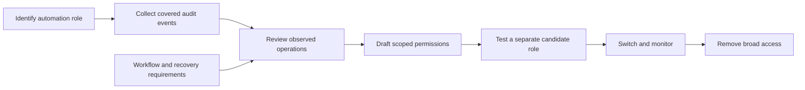

# Derive Least-Privilege Cloud IAM from Automation Audit Logs

Author: [nawazdhandala](https://www.github.com/nawazdhandala)

Tags: Cloud Automation, IAM, Security

Description: Turn cloud audit evidence into a reviewed permission set, test missing recovery paths, and remove administrator access without relying on logs alone.

An automation role starts with administrator access to get a prototype working. Months later, nobody can explain which permissions it actually needs. Removing administrator access feels risky because the next failure might occur during an incident.

Audit logs offer a practical starting point. They show what the automation attempted, which identity it used, and whether the service recorded an error. They do not describe every future operation. The goal is to combine observed activity with the workflow's intended behavior, then test a narrower identity before switching production.

This guide uses AWS for concrete examples. Identity and access management (IAM) means the rules that govern who can perform which operations on which resources. The review method also applies to other clouds, but their audit coverage and permission models require their own checks.

## Define a representative observation window

Start with a dedicated automation identity. If developers and jobs share one administrator role, the logs mix deployment requirements with manual troubleshooting. Separate those uses before deriving permissions.

List the workflows you must preserve: provisioning, updates, reading secrets, publishing artifacts, cleanup, rollback, and recovery. Include scheduled paths that run weekly or monthly. Record which were actually exercised during the observation period and which still need a controlled test.



Use a window long enough to include real lifecycle activity, not just successful deployments. Repeatedly running one happy path produces a convincing count with weak coverage. A deletion permission used once can be more important than a read permission used ten thousand times.

## Check what your logs omit

AWS CloudTrail event history shows the past 90 days of management events in one account and Region. It does not show data events such as individual object access. A quick export from event history is therefore not a complete record of an artifact downloader. Verify trails or event data stores, Regions, accounts, retention, and relevant data-event selectors before interpreting an absence. [CloudTrail event-history limitations](https://docs.aws.amazon.com/awscloudtrail/latest/userguide/view-cloudtrail-events.html).

Create an evidence register:

| Evidence | What it establishes | What it cannot establish |
|---|---|---|
| Recorded successful request | An operation was used | That it belongs in the intended design |
| Recorded denied request | The caller attempted something | That granting it is appropriate |
| No event found | Nothing in this export matches | That the permission is unnecessary |
| Workflow source and recovery plan | Intended paths and dependencies | That the implementation exercised them |

Investigate unexpected successful calls too. A compromised or buggy job can generate perfectly valid audit events. Automatically converting every observation into an allow rule would preserve that behavior.

## Inventory one assumed role precisely

For assumed-role activity, use the session issuer's role ARN, not a substring of the session name. CloudTrail documents `userIdentity.sessionContext.sessionIssuer` for this purpose. [CloudTrail identity fields](https://docs.aws.amazon.com/awscloudtrail/latest/userguide/cloudtrail-event-reference-user-identity.html).

The following Python 3.11 helper reads an already downloaded, decompressed CloudTrail log document containing a `Records` array. It does not accept the different `lookup-events` response format. Collect the intended time window before running it; the helper does not select dates or retrieve logs.

```python
import collections
import json
import sys

def inventory(records, role_arn):
    seen = set()
    counts = collections.Counter()
    for event in records:
        identity = event.get('userIdentity', {})
        issuer = identity.get('sessionContext', {}).get('sessionIssuer', {})
        if identity.get('type') != 'AssumedRole' or issuer.get('arn') != role_arn:
            continue
        required = ('eventID', 'eventSource', 'eventName', 'awsRegion')
        if any(not isinstance(event.get(k), str) or not event[k] for k in required):
            raise ValueError('Incomplete matching-role event; review the export')
        if event['eventID'] in seen:
            continue
        seen.add(event['eventID'])
        outcome = event.get('errorCode') or 'NO_ERROR_RECORDED'
        counts[(event['eventSource'], event['eventName'],
                event['awsRegion'], outcome)] += 1
    return [dict(source=k[0], event=k[1], region=k[2], outcome=k[3], count=n)
            for k, n in sorted(counts.items())]

if __name__ == '__main__':
    with open(sys.argv[1], encoding='utf-8') as stream:
        records = json.load(stream)['Records']
    print(json.dumps(inventory(records, sys.argv[2]), indent=2))
```

Save it as `inventory.py`, then run it against your reviewed export. Replace the sample account and role path with the exact automation role:

```bash
python3 inventory.py cloudtrail-records.json   'arn:aws:iam::111122223333:role/automation/deploy'
```

Expect counts grouped by service endpoint, event name, Region, and error code. Duplicate event IDs are counted once. `NO_ERROR_RECORDED` deliberately means only that the event lacks an error code; it is not an assertion that an asynchronous deployment finished successfully.

A malformed matching-role event stops the report instead of silently shrinking its coverage. Keep the original protected export for deeper review. This compact output omits request parameters and session credentials, but remains internal operational information.

Most importantly, these event names are **not a generated IAM policy**. API operations and IAM actions are not universally one-to-one. Use each service's authorization reference to identify actions, supported resource types, dependent permissions, and applicable condition keys. [AWS Service Authorization Reference](https://docs.aws.amazon.com/service-authorization/latest/reference/reference_policies_actions-resources-contextkeys.html).

## Build a candidate, including the missing paths

IAM Access Analyzer can generate a policy template from a role's CloudTrail activity. It requires a configured trail and service role, and its generated results still need review. Its documented gaps include no action-level identification for data events and no `iam:PassRole`; denied activity is included in its analysis. Do not treat the template as a complete approved policy. [Policy-generation behavior and limitations](https://docs.aws.amazon.com/IAM/latest/UserGuide/access-analyzer-policy-generation.html).

For every proposed action, write down the workflow step, resource scope, conditions, and evidence. Add necessary but unobserved actions only with an explanation and a test plan. Remove accidental operations from the automation instead of granting permission indefinitely.

Passing a role to a service deserves particular attention. `iam:PassRole` is a permission check, not a standalone API event. Inspect the service operation that receives the role, constrain the role ARN, and use an appropriate service restriction where supported. [AWS PassRole guidance](https://docs.aws.amazon.com/IAM/latest/UserGuide/id_roles_use_passrole.html).

For example, an artifact reader that only lists and downloads `releases/` from one bucket might start with this candidate. Replace the bucket name; this is not a policy for uploads, object versions, or general deployment:

```json
{
  "Version": "2012-10-17",
  "Statement": [
    {
      "Sid": "ListReleasePrefix",
      "Effect": "Allow",
      "Action": "s3:ListBucket",
      "Resource": "arn:aws:s3:::YOUR_ARTIFACT_BUCKET",
      "Condition": {"StringLike": {"s3:prefix": ["releases/*"]}}
    },
    {
      "Sid": "ReadReleaseObjects",
      "Effect": "Allow",
      "Action": "s3:GetObject",
      "Resource": "arn:aws:s3:::YOUR_ARTIFACT_BUCKET/releases/*"
    }
  ]
}
```

The bucket-level permission restricts the requested listing prefix; the object-level permission restricts readable keys. A client listing the bucket root will fail, intentionally. Test the actual client, including whether it requests `releases/` or a different prefix. Encrypted artifacts can introduce KMS authorization requirements that this example does not grant. [S3 prefix-policy examples](https://docs.aws.amazon.com/AmazonS3/latest/userguide/amazon-s3-policy-keys.html).

## Validate and test without administrator fallback

With AWS CLI v2, an authenticated review identity authorized for Access Analyzer validation can submit a candidate document for findings:

```bash
aws accessanalyzer validate-policy   --policy-type IDENTITY_POLICY   --policy-document file://candidate-policy.json   --output json
```

This contacts AWS but does not attach the policy. Review all returned findings; command success means the request succeeded, not that the policy passed your security gate. The [CLI reference](https://docs.aws.amazon.com/cli/latest/reference/accessanalyzer/validate-policy.html) describes the operation, and [policy validation](https://docs.aws.amazon.com/IAM/latest/UserGuide/access-analyzer-policy-validation.html) checks grammar and best practices.

Create a separate candidate role with the narrowed policy and intended trust. Do not leave administrator access attached during the rehearsal: its allow rules can hide missing permissions. Account for resource policies, session policies, permissions boundaries, and organization controls when assessing effective access. [AWS policy evaluation](https://docs.aws.amazon.com/IAM/latest/UserGuide/reference_policies_evaluation-logic.html).

Simulate known action/resource combinations where useful, then exercise the actual workflow in a controlled environment. The IAM simulator does not send real service requests and can differ from live evaluation. [Simulator limitations](https://docs.aws.amazon.com/IAM/latest/UserGuide/access_policies_testing-policies.html).

Test both directions: expected deployment and recovery operations must succeed; access to an unrelated resource must fail. Confirm the job used the candidate role rather than a cached administrator profile. Include cleanup after partial failure, since that is often where missing permissions emerge.

## Switch with an explicit recovery path

Promote the tested policy through a reviewed change. Keep a separately controlled recovery identity available to operators, not as an automatic fallback inside the job. Watch permission denials, incomplete cleanup, and deployment health during the change window.

When an omission appears, connect it to a specific required step and resource before changing the policy. Record the justification and repeat its test. Once the candidate is operating correctly, remove the old broad grant and verify the effective identity again.

The local inventory helper passed thirteen fixture checks, and the sample policy parsed as JSON. Shell examples passed syntax checks. No AWS validation request, policy attachment, or production permission change was performed for this article.
