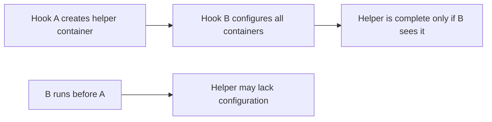

# Design Mutating Webhooks That Tolerate Changing Invocation Order

Author: [nawazdhandala](https://www.github.com/nawazdhandala)

Tags: Kubernetes, Reliability, Testing

Description: Design compatible webhook mutations with explicit field ownership, order-independent behavior, and local composition tests before a cluster canary.

Two webhooks can each be correct in isolation and still produce an unreliable admission chain. One injects a helper container. Another configures every container it sees. If configuration happens first, the helper may miss it. A repeat call might repair that result, but designing the feature around a particular sequence creates a fragile dependency.

The important question is not just whether each webhook can run twice. It is whether the complete collection produces an acceptable result when the invocation order changes, when only some hooks run, and when another mutation occurs between calls.

This article uses **Kubernetes v1.35.0** as the reference contract. The Python 3.11 examples are local tests of object transformations. They do not emulate API server scheduling or deploy webhook services.

## Separate three properties

**Idempotence** means repeating one mutation does not keep changing its result. For example, setting a particular label to `enabled` is idempotent if it preserves that value on later calls.

**Order independence** means two mutations produce the same intended result whichever runs first. Setting two independently owned label keys can have this property. Replacing the entire labels map usually does not.

**Compatibility** means the mutations can coexist without violating their contracts. Two hooks that set the same label to different values are individually idempotent but incompatible: whichever runs last wins. Running them again does not resolve their disagreement.

Kubernetes recommends designing the [whole set of mutating webhooks to be idempotent](https://kubernetes.io/docs/concepts/cluster-administration/admission-webhooks-good-practices/#mutating-webhook-ordering-and-idempotence). Treat that as a system requirement, not merely a unit test for each handler.

## Do not use ordering as a dependency manager

`reinvocationPolicy: IfNeeded` permits additional calls when later changes warrant them. It does not guarantee an unlimited cycle until every hook is satisfied, and eligible hooks may be reordered. `Never`, the default, does not request those additional calls. These constraints are part of the [v1.35.0 admissionregistration API](https://github.com/kubernetes/kubernetes/blob/v1.35.0/staging/src/k8s.io/api/admissionregistration/v1/types.go).

Do not rely on webhook naming conventions, installation order, or a sequence observed in one trace as the feature contract. An observation can help debug that request; it is not a durable orchestration mechanism.

This dependency is especially risky:



A stronger design gives the helper's owner responsibility for creating the complete helper. A second hook can still check or supplement independent settings, but the helper should not depend on a later call merely to be valid.

The API server tracks changes and reinvocation eligibility in its [mutating webhook context](https://github.com/kubernetes/kubernetes/blob/v1.35.0/staging/src/k8s.io/apiserver/pkg/admission/plugin/webhook/mutating/reinvocationcontext.go). That tracking is not a declaration of dependencies between your services.

## Write down what each hook owns

Before changing code, build a small ownership table for the requests where the hooks overlap:

| Mutation | Owner | Coordination rule |
|---|---|---|
| `platform.example.com/diagnostics` label | Diagnostics hook | Other hooks preserve it |
| `platform.example.com/billing` label | Billing hook | Other hooks preserve it |
| Helper container, its volume and mount | Helper injector | Created together by one owner |
| Required final security setting | Platform policy | Checked after mutation completes |

The example names are placeholders for your own domain and policies. Ownership must describe behavior when a field already exists: accept a compatible value, apply an agreed default, or reject a conflict. "Our hook writes it first" is not an ownership rule.

Also list what each hook reads. Two hooks may write different fields but still depend on one another if one derives its output from the other's result. For example, a label summarizing the number of containers depends on container injection even though the label and container list are different fields.

Avoid replacing shared collections. Patch the particular label key or named item your feature owns, preserving unrelated entries. JSON Patch provides document operations, not automatic ownership enforcement; consult [RFC 6902](https://www.rfc-editor.org/rfc/rfc6902) when choosing paths and operations.

## Run a composition test locally

A small executable test exposes the difference between repeatability and compatibility. Save this as `check_composition.py` and run it with Python 3.11. It requires no third-party packages.

The functions below are deliberately simplified object transformations, not production admission handlers. For real testing, replace them with adapters that call your actual patch builders and apply their patches to a copy of the input.

```python
from copy import deepcopy
from itertools import permutations


def label_mutator(key, value):
    def mutate(obj):
        result = deepcopy(obj)
        labels = result.setdefault("metadata", {}).setdefault("labels", {})
        labels[key] = value
        return result
    return mutate


def check_pair(left, right, original):
    expected = right(left(original))
    results = [second(first(original))
               for first, second in permutations((left, right))]
    assert all(result == expected for result in results), "order-dependent result"
    for first, second in permutations((left, right)):
        result = second(first(original))
        assert first(result) == result, "first hook changes combined result"
        assert second(result) == result, "second hook changes combined result"
    assert left(left(original)) == left(original)
    assert right(right(original)) == right(original)


pod = {"apiVersion": "v1", "kind": "Pod",
       "metadata": {"labels": {"team": "checkout"}}}
saved = deepcopy(pod)
diagnostics = label_mutator("platform.example.com/diagnostics", "enabled")
billing = label_mutator("platform.example.com/billing", "tracked")
check_pair(diagnostics, billing, pod)
assert pod == saved
assert billing(diagnostics(pod))["metadata"]["labels"]["team"] == "checkout"
print("Independent owners pass both orders and repeat checks.")

conflict = label_mutator("platform.example.com/diagnostics", "disabled")
try:
    check_pair(diagnostics, conflict, pod)
except AssertionError as error:
    print(f"Expected conflict detected: {error}")
else:
    raise AssertionError("the incompatible owners were not detected")
```

The first pair passes because the two mutations preserve each other's keys. The second pair deliberately fails the order comparison even though each function is individually idempotent. The expected conflict message demonstrates that the test can detect a real disagreement.

This fixture contains only the fields the transformations need; it is not a deployable Pod. The simple setter also overwrites existing values, making it useful for demonstrating the conflict. Production code needs your explicit existing-value policy and input validation.

## Expand the test beyond one pair

For real handlers, include an unmodified object, an already mutated object, conflicting user configuration, and objects changed by another hook between calls. Exercise both orders and repeat individual hooks after the combined result. Confirm that unrelated fields remain intact.

If two independent additions produce lists in different orders, decide whether that difference is meaningful. Do not blindly sort every array to make the test pass: some arrays represent an ordered process. Compare by stable names only for collections whose semantics genuinely allow it, and keep positional meaning where required.

Test partial execution too. If one optional hook is skipped by its selector or allowed to fail under `failurePolicy: Ignore`, another hook should either produce a valid standalone result or report a clear unmet requirement. A passing test where every dependency always runs is too narrow.

The sample above was executed locally and detected its intentional conflict. It is evidence for those transformations, not proof that a production chain converges. In particular, repeatedly running every hook until a test reaches a stable result would assume more rounds than Kubernetes promises.

## Verify the final contract in a canary

Use a narrowly enrolled test namespace with the same relevant webhook versions and configuration as production. Inspect final admitted objects, not just successful HTTP responses from individual services. Verify both fresh objects and objects already carrying the expected fields.

If a property is mandatory, check it in validating admission after mutation. The [admission control phases](https://kubernetes.io/docs/reference/access-authn-authz/admission-controllers/) separate mutation from validation; a validator can reject an incomplete final result, but it does not repair one or guarantee availability.

When two mutations are inseparable, consider combining their patch planning under one owner. When they are independent, preserve that independence in both field ownership and failure behavior. A predictable admission chain comes from clear contracts and composition tests, not from hoping the same hook always runs last.
