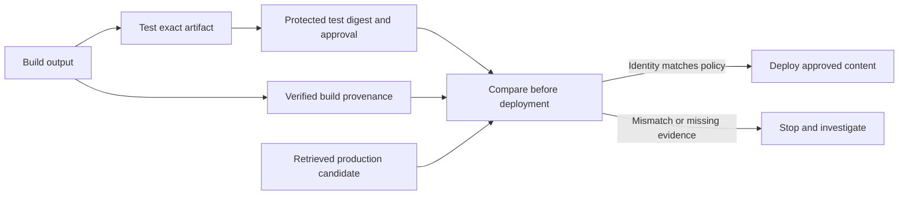

# Detect Artifact Rebuilds Between Test and Production

Author: [nawazdhandala](https://www.github.com/nawazdhandala)

Tags: Artifact Management, CI/CD, Security, Software Supply Chain

Description: Compare tested and production-candidate bytes, bind them to verified provenance, and distinguish changed outputs from a different build that produced identical content.

The test pipeline builds an archive, runs integration tests, and approves commit `abc123`. The production pipeline checks out that commit and builds again. Its dependency resolver selects a newer transitive dependency, so production receives bytes that never passed the tests.

The commit label still matches. The artifact does not. Detecting this requires preserving evidence about the tested output and comparing the actual production candidate, rather than checking only source revision or release name.

There is a second case: a rebuild can produce identical bytes. A content digest can establish equality, but cannot tell whether those bytes were copied or independently rebuilt. Verified build provenance supplies additional evidence about the execution that produced them.

## Capture the test boundary before promotion

At the point where tests select their input, record the exact artifact digest and the test run's result. Keep that record protected from the later production build job. A mutable file named `latest-checksum.txt` in the same writeable workspace is a weak approval boundary.

Retain the tested artifact or a durable content reference, its verified provenance, the test execution identity, and the approval decision. Then retrieve the production candidate independently using the same path or digest the deployment process will consume. Do not compare two local copies of the test output and assume that represents production.



Choose the comparison boundary carefully. For a generic archive, hash the archive bytes. For a container, distinguish the image index from the platform-specific manifest. A rebuilt archive with identical extracted files but different timestamps is still a different archive; decide whether your approval covers exact packaged bytes or another explicitly defined representation.

## Verify provenance before reading it as evidence

An in-toto statement binds a predicate, or claim, to subject artifacts identified by digests. The [Statement v1 specification](https://github.com/in-toto/attestation/blob/main/spec/v1/statement.md) defines that envelope. A SLSA build-provenance predicate describes build inputs and execution details; this article follows the [SLSA 1.2 build-provenance specification](https://slsa.dev/spec/v1.2/build-provenance), whose predicate type remains `https://slsa.dev/provenance/v1`.

A downloaded JSON document is not automatically trusted provenance. Use the verifier appropriate to your attestation format, require the expected signer or signing identity, and enforce your trusted-builder policy. For keyless signatures, constrain the expected certificate identity and issuer rather than accepting any valid certificate. Sigstore documents [attestation verification](https://docs.sigstore.dev/cosign/verifying/attestation/); SLSA separately describes [artifact verification policy](https://slsa.dev/spec/v1.2/verifying-artifacts).

Only export the verified statement for the comparison below after that verification succeeds. Preserve the verification result and original signed envelope. Decoding a signed payload and reading its fields without verifying the signature does not satisfy this prerequisite.

## Compare bytes and selected execution identities

This Python example is deliberately scoped to two downloaded generic artifact files and two already-verified in-toto v1 statements with SLSA build provenance v1. It was executed with **Python 3.9.6**. It does not invoke a signature verifier or implement a complete release policy.

The producer and consumer must agree on the subject name used to select the artifact within each statement. The example uses `payments-report`; real producers may use filenames or other names. Do not guess the selection rule when a statement contains multiple outputs.

Save as `compare.py`:

```python
import hashlib
import json
import sys
from pathlib import Path


def digest(path):
    h = hashlib.sha256()
    with Path(path).open("rb") as source:
        for chunk in iter(lambda: source.read(1024 * 1024), b""):
            h.update(chunk)
    return h.hexdigest()


def inspect(artifact, statement_path, subject_name):
    statement = json.loads(Path(statement_path).read_text())
    if statement.get("_type") != "https://in-toto.io/Statement/v1":
        raise ValueError("expected an in-toto v1 statement")
    if statement.get("predicateType") != "https://slsa.dev/provenance/v1":
        raise ValueError("expected SLSA build provenance v1")
    subjects = [s for s in statement["subject"] if s.get("name") == subject_name]
    if len(subjects) != 1:
        raise ValueError("expected exactly one subject with the agreed name")
    actual = digest(artifact)
    if subjects[0].get("digest", {}).get("sha256") != actual:
        raise ValueError("artifact does not match its provenance subject")
    details = statement["predicate"]["runDetails"]
    builder = details["builder"]["id"]
    invocation = details.get("metadata", {}).get("invocationId")
    if not isinstance(builder, str) or not builder or not isinstance(invocation, str) or not invocation:
        raise ValueError("this comparison requires builder and invocation identities")
    return actual, builder, invocation


if __name__ == "__main__":
    tested, candidate, test_statement, candidate_statement, name = sys.argv[1:]
    a = inspect(tested, test_statement, name)
    b = inspect(candidate, candidate_statement, name)
    print(json.dumps({"tested": a, "candidate": b}, indent=2))
    if a[0] != b[0]:
        raise SystemExit("STOP: candidate bytes differ from tested bytes")
    if a[1:] != b[1:]:
        raise SystemExit("REVIEW: equal bytes but different recorded builder or invocation")
    print("Bytes and selected provenance fields match; signature policy is a prerequisite")
```

Run it after supplying the real files:

```bash
python3 compare.py tested-report.tar.gz candidate-report.tar.gz \
  verified-test-statement.json verified-candidate-statement.json \
  payments-report
```

The output lists each artifact's digest, builder ID, and invocation ID. A missing invocation is rejected by this comparison policy, even though not every provenance producer supplies that optional metadata. If your producer lacks it, you cannot use this script to distinguish build executions without additional trusted evidence.

## Interpret mismatches without rewriting the evidence

| Observation | Interpretation | Next step |
| --- | --- | --- |
| Artifact differs from its statement subject | The evidence does not describe these bytes | Stop; check selection, download, and verification inputs |
| Candidate digest differs from tested digest | Production candidate is a different deliverable | Find the changed build, packaging, or substitution step |
| Digests match but invocation differs | Equivalent bytes have different recorded build histories | Review whether the promotion policy permits that |
| Bytes and selected identities match | These checks passed | Apply remaining approval and deployment policy |

The final row is not proof that no rebuild occurred. Someone could rebuild byte-identical output and carry the original valid provenance alongside it. Digest-based identity cannot reveal that physical history. If the process requirement forbids rebuilds entirely, also inspect trusted pipeline execution records and remove build capabilities from the promotion job.

Similarly, a builder ID string matching itself is not a trust decision. The earlier verifier must establish whether that builder is permitted. The script does not compare every external parameter, source dependency, or approval record.

## Find why the candidate changed

Once bytes differ, compare the verified build definitions using the producer's documented build type. Look for different source dependencies, toolchain versions, external parameters, build scripts, and dependency-resolution inputs. Avoid assuming every producer stores source revision under the same arbitrary JSON key.

Common causes include a production job running a package build again, an unpinned dependency, a container base tag moving, or environment-specific configuration being baked into the artifact. Another is signing or repackaging after tests. If post-test processing changes the deliverable, make that transformation explicit and test the final output at the intended approval boundary.

Do not “fix” a mismatch by replacing the expected digest with the candidate's digest. Preserve both outputs and their evidence, determine whether the change is intended, and run the required tests and approval for the new deliverable.

## Keep promotion focused on approved content

A promotion job should retrieve the approved content, verify identity and policy, and move or expose that same content through a supported repository operation. Keep environment configuration separate where the application permits it. If a format requires rewriting embedded version information, treat the result as a new artifact rather than calling it an unchanged promotion.

Local tests covered matching files, changed candidate bytes, equal bytes with a new invocation, wrong statement types, duplicate or missing named subjects, missing identities, and subject-digest mismatches. The fixtures were synthetic and unsigned. No signature, transparency-log, CI-platform, or registry verification was performed; those remain essential parts of the complete release check.
