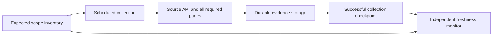

# Detect Broken Compliance Connectors Before Evidence Goes Missing

Author: [nawazdhandala](https://www.github.com/nawazdhandala)

Tags: Compliance, Monitoring, AWS

Description: Monitor evidence freshness, collection completeness, and account coverage so a healthy-looking connector cannot hide a growing audit-period evidence gap.

A connector can authenticate successfully while collecting nothing useful. Its token might still work, but a permission change can hide one account, a pagination bug can skip most resources, or a disabled source service can stop producing records.

Treat evidence collection as a data pipeline with an expected scope and delivery schedule. Monitor its output, not just the connection badge. The goal is to identify a gap while source records are still available and a responsible owner can repair it.

The examples below use a small local health classifier and a read-only AWS Config inspection. AWS Audit Manager is discussed only for existing eligible deployments: since April 30, 2026, AWS has restricted new setup and placed the service in maintenance mode. Review the account and Region restrictions before planning an expansion. [AWS availability change](https://docs.aws.amazon.com/audit-manager/latest/userguide/audit-manager-availability-change.html)

## Separate a failed control from failed collection

A control finding describes the assessed system, such as an unencrypted resource. A collection failure describes whether the evidence pipeline successfully observed the intended system. These need different owners and response paths.

An empty finding list might mean everything passed, no resources were in scope, no evaluation occurred, or the connector never retrieved the results. Do not collapse those possibilities into a green status.

Use four distinct questions:

| Question | Evidence to retain |
| --- | --- |
| Did the collector run? | Attempt time, run identifier, result and error category |
| Did it finish the intended collection? | Scope, page completion, cursor/checkpoint and source response status |
| Was the result stored successfully? | Durable object or record identifier and ingestion time |
| Does it cover the expected period and resources? | Source event time, coverage inventory and collection policy |

The last row is the important difference between monitoring a process and monitoring evidence availability.

## Define the expected schedule per source

An event-driven feed can be quiet without being broken. A daily configuration snapshot should have a different freshness expectation from a monthly review artifact. Define an expected interval, allowed delivery delay, and a separate check for source availability.

AWS Audit Manager illustrates why one global timer is misleading: CloudTrail activity collection, Config rule-triggered evaluations, Security Hub check schedules, and daily/weekly/monthly API snapshots have different collection behavior. [Supported AWS evidence sources](https://docs.aws.amazon.com/audit-manager/latest/userguide/control-data-sources.html)

For a daily snapshot, an internal example policy might allow 24 hours plus six hours of delivery slack. That is an operational choice, not an audit standard. For an event-driven source, monitor successful polling or cursor progress independently of whether new matching events exist.

Keep an expected inventory outside the connector's latest response. For example, list each active account, Region, source, and control mapping that should be covered. If the connector loses permission to one account, its smaller response must not silently redefine the expected inventory.

## Commit success only after the complete result is stored



Advance a successful collection checkpoint only after required pages have been retrieved and the result is durably recorded. Preserve the previous successful checkpoint when a run fails halfway through. Retain partial results with a partial status if useful; do not present them as complete coverage.

Store source time and collection time separately. A newly downloaded old record is recent ingestion, not recent observation. For a historical backfill, also retain the requested interval and how the source's retention and query semantics limit coverage.

A row count helps detect changes, but it is not a completeness proof. Compare identifiers or scope partitions where possible. Fifty thousand records from one account cannot compensate for zero records from another required account.

## Implement a small freshness check first

This Python 3 example classifies collector health records. The fields are an illustrative internal contract, not a vendor API schema. It assumes the expected connector has already been activated and its initial delivery deadline has passed.

```python
from datetime import datetime, timezone


def collection_health(record, now, max_age_seconds):
    if record is None:
        return "missing"
    if record.get("latest_run_complete") is not True:
        return "incomplete"
    timestamp = record.get("last_complete_stored_at")
    if not timestamp:
        return "missing-checkpoint"
    try:
        completed = datetime.fromisoformat(timestamp.replace("Z", "+00:00"))
        if completed.tzinfo is None:
            return "invalid-timestamp"
        age = (now - completed).total_seconds()
    except (ValueError, TypeError, AttributeError):
        return "invalid-timestamp"
    if age < -300:
        return "clock-error"
    if age > max_age_seconds:
        return "stale"
    return "current"


now = datetime(2026, 11, 20, 12, tzinfo=timezone.utc)
record = {
    "latest_run_complete": True,
    "last_complete_stored_at": "2026-11-19T00:00:00Z",
}
print(collection_health(record, now, 30 * 3600))
```

The output is `stale`: the last complete stored collection is 36 hours old against a 30-hour allowance. The fixed clock makes the example reproducible. In a service, supply a trusted current UTC time and an interval appropriate to that source. The five-minute future tolerance is an example clock-skew policy, not permission to rewrite timestamps.

Run this check for every expected inventory entry, including entries absent from the returned records. `current` means only that the recorded complete collection is recent. Add separate coverage and source-age checks before concluding that the evidence meets its intended purpose.

The classifier was executed with Python 3.11.13 against current, stale, incomplete, missing, malformed, timezone-free, and future-time cases. It does not establish that a real collector correctly writes its success checkpoint.

## Diagnose the earliest failed dependency

Start with account identity, Region, scope mapping, and permissions. Then inspect source production, connector retrieval, and evidence storage in that order. Retrying the final importer does little when the source never generated a result.

For an existing AWS Config deployment, the following read-only command retrieves customer-managed recorder status for one account and Region. Replace the profile and Region; the profile needs permission for `config:DescribeConfigurationRecorderStatus`.

```bash
aws configservice describe-configuration-recorder-status \
  --profile evidence-readonly \
  --region us-east-1 \
  --output json \
  --no-cli-pager
```

Inspect `recording`, `lastStatus`, and error fields. No returned customer-managed recorder is a different condition from a healthy recorder with no new evaluations. This call does not inspect every service-linked recorder, prove that the required rules exist, or verify downstream ingestion. Its command shape was checked locally with AWS CLI 2.38.1 using an output skeleton; no AWS request was made. [AWS CLI recorder-status reference](https://docs.aws.amazon.com/cli/latest/reference/configservice/describe-configuration-recorder-status.html)

For existing Audit Manager assessments, AWS documents missing source setup, Region mismatches, incorrectly mapped control identifiers, and evaluations that predate assessment setup as possible causes of absent evidence. Use the symptom-specific investigation before changing the assessment. [AWS evidence troubleshooting](https://docs.aws.amazon.com/audit-manager/latest/userguide/evidence-collection-issues.html)

## Alert while recovery is still possible

Route a freshness or coverage alert to the connector owner with the affected scope, last complete collection, first failed attempt, error category, and recovery deadline. Avoid putting evidence payloads or credentials in notifications.

Set urgency according to the risk of losing recoverable history and the collection requirement. Group related failures so one expired credential does not create a separate page for every dependent control. Symptom-focused alerts with actionable context follow established monitoring practice. [Prometheus alerting guidance](https://prometheus.io/docs/practices/alerting/)

After repair, reconcile the missing interval from retained source data where possible. Mark reconstructed records with their source and original timestamps; do not relabel today's state snapshot as proof of yesterday's state. If the interval cannot be recovered, record the limitation and involve the evidence owner rather than silently clearing the gap.

Finally, test the monitor in staging by withholding a fixture result, returning only one expected scope, and simulating a partial collection. Verify both notification and recovery. A reliable connector-monitoring system should notice missing output even when the connector itself has nothing reassuring to report.
