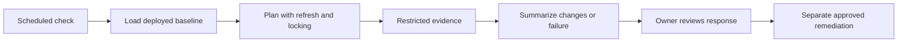

# Detect Cloud Drift on a Schedule Without Automatically Applying Changes

Author: [nawazdhandala](https://www.github.com/nawazdhandala)

Tags: Terraform, Drift Detection, Cloud Automation

Description: Schedule Terraform drift checks that distinguish changes from failures, protect plan evidence, and route destructive proposals to review instead of automatic apply.

Someone changes a security group in the console during an incident. The service recovers, but the Terraform configuration still describes the old rules. A scheduled job can discover the difference. It should not immediately restore the old rules and undo the incident response.

Drift detection observes and reports. Remediation changes infrastructure or accepts a new baseline. Keeping those decisions separate makes a scheduled check useful even when the correct response needs human judgment.

This guide uses Terraform 1.11.4 for a concrete, locally tested checker. It assumes an existing initialized Terraform root and reviewed provider configuration. Cloud credentials, scheduling, and incident routing remain environment-specific prerequisites.

## Compare against the deployed baseline

A normal Terraform plan compares refreshed resource information with configuration. If you check out a commit that has not been deployed, proposed changes may simply describe the pending release.

Record the last successfully deployed commit, variable-set revision, backend location, workspace, Terraform version, and provider lockfile. Resolve that trusted deployment record before checking for drift. Do not accept an arbitrary user-supplied commit or backend path in a privileged scheduled job.

Keep two questions separate:

| Question | Evidence |
|---|---|
| What changed outside Terraform since the saved state? | Reported `resource_drift` |
| What would this configuration change now? | Planned `resource_changes` |
| Did the checker finish successfully? | Process outcome and last-success timestamp |

Terraform's [plan JSON format](https://developer.hashicorp.com/terraform/internals/json-format) exposes drift and proposed changes separately. A proposal is not proof that an external actor changed something. Configuration changes, provider upgrades, and new data-source results can also affect a plan.

## Give the checker observation authority

Use a dedicated identity with the resource-read permissions required by the providers, plus the backend access required to read state and coordinate its lock. Do not attach the deployment administrator role merely because it makes the check pass.

Keep the normal backend lock enabled and coordinate checks with applies for the same state. A blocked check is an operational result, not an invitation to force-unlock. Terraform documents the risk of bypassing locks and provides a bounded lock wait. [Plan options](https://developer.hashicorp.com/terraform/cli/commands/plan).

A plan is not a universal guarantee of zero external effects: providers and external data-source programs execute code while evaluating configuration. Review those dependencies, pin versions, and restrict the runner's permissions and network access. In particular, an [external data source](https://github.com/hashicorp/terraform-provider-external/blob/v2.3.5/docs/data-sources/external.md) launches a program; the program must follow an observation-only contract.



There is intentionally no path from detected drift directly to an automatic apply.

## Preserve Terraform's three outcomes

With `-detailed-exitcode`, Terraform returns zero for an empty diff, one for an error, and two for a nonempty diff. A shell that treats every nonzero code as an undifferentiated failure loses this distinction. A shell that ignores every nonzero code can conceal a broken monitor.

The Python 3.11 script below saves restricted evidence, extracts a small report, and never calls `apply`. Save it as `drift_check.py` outside the Terraform root or in your reviewed automation directory. Run it from the initialized root, with all required variables supplied and Terraform 1.11.4 on `PATH`.

```python
import json
import os
from pathlib import Path
import subprocess
import tempfile


def summarize(plan, code):
    if str(plan.get('format_version', '')).split('.')[0] != '1':
        raise ValueError('Unsupported plan JSON format')
    def changes(field):
        return [{'address': r['address'], 'actions': r['change']['actions']}
                for r in plan.get(field, [])
                if r.get('mode') == 'managed'
                and r['change']['actions'] != ['no-op']]
    proposed = changes('resource_changes')
    drift = changes('resource_drift')
    return {
        'outcome': 'drift_detected' if drift else (
            'changes' if code == 2 else 'no_changes'),
        'plan_exit_code': code,
        'observed_drift': drift,
        'proposed_resource_changes': proposed,
        'contains_delete': any('delete' in r['actions'] for r in proposed),
        'changed_outputs': [name for name, change in
                            plan.get('output_changes', {}).items()
                            if change['actions'] != ['no-op']],
    }


def main():
    os.umask(0o077)
    evidence = Path(tempfile.mkdtemp(prefix='drift-check-'))
    with (evidence / 'plan.log').open('w') as log:
        result = subprocess.run([
            'terraform', 'plan', '-input=false', '-no-color',
            '-detailed-exitcode', '-lock-timeout=60s',
            '-out=' + str(evidence / 'plan.bin'),
        ], stdout=log, stderr=subprocess.STDOUT)
    if result.returncode not in (0, 2):
        print(json.dumps({'outcome': 'check_failed', 'evidence': str(evidence)}))
        return 1
    with (evidence / 'plan.json').open('w') as output:
        subprocess.run(['terraform', 'show', '-json', str(evidence / 'plan.bin')],
                       stdout=output, check=True)
    report = summarize(json.loads((evidence / 'plan.json').read_text()),
                       result.returncode)
    report['evidence'] = str(evidence)
    print(json.dumps(report, indent=2))
    return 0 if report['outcome'] == 'no_changes' else 2


if __name__ == '__main__':
    raise SystemExit(main())
```

Run it with an explicit path appropriate to your checkout:

```bash
python3 /path/to/reviewed-automation/drift_check.py
```

Its exit code is zero for no reported drift or plan changes, two for reviewable findings, and one for a planning failure. Other Python or `show` failures also fail the process; classify them as failed checks, never as a clean result. The report preserves Terraform's own plan exit code where available.

The checker also surfaces nonempty `resource_drift` even when the plan's exit code is zero. That keeps an observation distinct from whether Terraform proposes to change the configuration's resources. It reports changed output names without output values, and treats both replacement orders as containing deletion when their action list includes `delete`.

It does not label every finding destructive. An observed deletion followed by a proposed creation is different from a proposed delete-and-recreate operation. Inspect both arrays and the restricted full plan before deciding what happened.

## Protect evidence and keep the report small

Saved plans and `terraform show -json` output can contain sensitive values. The checker uses a private temporary directory and restrictive file permissions, but those protections do not make an unrestricted artifact upload safe. Terraform explicitly warns that JSON output exposes sensitive values in plaintext. [Show command documentation](https://developer.hashicorp.com/terraform/cli/commands/show).

The summary omits resource attribute values. Resource addresses and output names may still reveal internal information, so send it only to an authorized destination. Store full evidence under a defined retention policy with access controls; arrange cleanup of temporary files on persistent runners. On ephemeral runners, copy approved evidence to restricted storage before the runner disappears.

Attach the state identity, deployed commit, check timestamp, provider versions, and run URL to the incident or review record. Those details let someone reproduce the comparison without asking for a plan file in chat.

## Schedule the check and monitor its freshness

For GitHub Actions, this trigger fragment runs at 17 minutes past every sixth hour in UTC and permits a manual check:

```yaml
on:
  schedule:
    - cron: '17 */6 * * *'
  workflow_dispatch:
```

Add it to your existing reviewed checker workflow, which must resolve the deployed baseline, authenticate, initialize, and invoke the script. It is a trigger fragment, not a complete workflow. Scheduled workflows use the default branch and may be delayed or dropped under load; select an off-hour minute and monitor completion independently. [GitHub schedule behavior](https://docs.github.com/en/actions/reference/workflows-and-actions/events-that-trigger-workflows#schedule).

Handle exit two as a finding notification and exit one as a checker-health notification. If your CI platform renders both as failed jobs, preserve their distinct structured outcomes in the report. A job killed by a timeout may produce neither; an independent freshness check should flag the missing completion.

Deduplicate repeated findings by state and a stable summary of the observed changes. Update one open investigation instead of paging repeatedly for an unchanged condition. Preserve the first-seen and last-seen times so persistent drift does not disappear from attention.

## Understand what a clean check does not prove

Terraform only sees what the provider reads and models. Unmanaged resources, omitted accounts or Regions, insufficient read permissions, and ignored attributes can create blind spots. `ignore_changes` can suppress proposed updates for selected attributes; audit these exceptions rather than treating them as drift-monitoring coverage. [Lifecycle ignore rules](https://developer.hashicorp.com/terraform/language/meta-arguments/lifecycle).

Do not use `-refresh=false` for the scheduled observation, because it avoids the current remote reads you need. Avoid routine `-target` checks that inspect only a fragment of the root. A refresh-only plan answers a narrower state-reconciliation question and does not show the normal configuration-remediation proposal; choose it only when that is the intended monitor.

When a finding is valid, decide whether to restore the approved configuration or update configuration to accept the intentional change. Both paths need review. Generate a fresh plan during remediation, because the scheduled evidence may already be stale. Do not apply the old detection plan automatically.

## Rehearse the detector without a cloud mutation

I tested the checker with Terraform 1.11.4 and the [local provider 2.5.3](https://github.com/hashicorp/terraform-provider-local/blob/v2.5.3/docs/resources/file.md) managing a disposable file. After creating the baseline, an out-of-band file edit produced a drift report; the checker left both the edited file and saved state unchanged. An invalid configuration produced a failed-check result. A clean baseline produced no changes.

Additional local fixtures covered replacement action ordering, output-only changes, an unsupported JSON format, and drift accompanying an empty plan diff. These tests verify the reporting path. They do not validate any cloud provider's drift coverage, scheduled delivery, notification receipt, or production IAM permissions.
