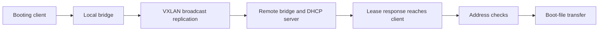

# Trace DHCP and PXE Failures After VXLAN ARP Suppression

Author: [nawazdhandala](https://www.github.com/nawazdhandala)

Tags: VXLAN, DHCP, Troubleshooting

Description: Separate DHCP broadcast delivery, ARP conflict probes, and boot-file transfer when network boot fails after a suppression change on a pure Layer 2 VNI.

A machine that already has an address can communicate, but a freshly booted machine cannot obtain a lease or download its boot image. If this began after enabling ARP suppression, preserve that correlation without assuming every lost packet is ARP.

Network boot crosses several protocol stages. DHCP uses UDP. Address conflict detection can use ARP probes. The boot loader then retrieves a file through the configured boot mechanism. The first missing exchange tells you which part of the network to investigate.

This guide follows an IPv4 client and DHCP server connected through the same bridged VXLAN segment, with no relay or gateway added by the VTEPs. It uses Linux 6.12 implementation references, iproute2 6.12.0 command syntax, and optional FRR 10.2.1 inspection. A deployment with DHCP relay must also trace its relay path and server-facing routing.

## Draw the boot path before changing the network

A pure Layer 2 VNI is an overlay segment that bridges Ethernet traffic without requiring its VTEPs to route tenant packets. The VNI identifies that segment. The DHCP server might be attached behind another VTEP, so a booting client's broadcast still needs a working remote delivery path.



BUM means broadcast, unknown-unicast, and multicast traffic. DHCP discovery is one reason a working BUM path remains important even when known unicast traffic works. An established host may bypass the failing startup exchange because its neighbor and lease state are already populated.

PXE, the Preboot Execution Environment, uses network services to locate and retrieve a boot image. UEFI documents DHCP/discovery and boot-file retrieval as separate operations. A lease alone is not a complete PXE success. [UEFI 2.10 network loading](https://uefi.org/specs/UEFI/2.10/13_Protocols_Media_Access.html).

## Identify the first missing DHCP message

Record the client MAC, transaction ID, segment VNI, DHCP server attachment, and test time. A new DHCP allocation commonly follows Discover, Offer, Request, and Acknowledgment. Correlate the transaction rather than counting unrelated broadcasts on a busy segment. [DHCP client/server exchanges](https://www.rfc-editor.org/rfc/rfc2131.html).

On an authorized staging workload-facing interface, capture:

```bash
sudo tcpdump -nn -e -vv -s 0 -i CLIENT_INTERFACE -c 100 \
  'arp or (udp and (port 67 or port 68))'
```

Replace the interface. Stop with Ctrl-C if the packet count is not reached; the count is not a time limit. The filter is intended for an untagged client-facing capture point. Adapt it if the capture exposes VLAN headers, and protect captured client information. [tcpdump options](https://raw.githubusercontent.com/the-tcpdump-group/tcpdump/tcpdump-4.99.5/tcpdump.1.in), [libpcap filter reference](https://raw.githubusercontent.com/the-tcpdump-group/libpcap/libpcap-1.10.5/pcap-filter.manmisc.in).

Repeat the observation on the server-facing side. This is a tenant-packet filter, not an underlay VXLAN filter; on the underlay, the outer UDP port and encapsulation differ.

Use the last observed step to narrow the fault:

| Evidence | Next check |
| --- | --- |
| Discover never leaves client attachment | Local link, VLAN classification, firmware/client behavior |
| Discover reaches local bridge but not server side | VNI membership and broadcast replication |
| Server sees Discover but sends no Offer | Server policy, address pool, service logs |
| Offer leaves server but never reaches client | Reply forwarding, client MAC state, filtering |
| Lease completes but boot stalls | Address checks and boot-file service |

DHCP replies can use broadcast or unicast delivery depending on the client flags and protocol state. Do not assume that repairing only one direction's broadcast path repairs every response. [DHCP message delivery rules](https://www.rfc-editor.org/rfc/rfc2131.html).

## Check the segment's flood and replication state

On the relevant Linux VTEP, replace the example names:

```bash
bridge -d link show dev vxlan10100
bridge link show master br10100
bridge fdb show dev vxlan10100
```

Record bridge membership and the port's broadcast-flood and neighbor-suppression properties. `bcast_flood` concerns broadcasts; the `flood` flag concerns unknown unicast. They are not interchangeable controls. [iproute2 bridge-port definitions](https://raw.githubusercontent.com/iproute2/iproute2/v6.12.0/man/man8/bridge.8).

For an EVPN ingress-replication deployment, inspect segment advertisements as well:

```bash
vtysh -c 'show bgp l2vpn evpn route type multicast'
```

In FRR 10.2.1, this selects Type 3 routes. These IMET advertisements describe segment participation used in BUM delivery; inspect the intended remote endpoint rather than accepting any route count as proof. [Tagged FRR command definitions](https://raw.githubusercontent.com/FRRouting/frr/frr-10.2.1/bgpd/bgp_evpn_vty.c), [EVPN overlay procedures](https://www.rfc-editor.org/rfc/rfc8365.html).

A manually configured flood list needs its own peer comparison. Do not add manual flood entries over controller-owned EVPN state merely because one appears absent. Resolve the missing membership through its owner.

## Distinguish DHCP from zero-source ARP probes

After allocation, address-conflict detection may send an ARP request whose sender IP is `0.0.0.0` and whose target is the candidate address. This probe asks whether another host already owns that address. It is different from a normal request sent by a configured host resolving a peer. [IPv4 address probing](https://www.rfc-editor.org/rfc/rfc5227.html).

Local synthetic capture checks produced these diagnostic excerpts:

```text
0.0.0.0.68 > 255.255.255.255.67
DHCP-Message (53), length 1: Discover
Probe who-has 10.20.0.12 tell 0.0.0.0
```

The combined filter retained both packets; a DHCP-port-only filter omitted the ARP probe. These were generated packet files decoded by tcpdump 4.99.1, not a live DHCP lease or boot test.

Linux 6.12 has special handling for ARP packets with a zero sender address or matching sender/target addresses when neighbor suppression is active. Its bridge code marks relevant packets to prevent flooding toward suppression-enabled ports. That behavior is separate from DHCP UDP processing. [Linux ARP suppression path](https://raw.githubusercontent.com/torvalds/linux/v6.12/net/bridge/br_arp_nd_proxy.c), [Bridge flood handling](https://raw.githubusercontent.com/torvalds/linux/v6.12/net/bridge/br_forward.c).

Do not equate a missing remote probe with proof that the address is unused. Conversely, do not claim this alone explains a missing DHCP Offer. Locate the actual failed stage and compare the packet's fields with the implementation's behavior.

For FRR's documented setup, ARP/ND suppression requires the appropriate SVI and is a kernel function. A pure bridge that only learns MACs does not automatically provide all the IP-binding state expected by proxy resolution. Review that prerequisite before keeping suppression enabled on the segment. [FRR suppression requirements](https://docs.frrouting.org/en/stable-10.2/evpn.html).

## Follow the boot-file transfer after the lease

Once the client has a usable address, record the boot server and filename or URI it actually received. Verify the firmware's expected boot method and image architecture instead of treating every later timeout as DHCP failure.

For a TFTP-based boot, the initial request goes to UDP port 69, but the transfer uses selected transfer identifiers, which are UDP ports. A capture or firewall policy limited to destination port 69 can miss the continuing exchange. Trace the client/server flow and stateful policy for the actual transfer. [TFTP connection establishment](https://www.rfc-editor.org/rfc/rfc1350.html).

If the deployment uses another boot transport, inspect that transport's connection and server logs. Keep file selection, permission, and transfer failures distinct from the earlier address-allocation evidence.

## Rehearse the correction without masking the fault

In an isolated staging segment, compare the approved prior suppression configuration with the proposed one using the same boot client and server. Preserve packet evidence and configuration before each run. Do not disable every bridge protection or add a gateway to a deliberately pure Layer 2 design as a diagnostic shortcut.

Acceptance means a new client receives a lease, performs the required address checks under the intended policy, retrieves the correct boot image, and reaches the expected boot stage. Repeat from each relevant leaf and after a controlled cold start.

The local checks here verified synthetic packet decoding, capture-filter coverage, source references, and shell syntax. No live DHCP server, PXE firmware, EVPN fabric, or suppression change was exercised.
