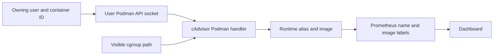

# Diagnose Missing cAdvisor Container Names with Rootless Podman

Author: [nawazdhandala](https://www.github.com/nawazdhandala)

Tags: Podman, Linux, Prometheus, Monitoring, Troubleshooting

Description: Trace rootless Podman names through the owning user's API socket, cAdvisor runtime discovery, cgroup access, and exported Prometheus labels.

cAdvisor reports CPU or memory for a long cgroup path, but the friendly container name is missing. Meanwhile, `podman ps` shows the name perfectly. Both observations can be true: reading a cgroup's counters and resolving its Podman metadata are separate steps.

With rootless Podman, the owning user is an essential part of the diagnosis. An exporter pointed at the rootful runtime socket can observe host cgroups without obtaining metadata for containers managed by another user's rootless service.

This article follows cAdvisor 0.55.1 and Podman 5.4.0 documentation. It describes a diagnostic process, not a claim that every rootless host or storage configuration has been tested with this combination.

## Start with one container and its owner

Run inspection as the user who owns the rootless container on the Linux host. Do not add `sudo` as a troubleshooting shortcut: that can switch to a different Podman environment.

Replace `app-container` with a known running container:

```bash
podman container inspect app-container \
  --format '{{.ID}} {{.Name}} {{.ImageName}} {{.State.Running}}'
```

The command prints its full identity, friendly name, image name, and running state. These fields are documented in [Podman 5.4.0 container inspect](https://docs.podman.io/en/v5.4.0/markdown/podman-container-inspect.1.html). Keep the ID for comparison with cAdvisor; names can be reused after recreation.

If the owner cannot inspect the container, resolve that discrepancy first. You may be using the wrong account, a remote Podman connection, or a stale name. An exporter cannot repair a mismatch in which workload you are investigating.

## Follow the metadata path



The [cAdvisor Podman factory](https://github.com/google/cadvisor/blob/v0.55.1/container/podman/factory.go) recognizes candidate paths and inspects the corresponding container through the configured endpoint. Its default endpoint is `unix:///var/run/podman/podman.sock`. That default does not automatically identify the socket for every rootless user.

When runtime inspection succeeds, the [Podman handler](https://github.com/google/cadvisor/blob/v0.55.1/container/podman/handler.go) uses the container's name as its first alias, stripping a leading slash. The [Prometheus label function](https://github.com/google/cadvisor/blob/v0.55.1/metrics/prometheus.go) uses that alias for `name`. This gives you a concrete chain to investigate instead of trying to infer friendly names from cgroup paths.

## Check the rootless socket explicitly

Podman's user service normally uses `$XDG_RUNTIME_DIR/podman/podman.sock`; a common example is `/run/user/1000/podman/podman.sock`. The rootful service has a separate socket. The [Podman service documentation](https://docs.podman.io/en/v5.4.0/markdown/podman-system-service.1.html) describes both and their socket activation behavior.

In an existing login session for the owning user, inspect the expected socket path:

```bash
printf '%s\n' "${XDG_RUNTIME_DIR:?Run in the owner login session}/podman/podman.sock"
```

The shell stops with an explanatory error if the runtime directory is unset. The printed path is a candidate based on the standard service layout; custom service units can change it.

If the API service is intentionally required for monitoring but its user socket is not running, start that socket through the user's systemd manager:

```bash
systemctl --user start podman.socket
```

This changes service state. It is appropriate on a Linux host with the documented user units, not on a macOS workstation merely connected to a remote Podman machine. Decide separately how the service should persist across login sessions or reboots.

For a standalone cAdvisor process that can access the observed socket, the corresponding argument is:

```text
--podman=unix:///run/user/1000/podman/podman.sock
```

Replace `1000` and the path with the actual endpoint. This is an argument fragment, not a complete deployment. If cAdvisor runs in a container, the path must exist in its filesystem view; host existence alone is insufficient. Verify the configured mount and the process's access rights.

The reviewed cAdvisor [Podman client](https://github.com/google/cadvisor/blob/v0.55.1/container/podman/client.go) uses its `--podman` endpoint and supports the Unix scheme in that implementation. Do not assume setting `DOCKER_HOST` elsewhere changes this client, or that an arbitrary remote endpoint works identically.

## Treat API access as a real permission grant

The Podman API can perform runtime operations as its owning user. Giving an exporter access to that socket is broader than granting permission to read metric files. Making the socket world-writable is not an acceptable way to repair missing labels.

For containerized access, also investigate mandatory-access-control denials if your host uses SELinux. Follow a reviewed deployment policy rather than globally disabling enforcement. A read-only bind-mount option does not turn a command-capable Unix socket into a read-only API.

On a host with multiple rootless owners, one user's socket is not a universal inventory. The reviewed factory has one configured endpoint. Plan collection boundaries deliberately and prevent duplicate cgroup metrics if separate collectors overlap. Do not merge all users' socket permissions simply to populate dashboard legends.

## Separate socket access from cgroup support

Successful Podman inspection is necessary for metadata, but it is not the only requirement. cAdvisor still needs suitable cgroup visibility and a working handler for the container's storage/runtime details.

The [cAdvisor Podman registration code](https://github.com/google/cadvisor/blob/v0.55.1/container/podman/plugin.go) validates runtime information and warns that rootless Podman containers do not work with cgroups v1 in that path. Capture the actual cgroup version and exporter logs before assuming a socket adjustment is sufficient. Do not change the host's cgroup configuration casually to fix a legend.

Useful evidence includes failure to validate Podman information, container-inspection errors, storage-handler errors, and paths that do not match the container being investigated. Keep the full error and version details. If the exporter falls back to observing a raw cgroup, its numeric measurements do not prove runtime metadata was resolved.

## Check the raw name before the dashboard

Use an unaggregated query for the relevant target, replacing the example job and instance:

```promql
container_memory_working_set_bytes{
  job="cadvisor", instance="node-a:8080", id!=""
}
```

Inspect all labels. Do not filter on `name!=""` yet, because that would hide the missing-name rows. Compare the selected container ID and expected name with the raw exporter response.

If the raw response has the name but Prometheus does not, inspect metric relabel rules. If Prometheus has it but the dashboard does not, inspect aggregation and legend settings. Those are downstream problems; granting more runtime access will not fix them.

Finish with two known containers owned by the same user and, where relevant, a second user outside the collector's intended scope. Verify that names attach to the correct IDs and that unsupported coverage remains explicit. Local checks for this article exercise cAdvisor's label mapping with synthetic metadata; they do not establish rootless runtime discovery on a real host.
