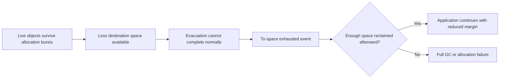

# Diagnose G1 To-Space Exhaustion Before Repeated Full GC

Author: [nawazdhandala](https://www.github.com/nawazdhandala)

Tags: Java, Garbage Collection, Troubleshooting

Description: Investigate G1 evacuation failures using collection timelines, retained heap and marking progress, then choose a measured response instead of copying JVM flags.

`To-space exhausted` means G1 could not obtain enough destination space while copying live objects during a collection. It is a warning about evacuation capacity, not a statement that the operating system has run out of RAM. The JVM may recover, but repeated failures can lead into expensive Full GC cycles.

Investigate the first failure and the collections around it, rather than waiting for an out-of-memory error. This guide uses G1 on Azul Zulu OpenJDK 17.0.16+8. A bounded local allocation lab reproduced the message and subsequent Full GC. Its tiny heaps and counts are diagnostic examples, not production sizing recommendations.

## Understand the space that G1 needs

G1 divides the heap into regions. During an evacuation pause, it copies surviving objects out of selected regions so those regions can be reused. That copying needs destination space while the old locations still exist. A heap can therefore be under pressure even when a simple used-versus-maximum graph appears to show some room.

Young collections handle young regions; mixed collections also reclaim selected old regions after marking identifies useful candidates. Marking is work that determines which objects remain reachable. See Oracle's [G1 collector overview](https://docs.oracle.com/en/java/javase/17/gctuning/garbage-first-g1-garbage-collector1.html) for this sequence.



One failure is not a promise that the next collection must be Full GC. The useful questions are whether space recovers, whether old occupancy keeps rising, and whether the collector repeatedly runs out of time or room.

## Preserve the first failure's context

For a staging reproduction, add the following option to the service's existing startup command. Create a writable `logs` directory and replace `service.jar`:

```bash
java '-Xlog:gc*,gc+ihop=debug:file=logs/gc.log:time,uptime,level,tags:filecount=3,filesize=10M' \
  -jar service.jar
```

The option records collection details and additional information about the initiating heap occupancy threshold, abbreviated IHOP. Keep the application's existing collector and memory options. Do not copy the lab's small heap into a real service. The [JDK 17 launcher reference](https://docs.oracle.com/en/java/javase/17/docs/specs/man/java.html) documents unified logging and file rotation.

Retain logs from startup through the incident when possible, including rotated files. Startup records identify the heap and region size; earlier collections explain how the collector reached the failing state. Label files with the JVM instance and restart identity.

The local lab retained a ring of 850 arrays, each 64 KiB, while replacing entries through 10,000 allocations. With a 64 MiB heap, its first sequence included:

```text
GC(11) To-space exhausted
GC(12) To-space exhausted
GC(13) Pause Full (G1 Compaction Pause) 62M->54M(64M) 1.997ms
GC(3) Concurrent Mark Abort
```

These are message excerpts from one real run. The final line belongs to an earlier concurrent cycle; collection identifiers are not a simple sequence of independent, non-overlapping activities. The Full GC reclaimed some memory, but approximately 54 MiB remained occupied immediately afterward.

## Count events without counting each log line

A Full GC commonly has both a start record and a completion record. Counting occurrences of `Pause Full` can therefore overstate the number of collections. The companion [count-events.py](./count-events.py) deduplicates identifiers for this JDK 17 message layout:

```bash
python3 count-events.py logs/gc.log
```

It reports separate counts for evacuation-failure events and Full GC events. Run it on logs from one JVM lifetime; combining restarts without preserving identity can incorrectly merge reused identifiers. The script does not calculate pause duration or prove that every Full GC followed a particular failure.

Against the local 64 MiB run it reported 265 failure events and 137 Full GCs. Against a separate low-retention allocation lab, it reported zero of each. Those checks validate classification, not an alert threshold suitable for every service.

## Build a short evidence table

For several collections before and after the first event, record these observations:

| Evidence | What it helps distinguish |
|---|---|
| Occupancy after collections | Brief allocation burst versus persistently retained objects |
| Old-region trend | Increasing promotion or long-lived data |
| Humongous-region count | Large-object pressure that needs separate investigation |
| Concurrent start, remark, cleanup and abort records | Whether marking completes before space becomes critical |
| Pause time and CPU availability | Insufficient collection progress under the available resources |

Do not infer a memory leak from one high occupancy sample. The lab intentionally retained a fixed ring; it could produce repeated failures without unbounded growth. Conversely, a steadily growing retained set across comparable completed cycles deserves application-level investigation.

Oracle's [G1 tuning guide](https://docs.oracle.com/en/java/javase/17/gctuning/garbage-first-garbage-collector-tuning.html) describes evacuation failures as a common precursor to Full GC and discusses allocation rate, marking progress, and large objects. Use those as competing explanations, rather than treating the log message as a unique diagnosis.

## Choose a response that matches the evidence

If the application retains too much live data for its allocation rate and heap, reducing retention or giving the JVM justified additional headroom can help. Check the container or host memory budget before increasing `-Xmx`: the Java heap is only part of process memory. A larger heap that causes a container kill is not a successful fix.

If concurrent marking repeatedly fails to finish in time, examine CPU contention and the growth rate of old data. Starting marking earlier or reviewing reserve policy may be appropriate controlled experiments. Do not set several IHOP, reserve, young-generation, and worker-count flags at once; that prevents you from identifying which change mattered.

If humongous objects dominate, investigate allocation sizes and region usage separately. Do not assume every evacuation failure requires changing region size. The retained arrays in this lab were much smaller than half of its one-MiB regions, so the reproduction did not depend on humongous allocations.

Avoid forcing `System.gc()` as a routine response. It adds another collection request and changes the timeline you are trying to understand. Diagnostic operations can also be disruptive: the [JDK `jcmd` reference](https://docs.oracle.com/en/java/javase/17/docs/specs/man/jcmd.html) classifies heap histograms and dumps as high-impact operations. Plan those separately when lighter evidence is insufficient.

## Rehearse one change and watch recurrence

Repeat the same workload with one changed variable and compare failures, Full GCs, pause time, throughput, and memory usage. In this lab, raising the heap to 128 MiB reduced but did not eliminate failures: that run still had 22 evacuation failures and nine Full GCs. A 256 MiB run still had two failures and one Full GC.

These single-run observations show why “add memory” should be verified, not announced as a guaranteed solution. They do not establish stable rates or a recommended heap size. A proper service trial needs representative warm-up, steady load, bursts, and enough duration to observe repeated collection cycles.

The local logging and counter checks passed on the stated JDK. No production workload, container limit, CPU throttling, heap dump, or IHOP/reserve tuning experiment was tested. Set an operational response for newly observed evacuation failures, preserve their surrounding timeline, and judge remediation by restored headroom and sustained behavior rather than the disappearance of one log line.
