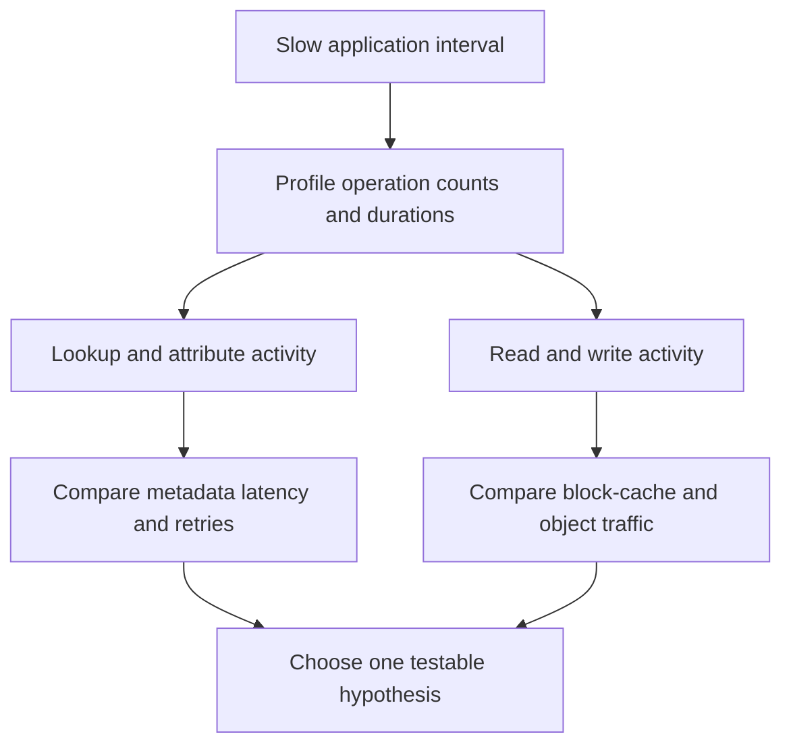

# Diagnose Slow JuiceFS Small-File Workloads with Access Logs and Stats

Author: [nawazdhandala](https://www.github.com/nawazdhandala)

Tags: JuiceFS, Performance, Troubleshooting

Description: Correlate JuiceFS operation profiles, metadata latency, cache traffic, and object requests to explain slow small-file jobs before changing tuning settings.

A job can spend minutes scanning tiny files while showing very little read bandwidth. Each file may require name lookup, attribute checks, opening, reading, and closing. Increasing object-storage bandwidth will not necessarily help if the job spends most of its time waiting for metadata operations.

The useful question is which operations dominate the slow interval and where those operations wait. **JuiceFS Community Edition 1.4.2** provides three complementary views: `.accesslog` records completed filesystem operations, `profile` summarizes those records, and `stats` shows client metrics over time.

## Choose a repeatable workload window

Select one representative job and record its input set, concurrency, host, mountpoint, client version, and start/end times. Measure the application's own elapsed time and useful work, such as files processed per second. Keep a successful-output check alongside the performance measurement.

Distinguish a cold run from a repeated run. A second pass may benefit from kernel page cache, JuiceFS data cache, or metadata cache. Do not describe that improvement as a backend optimization unless the evidence supports it.

Use a staging input or a bounded production observation approved for diagnosis. Access records can expose file names, inode identifiers, and user/process IDs. Store captures outside the monitored mount in a restricted local directory so capture writes do not become part of the measured filesystem workload.

## Capture operations and metrics for the same interval

The virtual `.accesslog` file streams operations while it is read; it is not an ordinary finite log file. A plain `cat` waits for more records rather than exiting. The [diagnostic guide](https://github.com/juicedata/juicefs/blob/v1.4.2/docs/en/administration/fault_diagnosis_and_analysis.md#access-log) documents the record format and client-specific access paths.

For a Linux host with GNU `timeout`, run this in the first terminal:

```bash
umask 077
CAPTURE_DIR=$(mktemp -d /tmp/juicefs-small-files.XXXXXX)
printf 'Capture directory: %s\n' "$CAPTURE_DIR"

if timeout --signal=TERM 30s cat /mnt/jfs/.accesslog \
    > "$CAPTURE_DIR/access.log"; then
  :
else
  result=$?
  if [ "$result" -ne 124 ]; then
    echo "Capture failed with status $result" >&2
    exit "$result"
  fi
fi
```

Replace `/mnt/jfs` with the actual mountpoint. The new directory avoids overwriting an earlier capture. Status 124 is the expected timeout result; other failures must be investigated. A final partial record can occur when capture stops, so inspect parser warnings rather than assuming every line is complete. GNU documents the timeout status in its [command reference](https://www.gnu.org/software/coreutils/manual/html_node/timeout-invocation.html).

In a second terminal, use the printed capture directory and start the metrics observation just before reproducing the workload:

```bash
juicefs stats --schema tufmco --verbosity 1 \
  --interval 1 --count 30 /mnt/jfs \
  > /tmp/REPLACE-WITH-CAPTURE-DIRECTORY/stats.txt
```

Replace the output path with the exact new directory from the first terminal. The schema requests time, resource usage, FUSE, metadata, block cache, and object-storage sections. FUSE is the kernel-to-userspace filesystem interface. Thirty updates bound the observation; the two terminals provide approximately overlapping windows, not a perfectly synchronized trace.

The [pinned stats implementation](https://github.com/juicedata/juicefs/blob/v1.4.2/cmd/stats.go) and this version's command help define these options. Neither command generates a representative workload by itself.

## Replay the saved operations

After capture, use the saved file rather than reopening the live stream:

```bash
juicefs profile --interval 0 "$CAPTURE_DIR/access.log"
```

`--interval 0` summarizes a saved log immediately. It is not the same as CPU profiling with Go's `pprof`. This command aggregates completed filesystem operations and their durations. It cannot explain an operation that has not completed and therefore has not yet produced a record.

If the mount serves multiple applications, filter using an observed process ID:

```bash
juicefs profile --interval 0 --pid 12345 "$CAPTURE_DIR/access.log"
```

Replace 12345 with a PID present in the capture. Container and host PID views may differ, so use the IDs recorded by the client. This filters the operation profile; it does not retroactively filter the client-wide `stats` metrics. The [profile implementation](https://github.com/juicedata/juicefs/blob/v1.4.2/cmd/profile.go) also supports user and group filters.

Pay attention to units: profile reports average and accumulated operation durations in microseconds, whereas the common `stats` latency columns use milliseconds. Accumulated duration is not CPU time or necessarily the job's wall-clock duration; concurrent operations can overlap.

## Correlate the operation mix with the backend



Use the observations to narrow the next experiment:

| Evidence during the slow window | Useful next check |
| --- | --- |
| Many lookup/attribute operations plus elevated metadata latency | Metadata service/network latency and application traversal pattern |
| Many operations but low individual latency | Excessive repeated work or insufficient useful work per operation |
| Object GET activity rises with read latency | Cache misses, object latency, or read amplification |
| High client resource use or buffer pressure | CPU contention, memory limits, and application concurrency |
| High metadata retry activity | Backend contention and transaction behavior |

An operation name alone does not identify its backend cost. Client and kernel caches can satisfy some work without a metadata request. Likewise, reads served by kernel page cache do not become JuiceFS block-cache reads. Interpret counts at the layer where they were measured.

A small application read can trigger a larger object read, so compare object GET bytes with useful application bytes over the same workload. Treat the ratio as a diagnostic clue: prefetching, cache population, and unrelated consumers can affect it. Do not label all extra traffic waste without checking later reuse.

## Make one change and preserve consistency requirements

If repeated directory scans dominate, test reducing redundant application scans or batching work. If metadata latency dominates, investigate the metadata engine and network before increasing data-cache size. If object reads dominate a stable repeated dataset, assess cache capacity and placement using a controlled warm/cold comparison.

Avoid changing every cache TTL at once. A time-to-live (TTL) controls how long cached information can be reused, and longer metadata lifetimes can change how quickly one client notices another client's changes. The fastest run is not acceptable if it hides updates the application needs to see.

Repeat the same input and concurrency after one change. Compare application completion time, operation counts, per-operation averages, metadata behavior, and object traffic. Check output correctness again. If only the second run improves, distinguish the change from ordinary cache warming.

## Keep the evidence honest

A synthetic four-record log was replayed locally using JuiceFS 1.4.2. PID filtering retained two lookup operations with a 15,000-microsecond average and one read with a 4,000-microsecond average, matching the fixture. These numbers demonstrate interpretation and filtering; they are not a JuiceFS benchmark or production incident.

No mounted workload or live `stats` stream was exercised for this article. Before drawing conclusions from real captures, check for partial records, unrelated traffic, and missing slow operations that have not completed. A concise diagnosis should state the workload, observed bottleneck evidence, tested change, and correctness result rather than offering a universal cache setting.
