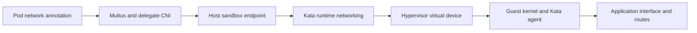

# Diagnose Multus Interfaces Missing Inside Kata Containers

Author: [nawazdhandala](https://www.github.com/nawazdhandala)

Tags: Multus, Kubernetes, Troubleshooting

Description: Trace a missing secondary interface across Multus, the host sandbox, Kata's virtual-machine networking, and the guest instead of treating network-status as proof of guest delivery.

A Multus network-status annotation lists a secondary interface, yet `ip link` inside a Kata workload does not show what you expected. The apparent contradiction comes from observing different layers. Multus configures an attachment through CNI, while Kata must make the corresponding networking available to a workload running inside a virtual machine.

The useful question is where the attachment stops appearing. Is the request missing? Did the delegate fail? Does the host sandbox contain the endpoint but the guest not receive it? Or does the guest have an interface under an unexpected name without the intended address?

This guide uses **Kata Containers 3.29.0** architecture and Go-runtime source as a concrete reference, alongside **Multus v4.3.1** concepts. Runtime implementation, hypervisor and platform packaging matter. No Kata virtual machine or live Multus cluster was available for testing; commands were source-reviewed and syntax-checked.

## Separate the host and guest views

A normal Linux container shares the host kernel's networking implementation. A Kata workload runs behind a virtual-machine boundary. Kata's documented networking design connects suitable host-side interfaces to VM networking, commonly through TAP devices and traffic-control redirection. A TAP device presents Ethernet traffic to a userspace virtual-machine process. [Kata networking architecture](https://github.com/kata-containers/kata-containers/blob/3.29.0/docs/design/architecture/networking.md).



Network status is evidence from the attachment workflow. It is not a direct inventory of devices visible to the guest application. Conversely, a TAP or host-side device is not necessarily expected to appear with the same name inside the guest.

Record evidence at each boundary instead of repeatedly editing the NetworkAttachmentDefinition. The first missing or inconsistent layer determines the next investigation.

## Verify which runtime actually ran the Pod

Inspect the Pod and its RuntimeClass:

```bash
kubectl -n REPLACE_NAMESPACE get pod REPLACE_POD -o yaml
kubectl get runtimeclass REPLACE_RUNTIME_CLASS -o yaml
```

Read `spec.runtimeClassName`, the RuntimeClass handler, the assigned node, and the Pod UID. The handler maps to a runtime configuration on the node. A familiar RuntimeClass name alone does not prove which hypervisor, runtime implementation, guest image, or networking settings the node uses. [Kubernetes RuntimeClass](https://kubernetes.io/docs/concepts/containers/runtime-class/).

Record the installed Kata version, container runtime version, selected handler configuration, guest kernel/image, Multus version and delegate versions. Compare this tuple with a known working node if one exists. Avoid changing several components together before capturing the failure.

## Verify the request and delegate result

Read the network annotation, network status and Pod events. Match the intended namespace-qualified network name and requested interface. A missing name or different namespace can explain the result before Kata is involved.

```bash
kubectl -n REPLACE_NAMESPACE describe pod REPLACE_POD
kubectl -n REPLACE_NAMESPACE get network-attachment-definition REPLACE_NAD -o yaml
```

Check Multus and delegate logs on the Pod's node around sandbox creation. Look for an actual successful attachment result, not just a request being queued. Confirm IPAM succeeded, required binaries were present, and the expected parent or bridge existed.

If the same approved test configuration fails under both Kata and a conventional runtime in a disposable staging comparison, focus first on shared CNI or node preparation. If only Kata fails, the guest boundary deserves closer inspection. Keep address allocation isolated between tests; do not reuse a fixed address concurrently.

## Inspect the host sandbox without changing it

On the affected node, use the supported `crictl` configuration to identify the correct sandbox:

```bash
sudo crictl pods
sudo crictl inspectp REPLACE_SANDBOX_ID
```

Correlate its identity with the Pod UID and node. Runtime-specific inspection output or supported runtime diagnostics can identify the sandbox's host network namespace. There is no universal JSON path for every runtime, so verify the actual path rather than copying one from an unrelated installation. [crictl inspection](https://kubernetes.io/docs/tasks/debug/debug-cluster/crictl/).

Once the namespace path is verified, inspect it with Linux util-linux `nsenter` and iproute2:

```bash
sudo nsenter --net=REPLACE_VERIFIED_NETNS_PATH -- ip -d link show
sudo nsenter --net=REPLACE_VERIFIED_NETNS_PATH -- ip address show
sudo nsenter --net=REPLACE_VERIFIED_NETNS_PATH -- ip route show
```

These commands enter the host-side namespace only; they do not enter the Kata guest. They are read-only networking inspections. Use approved elevated access and the correct sandbox identity. [nsenter namespace selection](https://man7.org/linux/man-pages/man1/nsenter.1.html).

Do not assume an address missing from a host-side interface proves IPAM failed. Kata can transform the endpoint for VM connectivity. In the pinned Go-runtime implementation, the traffic-control setup includes moving networking responsibilities and clearing addresses from a host-side veth to avoid address conflicts. Interpret host state alongside runtime logs and guest state. [Kata Go-runtime network implementation](https://github.com/kata-containers/kata-containers/blob/3.29.0/src/runtime/virtcontainers/network_linux.go).

## Inspect what the application sees

If the workload is running and its approved image contains iproute2:

```bash
kubectl -n REPLACE_NAMESPACE exec REPLACE_POD -c REPLACE_CONTAINER -- ip -d link show
kubectl -n REPLACE_NAMESPACE exec REPLACE_POD -c REPLACE_CONTAINER -- ip address show
kubectl -n REPLACE_NAMESPACE exec REPLACE_POD -c REPLACE_CONTAINER -- ip route show
```

Compare MAC addresses, assigned IPs, link properties and routes, not just names. An interface that exists with an unexpected name is a different failure from a missing virtual device. An interface without an IP is different again from a valid interface whose traffic is blocked upstream.

If the Pod never starts, use your platform's supported runtime and guest diagnostic collection rather than expecting `kubectl exec` to work. Collect logs around the same sandbox ID, including virtual-device setup and agent network configuration failures. Keep sensitive configuration and workload data out of broadly shared incident attachments.

## Check endpoint type and lifecycle support

The Kata 3.29.0 Go-runtime endpoint selection code contains explicit paths for multiple interface types and an unsupported-type error path. That is a reason to inspect the actual delegate result type and selected runtime, not a guarantee that every CNI chain works with every hypervisor. A Rust runtime or platform-specific build can have a different support surface.

Also distinguish an attachment present during sandbox creation from one added afterward. Multus dynamic reconciliation on the host does not establish that the chosen Kata/runtime/hypervisor combination propagates the new endpoint into the running guest. Kata documents network hot-plug mechanisms, but your integration must actually invoke and support the required lifecycle. Test initial attachment and hot-plug separately.

| Last confirmed layer | Next evidence to collect |
| --- | --- |
| Desired annotation only | Delegate ADD result and allocation errors |
| Host endpoint exists | Runtime endpoint recognition and VM device setup |
| VM device exists | Guest driver and agent configuration |
| Guest interface exists, no address | Guest network configuration and address transfer |
| Guest address and route exist | Actual traffic, policy, MTU and return path |

## Finish with a reproducible boundary test

Reduce the staging case to one secondary attachment and one approved peer. Record both host and guest snapshots before changing configuration. Apply one supported correction, recreate the disposable Pod when required, and repeat attachment, traffic and deletion checks.

Do not manually construct a guest interface and call the issue solved unless that is the supported lifecycle owner. Such a change can disappear on replacement and bypass CNI cleanup. The durable result is a repeatable path from the declared attachment to a usable guest interface, with evidence showing which boundary previously failed.
