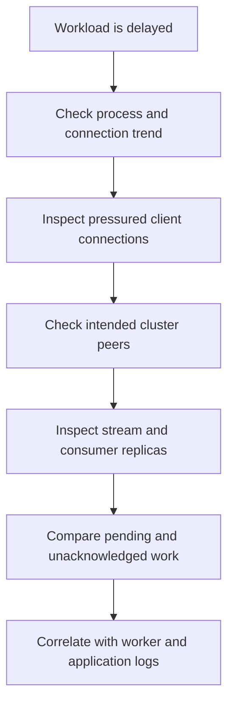

# Diagnose NATS and JetStream Health with Four Monitoring Endpoints

Author: [nawazdhandala](https://www.github.com/nawazdhandala)

Tags: NATS, Monitoring, Observability, Troubleshooting

Description: Use varz, connz, routez, and jsz together to distinguish connection pressure, missing peers, replication problems, and consumer backlog without misleading counts.

A NATS process can answer HTTP while a worker is stuck. Cluster routes can be connected while a JetStream replica is catching up. A stream can have millions of retained messages while its consumers are fully caught up. Each observation describes a different layer.

Use `/varz`, `/connz`, `/routez`, and `/jsz` as a sequence of questions, not four interchangeable health checks. Start with the process and connected clients, then inspect cluster links, and finally the stream and consumer responsible for the affected workload.

The examples were checked against **NATS Server 2.11.4**, using a disposable three-node local cluster and a three-replica stream. Install `curl` and `jq` before running them. The monitoring URL is deliberately loopback-only; substitute your approved local or tunneled endpoint.

## Keep monitoring access private

The HTTP monitoring listener is separate from the NATS client listener. NATS client authentication does not automatically protect these HTTP paths. Endpoint output can expose connection names, subjects, account identities, and internal topology. The [monitoring endpoint guide](https://docs.nats.io/learn/monitoring/monitoring-endpoints) describes this access model.

For a local diagnostic server, the configuration can bind monitoring explicitly:

```text
http: "127.0.0.1:18242"
```

For remote servers, use your established private access path or authenticated monitoring proxy. Do not open the port publicly to make a troubleshooting command work. Fetch detailed subscription or authentication fields only when necessary, and treat saved snapshots as operational data.

Run the shell examples in Bash with error handling enabled:

```bash
set -euo pipefail
BASE='http://127.0.0.1:18242'
```

`--fail` makes HTTP errors visible, and `--max-time` bounds the request. `pipefail` prevents a failed fetch from being hidden by a later successful JSON command. All queries below are read-only.

## Begin with the process in varz

```bash
curl --fail --silent --show-error --max-time 3 "$BASE/varz" |
  jq '{server_name, version, uptime, connections, total_connections,
       in_msgs, out_msgs, slow_consumers}'
```

Check the name and version first. An unexpected node or version can explain an apparent configuration difference. Then compare live `connections` with the growth rate of `total_connections`, which counts connections over the process lifetime. A large lifetime value alone is not an incident; a sudden increase over a short interval may indicate reconnect churn.

Similarly, message counters need two timestamps to become rates. Account for server restarts before interpreting a counter decrease. Do not divide a lifetime total by your dashboard's refresh interval.

The server's slow-consumer observations also differ from client-side subscription overflow. A Go client may drop deliveries from a bounded local queue while the server remains connected and its slow-consumer counter stays unchanged. Combine server observations with client error callbacks rather than assuming one counter detects every lost delivery.

## Find pressured connections with connz

```bash
curl --fail --silent --show-error --max-time 3 \
  "$BASE/connz?sort=pending&limit=10&offset=0" |
  jq '{total, num_connections,
       connections: [.connections[]? |
         {cid, name, pending_bytes, in_msgs, out_msgs}]}'
```

This asks for the first ten connections sorted by pending output bytes. A growing pending buffer suggests the server is having trouble sending to that connection. Correlate its connection ID and application name with logs, network conditions, and worker resource usage.

The response count is not necessarily the total connection count: pagination deliberately returns only a slice. Increase the offset when investigating the rest. A quiet result on one node also says nothing about clients connected elsewhere; query the other nodes using their own monitoring endpoints.

Pending bytes are transport backlog. They are not the count of business operations waiting in a JetStream consumer. A worker can have zero socket backlog while it slowly processes a batch it has already received.

## Count peers rather than assuming one route per server

```bash
curl --fail --silent --show-error --max-time 3 "$BASE/routez" |
  jq '{num_routes,
       peers: ([.routes[]?.remote_name] | unique),
       routes: [.routes[]? | {remote_name, rtt, pending_size}]}'
```

The output shows both raw route entries and distinct peer names. Route pooling means several connections can exist between the same pair of servers. Our three-node fixture reported eight route entries on a node but only two distinct remote peers. Hard-coding “two routes means healthy” would have been wrong for that configuration.

Compare distinct peer identities with the deployment you intended. Use stable unique server names, and inspect remote server IDs if names are ambiguous. Missing peers warrant checking network reachability, route authentication, certificates, and server logs. Rising route pending bytes or round-trip time can indicate pressure even while the route remains present.

Routes describe connectivity inside a cluster. They do not report every gateway or leaf connection, and their existence is not proof that every stream has a healthy replication quorum.

## Inspect the relevant account in jsz

The lab's default account is `$G`, and its stream is `HEALTH`. Replace both when investigating a real workload. Single quotes preserve the literal dollar sign; `--data-urlencode` safely places it in the URL.

```bash
curl --fail --silent --show-error --max-time 3 --get "$BASE/jsz" \
  --data-urlencode 'acc=$G' \
  --data-urlencode 'streams=true' \
  --data-urlencode 'consumers=true' |
  jq '{meta_cluster,
       streams: [.account_details[]?.stream_detail[]? |
         select(.name == "HEALTH") |
         {name, cluster, state,
          consumers: [.consumer_detail[]? |
            {name, num_pending, num_ack_pending, num_redelivered,
             num_waiting, cluster}]}]}'
```

The account filter reduces the scope of server-side collection. The `jq` stream selection filters the response locally; it does not make the server collect only that stream. Avoid repeatedly requesting every consumer across every account on a large installation.

Inspect the metadata leader, then the stream's leader and replicas, and then the consumer's cluster information. These are separate replication groups. Compare observations across nodes and use the relevant leader's view when resolving disagreement. Follower snapshots and observations taken at different times can differ during startup or recovery. Exact response fields and query handling are defined in the [pinned monitoring implementation](https://github.com/nats-io/nats-server/blob/v2.11.4/server/monitor.go).

For consumer progress, distinguish:

- `num_pending`: matching messages waiting to be delivered.
- `num_ack_pending`: delivered messages still awaiting acknowledgment.
- `num_redelivered`: the consumer's reported redelivery state, not a rate calculated from two samples.
- `num_waiting`: outstanding pull requests, not queued business messages.

For an explicit-ack consumer, pending plus acknowledgment-pending is a useful view of remaining and in-flight work. It is not an estimate of completion time. Message sizes and processing costs can vary substantially.

Do not calculate general consumer backlog as stream last sequence minus acknowledgment-floor sequence. Filters skip unrelated subjects, retention creates gaps, and acknowledgment state has its own semantics. In our fixture, three stored records included one excluded subject. The consumer had one undelivered matching record and one unacknowledged delivery, while sequence subtraction misleadingly produced three.

## Turn observations into the next investigation



A `/healthz` success is useful but narrower than end-to-end workload success. Query parameters can further narrow what it checks, so preserve the exact probe URL when reviewing an incident. The [JetStream health guide](https://docs.nats.io/learn/monitoring/jetstream-health) provides additional consumer-state context.

The local validation exercised all four queries across three nodes, observed the expected peer identities, and waited for the stream replicas to become current. It did not inject network partitions, disk failures, or production load. Use these queries to gather evidence before changing replicas, restarting workers, or deleting consumer state; those actions require a diagnosis the snapshots alone cannot supply.
