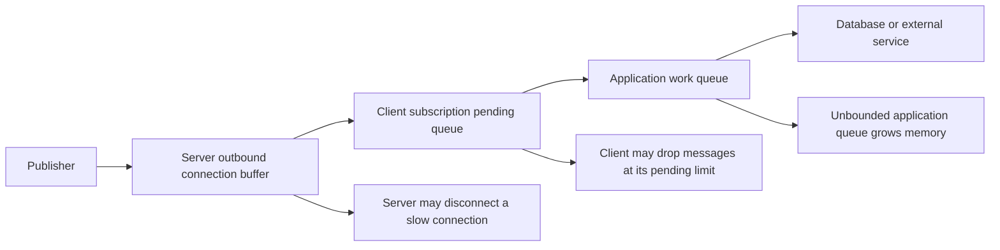

# Diagnose NATS Slow Consumers and Add Bounded Backpressure

Author: [nawazdhandala](https://www.github.com/nawazdhandala)

Tags: NATS, Messaging, Go, Troubleshooting

Description: Separate client-side drops from server slow-consumer disconnects, inspect the right queues, and bound delivery before overload becomes message loss.

A NATS subscriber can lose messages while its connection remains healthy. It can also disconnect because the server cannot send data to it quickly enough. Both situations are called slow-consumer problems, but they occur in different queues.

Before increasing a buffer, identify which queue is filling and what happens when it fills. A larger buffer buys time during a short burst. It does not repair a service that permanently processes fewer messages than it receives.

This walkthrough uses nats.go 1.42.0 and NATS Server 2.11.4. The local checks described below used a disposable server; they did not interrupt production connections or simulate a network outage.

## Locate the backlog

There are at least three places where work can accumulate:



The server sees a network connection. The client sees subscriptions. Your application sees business work. An apparently low server backlog therefore does not establish that a database writer is keeping up.

| Evidence | Likely boundary | First investigation |
| --- | --- | --- |
| Client slow-consumer callback and rising dropped count | Subscription queue | Callback duration, pending limits, blocking work |
| Server slow-consumer log and disconnect | Server-to-client connection | Client reading, network health, connection output backlog |
| Stable NATS queues but growing process memory | Application handoff | Unbounded channels, task lists, goroutines |
| JetStream unacknowledged count reaches its configured cap | Consumer delivery limit | Processing completion, acknowledgments, retry delays |

The official [slow-consumer operations guide](https://github.com/nats-io/nats.docs/blob/master/running-a-nats-service/nats_admin/slow_consumers.md) describes the separate client and server cases. It is archived documentation; use the pinned client implementation for version-specific defaults and API behavior.

## Make client drops visible

For a Go service, register an asynchronous error handler when connecting. Keep this handler short: it should report a problem, not perform a slow recovery operation.

```go
func reportAsyncError(_ *nats.Conn, sub *nats.Subscription, err error) {
    if sub == nil || !errors.Is(err, nats.ErrSlowConsumer) {
        log.Printf("NATS asynchronous error: %v", err)
        return
    }
    messages, bytes, pendingErr := sub.Pending()
    dropped, droppedErr := sub.Dropped()
    log.Printf("slow subscription=%s pending_messages=%d pending_bytes=%d dropped=%d inspection_errors=%v/%v",
        sub.Subject, messages, bytes, dropped, pendingErr, droppedErr)
}
```

This function requires imports `errors`, `log`, and `github.com/nats-io/nats.go`. Pass `nats.ErrorHandler(reportAsyncError)` to `nats.Connect`, alongside your connection name, credentials, and TLS options. The inspected values are snapshots: the queues can change between calls.

`Dropped()` reports known drops caused by the local subscription's pending limits. It is not an end-to-end loss counter, and it cannot reliably count messages lost when the server disconnects the connection. These semantics are defined in the [nats.go 1.42.0 implementation](https://github.com/nats-io/nats.go/blob/v1.42.0/nats.go).

Set an explicit limit for the subscription after creation, before allowing the lab publisher to start:

```go
if err := sub.SetPendingLimits(1024, 4*1024*1024); err != nil {
    return err
}
```

Here `sub` is a normal synchronous or asynchronous subscription, and the surrounding function returns an error. The limits cap queued message count and payload bytes; they are not a complete process-memory budget. This API does not apply to channel subscriptions. Reaching a limit is not a request for publishers to slow down: local messages can be discarded.

In production, export pending count, pending bytes, known drops, processing duration, and application queue depth as time series. A callback is useful evidence that a threshold has already been crossed. Trending queue growth provides the earlier warning.

## Inspect the server independently

Use an already secured monitoring connection or an approved local tunnel. Do not expose the monitoring port publicly to run these checks. The example assumes a local monitoring endpoint on port `18230`:

```bash
curl --fail --silent --show-error 'http://127.0.0.1:18230/varz'
curl --fail --silent --show-error \
  'http://127.0.0.1:18230/connz?sort=pending&limit=20'
```

In `/varz`, inspect `slow_consumers` over time, accounting for server restarts. In `/connz`, inspect `connections`, connection names, and `pending_bytes`. Sorting by pending bytes helps find connections currently backing up, but a snapshot can miss a short burst or a connection that has already closed. Correlate the connection identity with timestamped server logs.

The field names and query options are verified against the [NATS Server 2.11.4 monitoring handler](https://github.com/nats-io/nats-server/blob/v2.11.4/server/monitor.go). Gather the same evidence from each relevant server; one node's counters are not a cluster-wide total.

## Add backpressure at a boundary you control

Backpressure means reducing incoming work when capacity is unavailable. A bounded queue alone is not enough; decide what the upstream caller should do when that queue is full.

For disposable Core NATS updates, deliberate sampling or dropping may be acceptable if consumers can refresh the current state elsewhere. For required business work, use a durable intake path or an application protocol that makes acceptance and rejection explicit. Reconnecting does not replay missed Core NATS messages.

Avoid spawning a new goroutine for every callback just to make the callback return quickly. That shifts the backlog into application memory. Bound concurrency around the expensive database or API operation and measure that operation's latency.

JetStream pull consumers let the application ask for work when it has capacity. For a small lab, this configuration limits a consumer to two unacknowledged messages and two messages per fetch:

```go
consumer, err := js.CreateConsumer(ctx, "BOUNDED",
    jetstream.ConsumerConfig{
        Durable:         "bounded",
        AckPolicy:       jetstream.AckExplicitPolicy,
        AckWait:         30 * time.Second,
        MaxAckPending:   2,
        MaxRequestBatch: 2,
    })
if err != nil {
    return err
}
```

This fragment needs a connected `jetstream.JetStream` named `js`, a context, the `time` and `jetstream` imports, and an existing disposable `BOUNDED` stream. Use the returned `consumer` for bounded fetches. Finish processing and acknowledge successful work before requesting another batch. Inspect both the fetch call's error and the batch's final error.

`MaxAckPending` applies across the consumer, including multiple workers sharing it. It limits delivery, not publication into the stream. Stream retention and capacity still need their own plan. The [pull-consumer guide](https://docs.nats.io/learn/jetstream/pull-consumers) explains the fetch and continuous-consumption models; choose one whose buffering you can account for.

## Verify the fix with controlled overload

My local test deliberately left a Core subscription unread with a two-message limit, then published twenty one-byte messages. Two remained queued, eighteen were counted as dropped, and the error handler ran. The connection stayed open and the server's `slow_consumers` count stayed zero. This demonstrates why client and server evidence must be collected separately.

A second test published three JetStream records with `MaxAckPending=2`. After fetching two without acknowledging, another bounded fetch delivered nothing. Acknowledging one record allowed the third to arrive. The remaining acknowledgments completed normally.

These are functional checks, not a throughput benchmark or a server-disconnection test. For a representative staging workload, repeat a finite burst, then reduce arrivals and confirm the backlog drains. Also test a sustained overload and verify the chosen rejection, retention, or recovery behavior. Success means bounded resource use and understood message outcomes, not simply fewer slow-consumer log lines.
