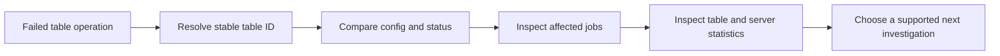

# Diagnose Unavailable RethinkDB Shards with System Tables

Author: [nawazdhandala](https://www.github.com/nawazdhandala)

Tags: RethinkDB, Troubleshooting, Observability

Description: Build a read-only RethinkDB incident trail from intended placement, current replica state, background jobs, and per-table server statistics.

A write fails because a shard is unavailable. One dashboard shows that all servers exist, another shows disk activity, and a third shows a backfill job. None of those observations alone explains whether the table can accept writes or what is preventing recovery.

Start with a specific table and collect four kinds of evidence: intended replica placement, current replica state, relevant background work, and measurements from the affected servers. Keeping those questions separate prevents an expensive operation from being mistaken for the cause of every outage.

This guide uses read-only Python examples with `rethinkdb==2.4.10.post1`. Query construction and Python syntax were checked locally. No live cluster was queried or repaired, and the diagnostic examples below are not captured incident output.

## Establish the scope and preserve identifiers

Record the failing database and table, operation type, error text, application endpoint, and time window. A failed read, a failed write, and a delayed query may point to different conditions. Do not start by changing replica counts or restarting all nodes.

Use an authorized administrative connection named `conn`, with your normal authentication and TLS settings. The system `jobs` and `stats` references describe administrative access; do not grant broad application privileges just to run an incident investigation. Results can contain internal topology and workload details, so keep the output in the incident's approved evidence store.

RethinkDB's [system-table documentation](https://rethinkdb.com/docs/system-tables/) explains that references can be returned as names or UUIDs. A UUID is a stable object identifier. Use UUIDs when correlating table and server records so renames do not break the investigation.

```python
from rethinkdb import RethinkDB

r = RethinkDB()
identity = r.db("app").table("events").config().run(conn)
table_id = identity["id"]
system = r.db("rethinkdb")
config = system.table("table_config", identifier_format="uuid").get(
    table_id
).run(conn)
status = system.table("table_status", identifier_format="uuid").get(
    table_id
).run(conn)
print({"table_id": table_id, "config": config, "status": status})
```

Replace `app.events` with the exact affected table. The first query resolves its identity; the following queries request the same table's intended and observed state. A missing result is evidence to investigate, not a healthy empty configuration. Check whether the table was renamed, dropped, or recreated during the incident.

These reads are separate observations, not one atomic snapshot. Record collection times and repeat when topology is changing. Avoid merging records gathered minutes apart into a supposedly simultaneous view.

## Compare intended placement with current readiness

`table_config` answers where replicas are intended to live. `table_status` answers what the system currently observes. The configured primary is not necessarily the current serving primary during failover. The [status reference](https://rethinkdb.com/api/python/status/) describes current primary replicas and replica states.



Read the table-level readiness flags first. If writes are unavailable, inspect every shard rather than averaging the healthy ones. One unavailable shard can explain why some keys fail while other requests succeed.

| Observed state | Useful next question |
|---|---|
| `disconnected` | Can the relevant server reach its peers and storage? |
| `waiting_for_primary` | Is a serving primary available for this shard? |
| `waiting_for_quorum` | Are enough configured voting replicas available? |
| `backfilling` | Is data transfer progressing, and what resources constrain it? |
| `transitioning` | Does this clear on the next observation or remain stuck? |

A configured replica list can include non-voters. Count voting membership when evaluating quorum, the majority needed for safe progress. RethinkDB's [failover guide](https://rethinkdb.com/docs/failover/) describes that requirement. Also note that status can include replicas retained temporarily during a transition; do not treat every observed storage copy as a configured voter.

## Inspect jobs without cancelling them

The [`jobs` table](https://rethinkdb.com/docs/system-jobs/) includes backfill and index-construction work. Query those job types without modifying the table:

```python
jobs = system.table("jobs").filter(
    lambda job: r.expr(["backfill", "index_construction"]).contains(job["type"])
).run(conn)
try:
    for job in jobs:
        print(job)
finally:
    jobs.close()
```

Review each job's `info` for its table and database, then correlate the affected entries with your investigation. This query intentionally leaves job-specific metadata visible instead of assuming every job type has identical fields. Capture progress and duration where present, then compare a later observation.

A backfill transfers data to bring a replica up to date. Progress moving from one sample to the next supports the conclusion that work continues; a single percentage does not predict completion time. An index-construction job can explain resource use without explaining a missing voting majority.

An absent job is not proof that no recovery is needed. Jobs can finish between queries, and incomplete visibility can hide relevant work. Likewise, disk compaction is ordinary background activity, so its presence alone is not evidence of a stuck shard.

Do not delete job rows as a diagnostic shortcut. The jobs documentation explains that deleting a query job can terminate it. This guide collects evidence and does not issue cancellation or repair operations.

## Read statistics at the affected replica level

A cluster-wide rate can hide one struggling table/server pair. The [`stats` reference](https://rethinkdb.com/docs/system-stats/) defines compound lookup keys: a table record uses `["table", table_id]`, while a replica-level record uses `["table_server", table_id, server_id]`.

Select a server UUID from the UUID-formatted configuration or status above. Then inspect the specific pair:

```python
server_id = "REPLACE_WITH_AFFECTED_SERVER_UUID"
row = system.table("stats").get(
    ["table_server", table_id, server_id]
).run(conn)
if row is None:
    print("No statistics row returned for this table/server pair")
elif "error" in row:
    print({"statistics_unavailable": row["error"]})
else:
    print(row)
```

Replace the placeholder with an actual server identifier, not its display name. Distinguish a missing record, an error record, and a valid record whose rate happens to be zero. The statistics documentation explicitly shows an error response when retrieval times out; interpreting that as zero activity would hide the failure.

For an available row, compare query rates, disk read/write rates, and cache use across repeated samples and peer replicas. Rates describe current activity, while cumulative totals need elapsed-time differences and care around server restarts. A high disk rate does not by itself establish storage saturation; correlate it with host-level latency, free space, errors, and the background job evidence.

The same server's connectivity view is available through a read-only lookup:

```python
print(system.table("server_status", identifier_format="uuid").get(
    server_id
).run(conn))
```

`server_status` describes the perspective available through the connected node. During a partition, compare observations from approved endpoints rather than assuming one view describes every side of the network.

## Turn observations into a bounded next step

A useful incident note names the affected table and shard, intended voters, current missing or blocked replicas, job progress over a stated interval, and whether statistics were available. Keep observations separate from conclusions. “Backfill progress did not change in two samples” is stronger evidence than “backfill is broken,” but still needs an interval and surrounding resource measurements.

If quorum is missing, investigate the absent voters and connectivity. If backfill progresses but slowly, investigate transfer and storage constraints. If status is healthy while only one application fails, return to the application's endpoint, permissions, and query behavior. A readiness check such as [`wait`](https://rethinkdb.com/api/python/wait/) can confirm a recovery condition, but it does not repair the cause.

Local checks constructed all the diagnostic queries and distinguished missing, errored, and valid zero-rate sample statistics. No server state, timing, or resource bottleneck was verified. The goal in deployment is an evidence trail that supports a specific recovery action, without destroying the information needed to choose that action safely.
