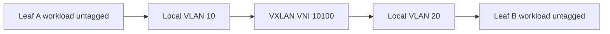

# Diagnose a VLAN-to-VNI Mismatch in a VXLAN Network

Author: [nawazdhandala](https://www.github.com/nawazdhandala)

Tags: VXLAN, Linux, Troubleshooting

Description: Trace access-port VLAN classification into the VXLAN VNI, distinguish local VLAN numbers from overlay identity, and verify the mapping at both endpoints.

The tunnel endpoints can reach each other, other tenants work, and the failing workload still cannot reach its peer. Before changing routing or increasing the MTU, check whether that workload enters the intended overlay segment at all.

A VLAN-to-VNI mismatch is a classification problem. The underlay may deliver every packet correctly while the source places traffic in the wrong segment or the destination delivers it to the wrong local VLAN. More underlay probes will not reveal that mapping by themselves.

This guide uses Linux inspection commands checked against **iproute2 6.12.0**. Its main example is a VLAN-aware bridge with a separate traditional VXLAN device for each VNI. It also identifies where a single VXLAN device carrying multiple VNIs needs a different mapping view. Commands are read-only; no live Linux fabric was tested here.

## Write the intended mapping before reading the current one

A VLAN identifies a local Ethernet broadcast domain. A VNI, or VXLAN network identifier, identifies the overlay segment carried between VTEPs, the VXLAN tunnel endpoints.

For a simple globally assigned VNI design, two leaves can attach different local VLAN numbers to the same VNI. The important relationship is that both local attachment domains represent the intended tenant segment. Do not assume that a local VLAN number must equal the VNI or the VLAN number on every other leaf. EVPN distinguishes local service organization from overlay identifiers. [EVPN overlay service models](https://www.rfc-editor.org/rfc/rfc8365.html).

For example:

| Location | Workload-facing traffic | Local VLAN | Overlay VNI |
| --- | --- | ---: | ---: |
| Leaf A | Untagged on `access0` | 10 | 10100 |
| Leaf B | Untagged on `access0` | 20 | 10100 |

This is an intended example, not discovered output. Some managed fabrics impose additional consistency rules; follow that fabric's supported design. The table does not authorize arbitrary translation in an environment that forbids it.



Now add the actual observed values beside the intended ones. A comparison is more useful than a list of interface names that happen to contain familiar numbers.

## Confirm which bridge model is deployed

On each Linux endpoint, replace the example names and inspect:

```bash
ip -d link show dev br0
bridge link show master br0
ip -d link show dev vxlan10100
```

Record whether the bridge has VLAN filtering enabled, which ports belong to it, and the VXLAN device's actual ID. An interface named `vxlan10100` can be configured with a different ID; the name is not the mapping.

With VLAN filtering disabled, Linux does not use the VLAN tag in the same filtering decision. A traditional per-segment bridge and a VLAN-aware bridge therefore need different interpretation. [Linux bridge VLAN filtering](https://docs.kernel.org/networking/bridge.html).

FRR's traditional interface example uses one bridge and one VXLAN device per broadcast domain. Do not combine that model's assumptions with commands intended for a VLAN-aware shared bridge. [FRR 10.2.1 interface models](https://raw.githubusercontent.com/FRRouting/frr/frr-10.2.1/doc/user/evpn.rst).

If the VXLAN device uses external metadata and carries multiple VNIs, its name and one displayed ID are insufficient. Use its per-VLAN tunnel mapping. For example, **Cumulus Linux 5.10** documents this read-only overview:

```bash
nv show bridge vlan-vni-map
```

This is an NVUE command for that platform, not a generic Linux command. It reports the bridge/VLAN/VNI relationships that must be compared with the access-port configuration. [Cumulus 5.10 mapping inspection](https://docs.nvidia.com/networking-ethernet-software/cumulus-linux-510/Network-Virtualization/Ethernet-Virtual-Private-Network-EVPN/Troubleshooting-EVPN/).

## Check the workload's ingress classification

For the VLAN-aware, per-VNI device example, inspect Leaf A:

```bash
bridge vlan show dev access0
bridge vlan show dev vxlan10100
```

PVID means port VLAN identifier. It assigns untagged incoming frames to a VLAN. The `untagged` property controls whether frames leave the port without a VLAN tag. These are separate directions of behavior. [Pinned bridge VLAN flag definitions](https://raw.githubusercontent.com/iproute2/iproute2/v6.12.0/man/man8/bridge.8).

For the example, an untagged workload entering `access0` must be classified into VLAN 10 on Leaf A. The VXLAN port's bridge-side membership must connect that VLAN to the device carrying VNI 10100. On Leaf B, perform the same comparison using its intended local VLAN 20.

Do not merely check that VLAN 10 appears somewhere in a listing. It might be allowed on a trunk while untagged frames still enter a different PVID. Conversely, a workload that sends tagged VLAN 10 frames needs an attachment that admits that tag; treating it as an untagged access host is a different configuration.

Check the workload or hypervisor side too. A guest VLAN subinterface, a virtual-switch port group, and a host bridge can each add or remove a tag. Record where the tag is expected to exist rather than guessing from the guest's IP subnet.

## Compare learned MAC placement with the intended segment

Send one controlled staging request from the workload, then inspect the forwarding database, or FDB:

```bash
bridge fdb show br br0 vlan 10
bridge fdb show dev vxlan10100
```

Use VLAN 20 on Leaf B in this example. Look for the known workload source MAC on its expected access port and local VLAN. Inspect the remote MAC and tunnel destination separately. A MAC learned under an unexpected local VLAN is strong evidence to investigate ingress classification before changing remote routing. [Bridge FDB filtering](https://raw.githubusercontent.com/iproute2/iproute2/v6.12.0/man/man8/bridge.8).

Absence is less conclusive. A silent host, blocked port, learning policy, or hardware offload can affect what is visible. Preserve the current state and correlate it with a controlled packet; do not flush every MAC table to manufacture a clean-looking result.

For EVPN-managed endpoints, compare the advertised segment identity as well. Correct route exchange for VNI 10200 does not help a workload intended for VNI 10100. A healthy BGP session can transport the wrong tenant information perfectly well.

## Observe the transformation at the tunnel boundary

Use approved captures on the workload-facing link and the underlay. Identify one packet by its workload MACs and protocol identifiers. At ingress, determine whether it arrives tagged or untagged. In the encapsulated packet, read the VXLAN VNI.

Do not infer the VNI from the outer Ethernet VLAN tag. That outer tag can belong to the physical transport network and is independent of the tenant segment carried inside VXLAN. The VXLAN header is where the overlay identifier is encoded. [VXLAN packet layout](https://www.rfc-editor.org/rfc/rfc7348.html).

If the packet leaves Leaf A with VNI 10200 instead of 10100, the wrong segment was selected before the underlay transported it. If it arrives at Leaf B with VNI 10100 but exits toward an unintended local VLAN, investigate the receiving mapping. These observations locate the fault more precisely than another successful endpoint ping.

Host capture offloads can affect visible tags and packet representation. Corroborate ambiguous observations at another appropriate capture point rather than treating one display as definitive wire evidence. [Linux tunnel offload considerations](https://docs.kernel.org/networking/vxlan.html).

## Repair the smallest incorrect relationship

Have the configuration owner correct the demonstrated access classification or VLAN-to-VNI association. Preserve the intended tenant separation. Disabling VLAN filtering or admitting every VLAN can make a test pass while creating a much larger isolation failure.

Before resuming normal traffic, verify the mapping in both directions, the expected local MAC placement, the VNI on the observed packet, and application delivery. Check another tenant as a negative control: the correction must not expose its traffic to this workload.

Store the intended-versus-observed mapping table with the before-and-after evidence. Local validation for this article covered command documentation, shell syntax, and diagram structure. It did not execute Linux bridge commands, NVUE, or a live packet-forwarding test.
