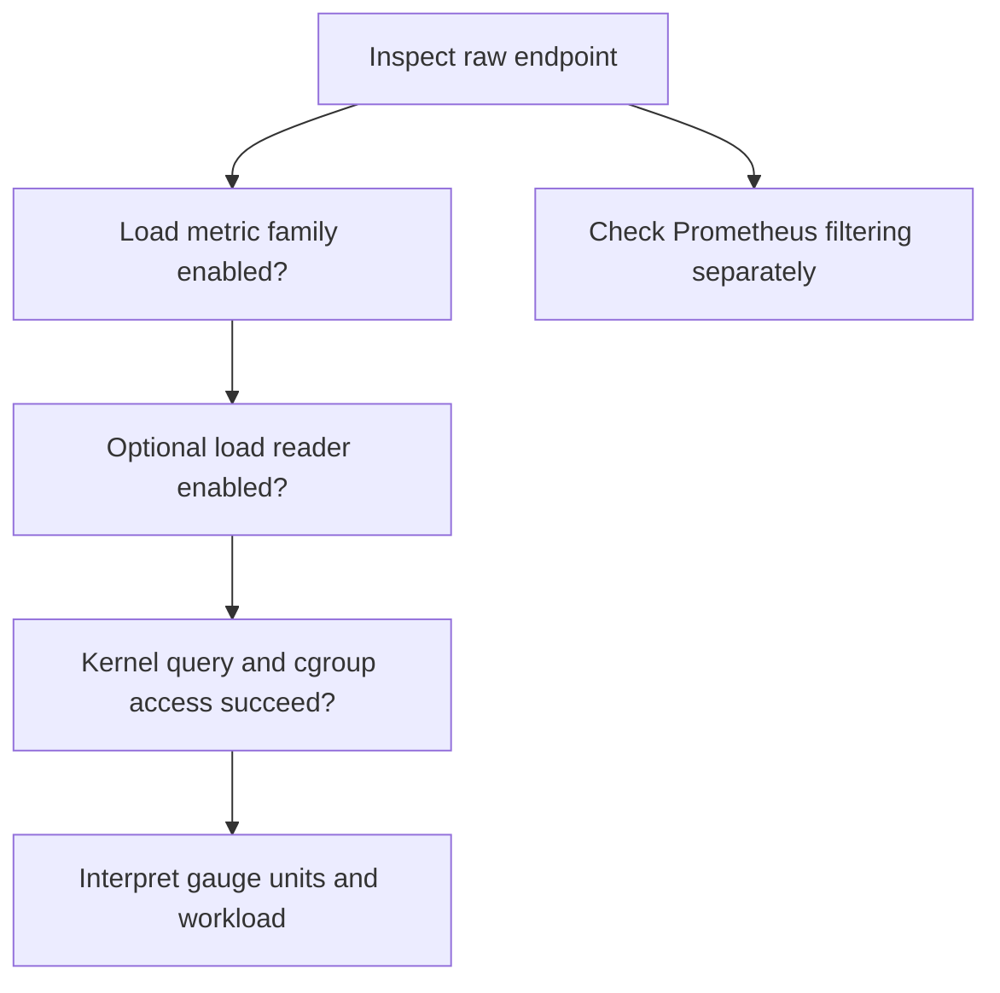

# Diagnose Zero CPU Load Average Values in cAdvisor

Author: [nawazdhandala](https://www.github.com/nawazdhandala)

Tags: Docker, Linux, Prometheus, Monitoring, Troubleshooting

Description: Trace zero cAdvisor CPU load readings through metric selection, the optional load reader, kernel access, and query units before trusting the result.

A container is clearly consuming CPU, but `container_cpu_load_average_10s` stays at zero. That does not immediately mean the CPU usage metric is wrong. CPU usage and this load gauge come from different collection paths, and the load reader is optional.

The first task is to distinguish a measured zero from an unpopulated field. A dashboard cannot make that distinction just by coloring the number green. Inspect the exporter configuration and collection errors before interpreting zero as healthy capacity.

This guide follows cAdvisor 0.55.1 source and uses Prometheus 3.7.3 for query checks. Recheck the implementation for a different release, especially when cAdvisor is embedded inside kubelet rather than running as a separate service.

## Understand the metric before repairing it

CPU usage measures accumulated execution time. Its rate can tell you that a container used the equivalent of 1.5 CPUs. Load describes a different observation: runnable tasks, smoothed over time in this implementation. These values are not expected to be numerically equal.

The cAdvisor 0.55.1 manager feeds `NrRunning` into a smoothing calculation and stores the result multiplied by 1,000. The [Prometheus exporter](https://github.com/google/cadvisor/blob/v0.55.1/metrics/prometheus.go) emits that stored field directly as a gauge. For this version, 1,000 represents a smoothed runnable-task value of approximately one, not 1,000 percent CPU.

A separate `container_cpu_load_d_average_10s` field concerns uninterruptible tasks. Do not substitute the runnable-task gauge for the host's familiar load-average display without checking the accounting definition. Also avoid `rate()` on this gauge: it is not a cumulative CPU-time counter.

## Follow the two collection gates

There are two independent questions: is the metric family exported, and is its underlying reader running?



In cAdvisor 0.55.1, the metric family belongs to `cpuLoad`. The manager flag `enable_load_reader` defaults to false. When enabled, it attempts to construct a reader and logs an initialization warning if that fails. During collection it requests the container's CPU cgroup path and obtains load statistics. These details are visible in the [versioned manager source](https://github.com/google/cadvisor/blob/v0.55.1/manager/container.go).

A present gauge is therefore not proof that its input was collected. Conversely, a missing gauge may be a metric-selection or ingestion problem rather than a measured zero.

## Check the running configuration

For a Docker-managed cAdvisor instance, inspect its startup arguments and recent logs. Replace `cadvisor` with the actual container name and use the Docker context for the relevant host:

```bash
docker container inspect cadvisor --format '{{json .Config.Cmd}}'
docker container logs --since 10m --tail 200 cadvisor
```

These commands are read-only. The [inspect](https://docs.docker.com/reference/cli/docker/container/inspect/) and [logs](https://docs.docker.com/reference/cli/docker/container/logs/) references document their options. Inspect the deployment's entrypoint or wrapper too if the command alone does not show the effective arguments.

Look for an explicit reader setting and for metric include/exclude settings affecting `cpuLoad`. Preserve other configured metric groups when changing selection. The [cAdvisor command source](https://github.com/google/cadvisor/blob/v0.55.1/cmd/cadvisor.go) defines the metric-selection flags; copying a minimal include list can unintentionally remove unrelated monitoring.

If the reader is disabled, this is the relevant additional argument for a controlled standalone deployment:

```text
--enable_load_reader=true
```

This is not a complete installation command or a guarantee of platform support. Apply it first in a representative staging environment through your normal deployment configuration. A flag on a standalone cAdvisor container does not reconfigure kubelet's embedded collector.

## Diagnose reader failures from evidence

The [reader factory](https://github.com/google/cadvisor/blob/v0.55.1/utils/cpuload/cpuload.go) selects a netlink-based reader. Netlink is a Linux communication interface used here to request kernel statistics. The [reader implementation](https://github.com/google/cadvisor/blob/v0.55.1/utils/cpuload/netlink/reader.go) opens the supplied cgroup directory, and the [protocol implementation](https://github.com/google/cadvisor/blob/v0.55.1/utils/cpuload/netlink/netlink.go) uses the taskstats family and a cgroup-statistics request.

Use the error stage to narrow the investigation:

| Evidence | Next investigation |
|---|---|
| Reader initialization warning | Kernel interface availability and execution environment |
| Failure opening a cgroup path | The actual path, mount visibility, and access restrictions |
| Failure retrieving load statistics | Kernel response and compatibility with the deployed cgroup setup |
| No warning, but only some containers are affected | Per-container discovery and cgroup-path resolution |
| Raw endpoint changes but dashboard stays zero | Scrape, relabeling, query, and display configuration |

Do not infer that all cgroup v2 systems work, or that none work, from one failure. Capture the kernel version, cgroup setup, cAdvisor version, effective arguments, and complete error before choosing a repair. Likewise, do not enable blanket privileges as the first response to a zero graph. Match any access change to a demonstrated failure and review its impact.

If this reader is unavailable in your supported environment, label the signal as unavailable and use other validated CPU signals. A permanently zero panel is a poor substitute for an explicit coverage limitation.

## Compare a known container without mixing units

Choose one verified container identity. Replace the placeholders in this query with observed labels:

```promql
container_cpu_load_average_10s{
  job="JOB", instance="INSTANCE", id="CGROUP_ID"
} / 1000
```

For the reviewed version, this converts the exported scale into smoothed runnable-task units. Keep the raw value alongside it while validating. Do not apply this conversion blindly to a future version or an intermediary that already rescales the metric.

Compare it with CPU execution rate:

```promql
sum by (job, instance, id) (
  rate(container_cpu_usage_seconds_total{
    job="JOB", instance="INSTANCE", id="CGROUP_ID"
  }[5m])
)
```

This second result is CPU cores used on average, not load. The [Prometheus rate documentation](https://prometheus.io/docs/prometheus/latest/querying/functions/#rate) describes counter-reset handling. Confirm that the selected series is not duplicated through multiple scrape paths.

A controlled staging check should include an idle period and an approved workload change, with enough observation time for smoothing and collection. Watch logs as well as numbers. Local synthetic tests for this article verify scaling, missing-series behavior, and a CPU counter rate; they do not exercise the Linux load reader itself.

Only promote the panel after you can explain both its collection path and units. If zeros persist, preserve that uncertainty in the panel description instead of presenting an unsupported conclusion that the container has no CPU pressure.
