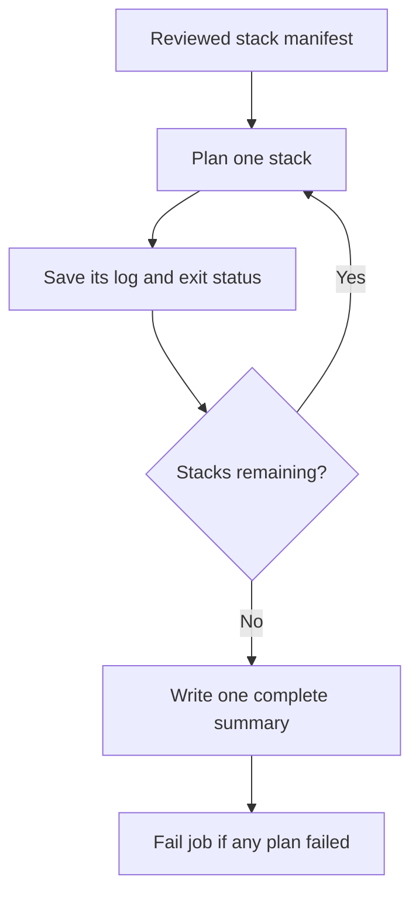

# Plan Every CDKTF Stack and Produce One CI Summary

Author: [nawazdhandala](https://www.github.com/nawazdhandala)

Tags: CDKTF, Terraform, CI/CD, Python

Description: Plan each synthesized CDKTF stack sequentially, preserve per-stack logs, distinguish changes from errors, and publish one complete CI summary.

A multi-stack CDKTF application needs more than the last command's exit status. One stack may have no changes, another may propose updates, and a third may fail because a required input is missing. If the script exits at the first nonzero status, reviewers never see the remaining results.

Use an explicit stack inventory, run each plan, and summarize every attempted stack. Preserve a separate log for each result so the short report remains readable without hiding diagnostics. Most importantly, distinguish Terraform's “changes present” status from an execution error.

This example targets CDKTF `0.21.0` and Terraform `1.11.4`. CDKTF is deprecated, so treat it as maintenance of an existing toolchain. [Official CDKTF status](https://developer.hashicorp.com/terraform/cdktf).

## Choose the planning interface deliberately

In CDKTF `0.21.0`, `diff` accepts one optional stack argument and performs a Terraform plan for that stack. Do not assume a wildcard accepted by another command has identical semantics here. The exact command declaration is `diff [stack]`. [Tagged diff implementation](https://github.com/hashicorp/terraform-cdk/blob/v0.21.0/packages/cdktf-cli/src/bin/cmds/diff.ts).

For a machine-readable success/change/error summary, this article invokes Terraform directly in each synthesized stack directory. That gives access to `-detailed-exitcode`:

| Terraform result | Meaning | Summary category |
| --- | --- | --- |
| `0` | Plan succeeded with no changes | NO CHANGES |
| `2` | Plan succeeded with changes | CHANGES |
| `1` or another unexpected status | Error or interrupted execution | FAILED |

These meanings apply when the detailed-exit-code flag is present. A nonzero result is not automatically a failed plan. [Terraform plan options](https://developer.hashicorp.com/terraform/cli/commands/plan).

## Prepare every stack before collecting results

Synthesize the reviewed application once. In CDKTF `0.21.0`, `cdktf.out/manifest.json` records stack names and their `workingDirectory` values. Read that manifest rather than parsing the display columns from `cdktf list`. The schema is an implementation detail pinned here to the reviewed release. [CDKTF manifest source](https://github.com/hashicorp/terraform-cdk/blob/v0.21.0/packages/cdktf/lib/manifest.ts).

Before running the script, initialize each selected stack through its approved backend process, restore provider locks, select the intended workspace, and supply required inputs. The script intentionally does not choose backend credentials or migrate state. A missing initialization will appear as a failed plan, not a reason to guess settings.

This example plans every stack in the manifest under one runner environment. Use it only when that runner is authorized for all those stacks. If environments require different credentials or variable values, arrange the approved per-stack execution context before adapting the loop. A shared `TF_VAR_*` environment is not a substitute for environment-specific configuration.



## Use a collector that does not stop at the first error

Save this as `plan-all-stacks.py`. It requires Python 3.9 or later and the pinned Terraform executable on `PATH`. The output report directory must not already exist, which avoids mixing logs from different runs.

```python
import json
import os
from pathlib import Path
import shutil
import subprocess
import sys

root = Path(sys.argv[1]).resolve()
manifest = json.loads((root / "manifest.json").read_text())
if manifest.get("version") != "0.21.0" or not manifest.get("stacks"):
    raise SystemExit("Expected a nonempty CDKTF 0.21.0 manifest")
terraform = shutil.which("terraform")
if not terraform:
    raise SystemExit("terraform is not on PATH")
report = Path(sys.argv[2]).resolve()
report.mkdir(parents=True, exist_ok=False)
env = dict(os.environ, TF_IN_AUTOMATION="1")
rows = []
for index, (name, stack) in enumerate(sorted(manifest["stacks"].items()), 1):
    logfile = report / f"{index:03d}.log"
    status, code = "FAILED", None
    with logfile.open("w") as log:
        try:
            workdir = (root / stack["workingDirectory"]).resolve()
            if root not in workdir.parents or not workdir.is_dir():
                raise ValueError("Stack directory is missing or outside output root")
            result = subprocess.run(
                [terraform, "plan", "-input=false", "-no-color",
                 "-detailed-exitcode", "-lock-timeout=30s"],
                cwd=workdir, env=env, stdout=log, stderr=subprocess.STDOUT,
            )
            code = result.returncode
            status = {0: "NO CHANGES", 2: "CHANGES"}.get(code, "FAILED")
        except (OSError, ValueError, KeyError) as error:
            log.write(f"Planning could not run: {error}\n")
    rows.append({"stack": name, "status": status, "exitCode": code,
                 "log": logfile.name})
(report / "results.json").write_text(json.dumps(rows, indent=2) + "\n")
lines = ["| Stack | Result | Log |", "| --- | --- | --- |"]
for row in rows:
    label = row["stack"].replace("|", "\\|").replace("\n", " ")
    lines.append(f"| {label} | {row['status']} | {row['log']} |")
(report / "summary.md").write_text("\n".join(lines) + "\n")
print("\n".join(lines))
raise SystemExit(1 if any(row["status"] == "FAILED" for row in rows) else 0)
```

The subprocess call passes arguments directly without constructing a shell command. Standard output and errors go into the same stack log, and the return code is handled explicitly. Python documents these controls in [`subprocess.run`](https://docs.python.org/3.13/library/subprocess.html).

`TF_IN_AUTOMATION` adjusts Terraform's output for an automated context; it does not grant permissions or disable locking. The script retains locking and waits up to 30 seconds for acquisition. `-input=false` makes missing inputs fail instead of waiting for an interactive answer. [Terraform automation environment setting](https://developer.hashicorp.com/terraform/cli/config/environment-variables#tf_in_automation).

Run the collector from the project directory:

```bash
python3 plan-all-stacks.py cdktf.out plan-report
```

It writes a Markdown table, structured JSON results, and numbered log files. Numbered names avoid treating stack names as filesystem paths. The summary is written before the final error status, so a failed stack does not prevent creation of the report.

## Publish the report even when the job fails

Configure your CI system's report or artifact-upload step to run after either success or failure. Keep the collector's failing exit status intact; do not append an unconditional success command that hides the failure.

An error-free run containing proposed changes exits zero by this script's policy. That means planning succeeded, not that deployment was approved. Use the `CHANGES` rows to route the run into the appropriate review process. If your policy requires a separate status for proposed changes, derive it from `results.json` while keeping errors distinct.

The script produces speculative plans because it does not save a plan with `-out`. A later apply will need its own reviewed execution workflow. Do not describe this summary as approval to apply a retained binary plan: no such artifact was created.

## Interpret a complete report carefully

The local test used three resource-free stacks. One was unchanged, one required an input that was deliberately omitted, and one proposed a new output. The resulting table was:

| Stack | Result | Log |
| --- | --- | --- |
| a-unchanged | NO CHANGES | 001.log |
| b-error | FAILED | 002.log |
| c-changes | CHANGES | 003.log |

Terraform returned `0`, `1`, and `2` respectively, and the collector returned `1`. The third stack was still planned after the second failed. Supplying the missing input made the next complete run succeed while retaining the change classifications. No apply was run.

A failed stack remains unknown until its failure is resolved. Do not count it as unchanged. Similarly, a summary of exit codes does not distinguish creates, replacements, output-only changes, or moves. Review the corresponding logs. If richer counts are needed, build them from Terraform's structured plan representation rather than scraping human-readable sentences. [Terraform JSON format](https://developer.hashicorp.com/terraform/internals/json-format).

## Respect dependencies and execution limits

This loop sorts stack names for reproducible reporting; it does not orchestrate deployment dependencies. Planning an upstream stack does not publish new outputs for a downstream stack. A downstream remote-state read can fail or use the last applied output even when the upstream plan succeeds. Treat that as a dependency limitation, not something to solve by automatically applying during a diff job.

Run the collector on reviewed configuration. Terraform plans can access state and provider APIs, and logs may contain sensitive values. Retain logs under the same access controls as the planning job and avoid posting complete logs into broadly visible comments.

The loop is sequential to simplify diagnosis and limit concurrent access. It has a lock-acquisition timeout, not a total execution timeout. Use your runner's established cancellation handling for hung operations. If the process is forcibly terminated, it cannot promise a complete final report. A normal completed run, however, gives reviewers one accountable result for every stack it attempted.
