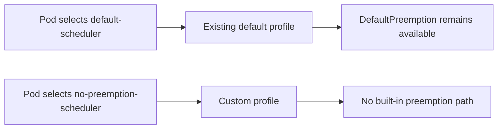

# Disable Preemption in One Kubernetes Scheduler Profile

Author: [nawazdhandala](https://www.github.com/nawazdhandala)

Tags: Kubernetes, Scheduling, Configuration

Description: Add a scheduler profile without DefaultPreemption, preserve the default profile, and verify routing and plugin behavior before moving workloads.

Some workloads should wait for capacity rather than remove other Pods. A non-preempting PriorityClass is often sufficient. When the requirement is tied to a dedicated scheduler profile, you can disable the built-in `DefaultPreemption` plugin for that profile while retaining it for ordinary scheduling.

The boundary matters: a profile controls how its incoming Pods are scheduled. It does not make those Pods immune to being selected as victims by another profile or scheduler. Disabling a plugin is not a cluster-wide deletion protection mechanism.

This example targets **Kubernetes kube-scheduler 1.34.0** with `kubescheduler.config.k8s.io/v1` configuration. It assumes an administrator can safely manage the scheduler's configuration. Managed control planes may not expose that capability.

## Decide whether a profile is necessary

If the only requirement is “this workload must not initiate preemption,” consider `preemptionPolicy: Never` on its approved PriorityClass first. A separate profile is useful when scheduling behavior is managed as a broader policy boundary or combined with other reviewed plugin choices.

Do not deploy a second scheduler process with the same scheduler names as an existing process merely to add this feature. Multiple profiles can run inside one scheduler process; separate processes require their own ownership and leader-election design.

The [scheduler configuration documentation](https://kubernetes.io/docs/reference/scheduling/config/#multiple-profiles) explains that each profile has a scheduler name. Pods select the profile through `spec.schedulerName`. Profiles in one process share a pending-Pod queue and must use compatible queue-sort configuration.

## Keep the default profile and add a narrow override

The following is the **profile portion of a scheduler configuration**, shown with its type metadata. Merge it into the existing administrator-managed configuration, preserving client access, leader election, scoring, and any other deployment-specific settings.

```yaml
apiVersion: kubescheduler.config.k8s.io/v1
kind: KubeSchedulerConfiguration
profiles:
  - schedulerName: default-scheduler
  - schedulerName: no-preemption-scheduler
    plugins:
      multiPoint:
        disabled:
          - name: DefaultPreemption
```

The first profile retains the standard defaults in this minimal example. If your existing `default-scheduler` profile already has custom settings, preserve them instead of replacing it with the empty entry shown here. The intended change belongs only to the added profile.

In the [1.34.0 default plugin configuration](https://github.com/kubernetes/kubernetes/blob/v1.34.0/pkg/scheduler/apis/config/v1/default_plugins.go), `DefaultPreemption` is enabled through `MultiPoint`. Disabling that named plugin there removes its default registration across supported extension points. This is more explicit than disabling every plugin at an extension point with `*`.

Review any existing explicit extension-point configuration as well. More specific plugin settings have precedence over multipoint settings, so do not merge a contradictory explicit enablement and assume the disable won. The [multipoint configuration reference](https://kubernetes.io/docs/reference/scheduling/config/#plugins-that-apply-to-multiple-extension-points) explains that precedence.



The second profile still needs its normal filters and binding behavior. A Pod that fits can schedule; a Pod that cannot fit should remain pending until conditions change rather than using this built-in preemption plugin.

## Route an explicit staging Pod

After the new profile is running and its configuration has been verified, a staging Pod can select it:

```yaml
apiVersion: v1
kind: Pod
metadata:
  name: no-preemption-profile-check
  namespace: scheduling-test
spec:
  schedulerName: no-preemption-scheduler
  restartPolicy: Never
  containers:
    - name: workload
      image: busybox:1.37.0
      command: ["sh", "-c", "sleep 3600"]
      resources:
        requests:
          cpu: "500m"
          memory: "128Mi"
        limits:
          cpu: "500m"
          memory: "128Mi"
```

This is a simple routing example using an existing staging namespace. It does not create a capacity shortage or establish a high-priority relationship. Use a separately reviewed PriorityClass when designing a preemption acceptance test.

If no scheduler handles `no-preemption-scheduler`, the Pod can remain pending without ever reaching your intended profile. Check the name exactly. A server-side dry run of the Pod validates its API request, not whether a live scheduler supports that name.

For a Deployment, put `schedulerName` inside its Pod template. That change creates replacement Pods through the normal rollout process; do not treat it as an in-place reroute of existing Pods.

## Validate configuration through the right mechanism

`KubeSchedulerConfiguration` is component configuration, not an ordinary cluster resource to install with `kubectl apply`. Supply it through the scheduler deployment's supported configuration path and rollout procedure. Keep a known-good copy and an administrator recovery path before changing the control plane.

A YAML parser only confirms syntax. Strict decoding against the matching version catches unknown fields, while the real scheduler also applies defaults, validates configuration relationships, loads plugins, and connects to the API server. Do not describe a parser check as a live scheduling test.

Review startup logs and the effective plugin configuration for both profiles in staging. Confirm that the custom profile omits the built-in preemption plugin and that the default profile retains its previous settings. Do not assume successful process startup alone proves the correct file was mounted or selected.

## Test both sides of the boundary

Use a controlled staging setup with known requests, node eligibility, and disposable workloads. First show that a fitting Pod using the custom profile is assigned. Then create a reviewed higher-priority test Pod that would require removing an existing lower-priority Pod to fit. It should stay pending under the custom profile, with no victim removal initiated through `DefaultPreemption`.

Run the corresponding default-profile test separately to confirm the ordinary behavior remains available. Do not mix two contention experiments and infer causality from whichever Pod disappears first.

Inspect the test objects and events:

```bash
kubectl --context staging -n scheduling-test get pods -o wide
kubectl --context staging -n scheduling-test describe pod no-preemption-profile-check
kubectl --context staging -n scheduling-test get events \
  --sort-by=.metadata.creationTimestamp
```

Check UIDs and scheduler names, not only Pod names. Retain scheduler logs for the relevant interval. Custom plugins or other removal mechanisms can still disrupt Pods, so an absence of this one plugin is not a universal availability guarantee.

The configuration was strictly decoded into Kubernetes 1.34.0 scheduler configuration types, the Pod example was schema-checked, and the default plugin source was reviewed. No live scheduler startup or contention experiment was run. Roll out only after both the custom waiting behavior and unchanged default-profile behavior have been demonstrated in your environment.
