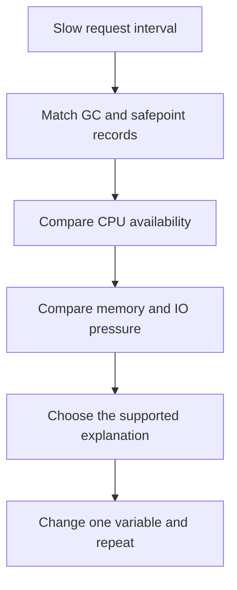

# Distinguish JVM GC Pauses from Safepoints, CPU and Swap Delays

Author: [nawazdhandala](https://www.github.com/nawazdhandala)

Tags: Java, Garbage Collection, Troubleshooting

Description: Separate GC work, safepoint coordination, CPU throttling and swapping with matching JVM and host evidence before changing collector settings.

A Java service stops responding briefly, and the incident is labeled “a GC pause.” That explanation may be correct, but it can also hide a non-GC JVM operation, delayed thread coordination, CPU throttling, or memory pages being fetched from swap.

Use separate evidence for each layer. This guide's JVM examples were tested on Azul Zulu OpenJDK 17.0.16+8. The Linux cgroup and swap inspection commands are source-reviewed examples; they were not executed against a Linux service during this review.

## Start with the interval, not the suspected cause

Choose one slow request or a narrow latency window and identify the exact JVM instance. Record wall time, process start identity, request duration, and any queue or downstream spans. A service-level graph aggregated across replicas can place one replica's collection beside another replica's slow request.

Then compare four questions:

| Question | Evidence to seek |
|---|---|
| Was the JVM performing a collection pause? | GC pause summary and collection identifier |
| Was a coordinated JVM operation delaying execution? | Safepoint operation and timing fields |
| Could runnable threads obtain CPU? | Process/host CPU pressure and cgroup throttling deltas |
| Was memory access waiting on reclaim or swap activity? | Memory pressure, swap activity and process context |

These explanations can overlap. CPU starvation can lengthen a genuine GC pause; swap activity can make collector memory access slower. The objective is to identify contributing mechanisms, not force every incident into one exclusive category.

## Log GC and safepoints together

For a bounded staging investigation, create a writable log directory and add this option to the service's existing startup command:

```bash
java '-Xlog:gc*,safepoint:file=logs/runtime.log:time,uptime,level,tags:filecount=5,filesize=10M' \
  -jar service.jar
```

Replace `service.jar`, preserve existing memory options, and retain logs with their instance identity. The [JDK 17 launcher documentation](https://docs.oracle.com/en/java/javase/17/docs/specs/man/java.html) defines unified logging and decorators.

A GC summary reports the collection's elapsed pause. A safepoint record reports coordinated stopping and the operation performed there. The same GC can appear in both, so do not add their durations together as two independent interruptions.

A local test produced this non-GC safepoint:

```text
Safepoint "PrintThreads", Time since last: 188912459 ns, Reaching safepoint: 3583 ns, Cleanup: 3417 ns, At safepoint: 142458 ns, Total: 149458 ns
```

The test had requested a thread dump from a sleeping lab JVM. Its log had no young-GC pause. That demonstrates a diagnostic operation reaching a safepoint without establishing any collection problem.

## Separate reaching the safepoint from work at it

In the example, `Reaching safepoint` describes the coordination interval, while `At safepoint` describes time after reaching that state. Cleanup is reported separately. The total is 149,458 nanoseconds, approximately 0.149 milliseconds. `Time since last` is the interval since the previous safepoint, not the duration of this pause.

The [pinned OpenJDK safepoint implementation](https://raw.githubusercontent.com/openjdk/jdk17u/jdk-17.0.16%2B8/src/hotspot/share/runtime/safepoint.cpp) supplies these fields. Their exact labels and precision are version-dependent, so read the format emitted by your JVM rather than assuming a parser for another release is equivalent.

When reaching time dominates, investigate why coordinated progress was delayed. When time at the safepoint dominates, inspect the named operation. Neither pattern alone tells you that the application needs a larger heap.

Thread dumps can help identify blocked threads, but collection itself can affect the process. With the matching JDK tools, appropriate permissions, and a verified single process ID, the diagnostic command is:

```bash
jcmd 12345 Thread.print
```

Replace `12345` with the target JVM PID; do not use `0`, which targets all available JVMs. Run as the appropriate service user in the correct process namespace. Oracle's [`jcmd` reference](https://docs.oracle.com/en/java/javase/17/docs/specs/man/jcmd.html) documents access requirements and command impact. The local test used this command once, not in a rapid polling loop.

## Check whether CPU limits stretched the interval

G1's CPU log reports user, system, and real elapsed time. Parallel worker CPU time can exceed wall time, so that difference is not automatically a fault. A long elapsed pause with relatively little CPU work is a reason to inspect scheduling and host conditions. Oracle's [G1 tuning guide](https://docs.oracle.com/en/java/javase/17/gctuning/garbage-first-garbage-collector-tuning.html) discusses these measurements.

On Linux with cgroup v2, locate the service's actual cgroup using the runtime or orchestrator. This example assumes its visible directory is `/sys/fs/cgroup/your-service`; replace that path before running:

```bash
cat /sys/fs/cgroup/your-service/cpu.max
cat /sys/fs/cgroup/your-service/cpu.stat
```

Read `cpu.stat` again after the incident interval and compare counters such as `nr_throttled` and `throttled_usec`. A cumulative value greater than zero only proves throttling happened sometime, not during the slow request. The [kernel cgroup v2 documentation](https://docs.kernel.org/admin-guide/cgroup-v2.html) defines these fields and the quota/period layout in `cpu.max`.

Check relevant ancestor limits too. A child can be affected by a parent budget. The shell's own cgroup is not necessarily the Java process's cgroup, especially from a debugging container.

## Distinguish occupied swap from active swapping

For the verified JVM PID on Linux, inspect its status:

```bash
cat /proc/12345/status
```

Look for `VmSwap`, but do not treat allocated swap as evidence of current disk activity. A process can have swapped-out pages without repeatedly reading them during the observed request. The [kernel proc documentation](https://docs.kernel.org/filesystems/proc.html) describes process status and system counters.

Compare system `pswpin` and `pswpout` counters from `/proc/vmstat` across the same interval, using the fields described in the [Linux proc_vmstat manual](https://man7.org/linux/man-pages/man5/proc_vmstat.5.html). These host-wide counters require attribution: activity elsewhere on the machine can change them. Likewise, major page faults can involve file-backed pages and are not a synonym for swap reads.

Pressure Stall Information, or PSI, reports time tasks spend stalled by resource pressure. Where available, inspect `/proc/pressure/cpu`, `/proc/pressure/memory`, and `/proc/pressure/io` and the relevant cgroup pressure files. The [kernel PSI guide](https://docs.kernel.org/accounting/psi.html) explains these signals. Use them with the process timeline, not as a standalone verdict that Java is swapping.

## Follow the evidence to the next experiment



If a long collection does substantial CPU work with healthy scheduling, examine collector phases and allocation behavior. If the JVM is throttled, test an appropriate CPU allocation before changing GC flags. If memory pressure dominates, investigate the total process and host budget; heap expansion may worsen it.

The local review recorded real `PrintThreads`, `PrintJNI`, and `FindDeadlocks` safepoints from one diagnostic thread dump, without a young-GC event. It validated the logging syntax and showed why diagnostic pauses should not be mislabeled as GC. It did not induce CPU starvation, Linux cgroup throttling, or swapping. Keep those limits explicit when applying the method: assemble the same-window evidence first, then test the explanation that fits it.
