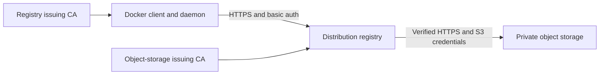

# Run Distribution Registry 3 with TLS, Basic Auth, and S3 Storage

Author: [nawazdhandala](https://www.github.com/nawazdhandala)

Tags: Container Registry, Docker, S3, Security

Description: Configure Distribution3.1.2 with verified TLS, bcrypt authentication, and an S3-compatible backend, then test authentication and durable image storage separately.

A private registry needs more than an open port. Clients must trust its certificate, users must authenticate, and uploaded content must survive the registry container. These requirements belong to different connections and deserve separate tests.

This example uses **CNCF Distribution3.1.2** as a single registry instance on a Linux Docker Engine host. The official `registry:3.1.2` image tag was checked during preparation. Record its approved digest before rollout rather than relying indefinitely on a mutable tag. Review the [Distribution release](https://github.com/distribution/distribution/releases/tag/v3.1.2) when selecting your deployed version.

## Prepare the endpoints and trust

Use a dedicated staging hostname such as `registry.example.internal:5000`. Obtain a serving certificate whose Subject Alternative Name includes `registry.example.internal`, its private key, and any intermediate certificates needed to build the chain. The certificate file should present the leaf followed by its intermediate chain.

Create a private S3-compatible bucket and a service identity restricted to the registry's required bucket operations. Provision DNS, routing, and a valid certificate for the object-storage endpoint too. An S3-compatible API does not guarantee that every provider implements every multipart-upload or signing behavior identically.



The registry's serving certificate does not establish its trust in object storage. Likewise, installing a CA in a browser does not configure Docker Engine's trust store.

For Linux Docker Engine, Docker documents custom registry CA files under `/etc/docker/certs.d/HOST:PORT/`, using a `.crt` extension. Match the exact registry authority, including port5000 here. Follow the [Docker certificate instructions](https://docs.docker.com/engine/security/certificates/) for the actual platform; Docker Desktop has a different host integration.

## Create the authentication file

Distribution's native `htpasswd` backend is appropriate for a small trusted group. It checks username and password; it is not a per-repository permission system. The [tagged access controller](https://github.com/distribution/distribution/blob/v3.1.2/registry/auth/htpasswd/access.go) returns an authenticated grant without implementing repository-specific role rules. Use a suitable token authorization service when teams need different repository permissions.

With Apache2.4 `htpasswd` installed, create a new directory and account:

```bash
umask 077
mkdir registry-pilot
cd registry-pilot
mkdir auth certs
htpasswd -Bc auth/htpasswd registry-user
```

The command prompts for a password and writes a bcrypt hash. `-c` creates the file and would truncate an existing one, so use this only for the new pilot. For additional accounts, omit `-c`. Avoid the option that places a plaintext password in command arguments. These behaviors are documented in the [Apache htpasswd reference](https://httpd.apache.org/docs/2.4/programs/htpasswd.html).

Place the reviewed serving chain at `certs/registry-chain.pem`, its key at `certs/registry-key.pem`, and the approved outbound CA bundle at `certs/outbound-ca.pem`. Restrict private-key and password-file access while ensuring the registry process can read them.

## Configure the registry and storage driver

Save this as `config.yml` inside the pilot directory. Replace the endpoint, region, bucket, and hostname with approved staging values:

```yaml
version: 0.1
log:
  level: info
storage:
  s3:
    region: us-east-1
    regionendpoint: https://objects.example.internal
    bucket: registry-pilot
    forcepathstyle: true
    secure: true
    skipverify: false
    v4auth: true
    rootdirectory: /distribution
  redirect:
    disable: true
  delete:
    enabled: false
auth:
  htpasswd:
    realm: Private Registry
    path: /auth/htpasswd
http:
  addr: :5000
  host: https://registry.example.internal:5000
  tls:
    certificate: /certs/registry-chain.pem
    key: /certs/registry-key.pem
```

`version: 0.1` is the configuration format, not the registry release. The driver keys are checked against the [3.1.2 S3 implementation](https://github.com/distribution/distribution/blob/v3.1.2/registry/storage/driver/s3-aws/s3.go). Path-style addressing puts the bucket in the request path; choose it according to your provider's requirements. The region must also match the provider's signing expectations.

Disabling redirects keeps blob downloads on the registry path. Otherwise S3 storage can redirect clients to signed object-storage URLs, which introduces client routing and trust requirements for that endpoint. Keeping traffic through the registry simplifies this pilot but increases registry bandwidth demand. See the [S3 driver documentation](https://distribution.github.io/distribution/storage-drivers/s3/).

Deletion is disabled deliberately. Bucket lifecycle rules must not expire registry objects independently of the registry's references. Plan retention and garbage collection as separate operational work.

## Supply secrets outside the article

Provision a protected `registry.env` file through your secret-management process. It must contain nonempty values for `REGISTRY_STORAGE_S3_ACCESSKEY`, `REGISTRY_STORAGE_S3_SECRETKEY`, and `REGISTRY_HTTP_SECRET`. The last value is a strong, persistent random secret used for registry upload state; retain it across restarts.

Do not commit this file. Environment variables remain visible to sufficiently privileged container administrators, so this arrangement is a small-host deployment choice, not a universal secret-isolation mechanism. The [configuration reference](https://distribution.github.io/distribution/about/configuration/) documents the environment override naming convention.

Start the staging instance after replacing the published address with the host's approved private address:

```bash
docker run -d --name registry-pilot --restart unless-stopped \
  -p PRIVATE_HOST_IP:5000:5000 \
  --env-file "$PWD/registry.env" \
  -e SSL_CERT_FILE=/certs/outbound-ca.pem \
  -e OTEL_TRACES_EXPORTER=none \
  --mount "type=bind,src=$PWD/config.yml,dst=/etc/distribution/config.yml,readonly" \
  --mount "type=bind,src=$PWD/auth,dst=/auth,readonly" \
  --mount "type=bind,src=$PWD/certs,dst=/certs,readonly" \
  registry:3.1.2 serve /etc/distribution/config.yml
```

The tagged image's [Dockerfile](https://github.com/distribution/distribution/blob/v3.1.2/Dockerfile) uses the registry executable as its entry point. This command selects the mounted configuration explicitly. On Linux, Go's certificate loader recognizes `SSL_CERT_FILE`; the supplied bundle must contain the required trusted roots. See [SystemCertPool](https://pkg.go.dev/crypto/x509#SystemCertPool). Keep certificate verification enabled.

## Test each boundary before trusting the service

From an approved client, first request the API without credentials, then with a prompted password:

```bash
curl --cacert /protected/registry-ca.pem -i \
  https://registry.example.internal:5000/v2/
curl --cacert /protected/registry-ca.pem --user registry-user -i \
  https://registry.example.internal:5000/v2/
```

Expect an authentication challenge for the first request and success for valid credentials in the second. A successful `/v2/` request does not establish that S3 writes work.

Next, log Docker into that exact authority, push a small approved test image to a dedicated repository, and pull it by the recorded digest from a clean test client. Restart the registry container and repeat the pull. Inspect storage and registry errors if authentication succeeds but upload or download fails. Exercise an image large enough to test multipart behavior before approving the storage backend.

Local validation parsed this configuration with Distribution3.1.2 and checked shell syntax. No registry container, S3 backend, or end-to-end image transfer was run. Those staging checks are the acceptance criteria for your deployment.
