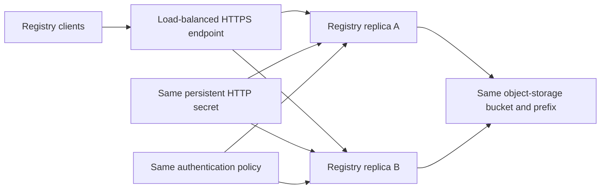

# Make Distribution Registry Replicas Share Storage and Upload State

Author: [nawazdhandala](https://www.github.com/nawazdhandala)

Tags: Container Registry, High Availability, Storage

Description: Design Distribution3.1.2 replicas around shared content, a consistent upload secret, correct load-balancer behavior, and measured failover tests.

Adding a second registry container can make an image service less reliable if the replicas disagree about where content lives or how upload state is signed. A pull might succeed through one replica and fail through another. An upload can start normally, then fail when the next request reaches a different backend.

High availability requires more than two processes. This guide uses **Distribution3.1.2** to identify the state that replicas must share and the tests that demonstrate useful failover. It covers a normal push/pull registry, not a Docker Hub pull-through cache.

## Design around the shared dependencies

Put registry replicas in independent failure domains and route clients through a stable, authenticated HTTPS endpoint. Use a storage backend that every replica can access consistently.



Two private filesystem directories with identical names are not shared storage. Avoid independently attached local volumes unless the storage design actually provides the required common filesystem semantics. For an object-storage driver, align the bucket, endpoint, region, and root prefix across replicas.

The [Distribution load-balancing guidance](https://distribution.github.io/distribution/about/deploying/#load-balancing-considerations) identifies the storage driver, HTTP secret, and configured Redis cache as shared concerns. The load balancer and storage backend also need their own availability plans; registry replicas cannot hide a complete outage of either dependency.

## Use one reviewed storage configuration

This fragment illustrates shared settings for an S3-compatible staging backend. Merge it into each replica's complete reviewed configuration, including authentication and TLS:

```yaml
storage:
  s3:
    region: us-east-1
    regionendpoint: https://objects.example.internal
    bucket: registry-shared
    rootdirectory: /distribution
    forcepathstyle: true
    secure: true
    skipverify: false
    v4auth: true
  redirect:
    disable: true
  delete:
    enabled: false
http:
  addr: :5000
  host: https://registry.example.internal:5000
  draintimeout: 60s
```

Replace the region and endpoints with the values required by your provider. Both replicas need the same data namespace and appropriate backend credentials. Their local credential delivery can differ, but it must not accidentally select different buckets or prefixes. The [tagged S3 driver](https://github.com/distribution/distribution/blob/v3.1.2/registry/storage/driver/s3-aws/s3.go) defines these connection and verification settings.

Here downloads stay on the registry path because redirects are disabled. If you instead allow signed storage redirects, clients must reach and trust the object-storage endpoint. Test that extra path during failover; a healthy registry response does not prove that redirected downloads work.

The drain timeout gives an instance time to stop gracefully. It is not a promise that every large upload will finish in sixty seconds. Align load-balancer draining and orchestrator termination grace with measured upload behavior.

## Share the upload-signing secret

Provision the same strong `REGISTRY_HTTP_SECRET` to every replica through your secret-management system. Retain it across ordinary restarts. Do not let each replica generate a different value at startup.

Distribution signs upload state using this secret. Its [HMAC implementation](https://github.com/distribution/distribution/blob/v3.1.2/registry/handlers/hmac.go) verifies that state when a request continues an upload. HMAC is a keyed integrity check: another replica can validate the state only if it has the matching key.

Sticky sessions can conceal a secret mismatch until a backend fails. They do not replace consistent state. Test uploads with requests reaching different backends and after one backend leaves service.

Treat HTTP-secret rotation as a coordinated change. An in-progress upload carrying state signed with the old value may fail on replicas using a new value. Plan a maintenance or retry strategy, drain appropriately, and test the transition rather than independently rotating each replica's secret.

## Make authentication consistent too

Every backend must enforce the same intended client access. With basic authentication, distribute the same approved account file and rotation procedure. With token authentication, align issuer, service audience, trusted signing keys, and authorization-service availability.

The TLS endpoint and token-signing trust are separate configurations. If TLS terminates at the load balancer, protect the backend connection according to your network design and prevent clients from reaching an unprotected alternate backend path.

At an HTTP proxy, preserve the external host and scheme information and the registry's authentication challenge. Incorrect forwarding can produce upload locations referring to an internal hostname or HTTP endpoint. Test the `Location` and `WWW-Authenticate` headers through the actual public path, not just a backend's root page.

## Keep caches optional until they are justified

A blob-descriptor cache stores metadata used to locate content; it is not the image-blob store. Adding Redis does not make two separate content stores consistent.

Begin with a measured baseline and omit an optional descriptor cache if you do not need it. If you configure Redis, use a shared, appropriately secured service and test its failure behavior. Its capacity, latency, eviction, and availability become operational concerns of the registry.

The [3.1.2 application initialization](https://github.com/distribution/distribution/blob/v3.1.2/registry/handlers/app.go) distinguishes Redis and in-memory descriptor caches. A process-local cache is not a fleet-wide coordination mechanism. Do not confuse either with the separate pull-through-cache feature that retrieves content from an upstream registry.

After deletion, migration, or maintenance, verify behavior through every replica. A cache hit on one backend should not be the only evidence that storage and references are correct.

## Test the real failure paths

For a design where each backend serves TLS for the registry hostname, an approved operator can test it directly while preserving the hostname used for TLS verification:

```bash
curl --cacert /protected/registry-ca.pem \
  --resolve registry.example.internal:5000:BACKEND_A_IP \
  --silent --show-error --dump-header - --output /dev/null \
  https://registry.example.internal:5000/v2/
```

Replace `BACKEND_A_IP` and repeat for replica B. This example does not apply unchanged to a plaintext backend behind TLS termination. curl's [`--resolve` option](https://curl.se/docs/manpage.html#--resolve) changes address resolution while keeping the URL authority.

For an authenticated registry, an unauthenticated `/v2/` probe should return the intended401 challenge. That demonstrates the authentication path is alive, not that storage reads and writes are healthy. Add approved synthetic operations that exercise actual storage and credentials.

In staging, push a multi-layer test image, interrupt one replica during an upload, and observe retry/resume behavior. Pull the resulting digest from a clean client through both backends. Repeat with the load balancer draining a backend, with a backend storage-access failure, and after a replica restart. Record client outcomes and backend errors rather than assuming zero interruption.

Keep storage backup and recovery separate from availability. Shared storage can propagate deletion or corruption to every replica. Test a restore into an isolated target, and coordinate garbage collection so active writers cannot race it.

Local validation ran Distribution3.1.2's upload-state tests: equal secrets accepted state, while mismatched secrets were rejected. It also parsed the configuration fragment in a complete fixture. No load balancer, shared storage, Redis outage, or live failover was tested. Those are the acceptance checks for the deployed system.
