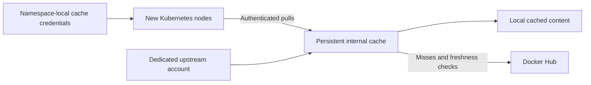

# Reduce Docker Hub 429s During Node Rotations with a Pull-Through Cache

Author: [nawazdhandala](https://www.github.com/nawazdhandala)

Tags: Kubernetes, Container Registry, Docker

Description: Use an authenticated Distribution cache to reduce repeated image downloads during node replacement, while accounting for quotas, cache misses, and private-image access.

Replacing a large Kubernetes node pool removes many local image caches at once. New nodes then request the same images through a shared internet connection, and Docker Hub starts returning429 responses. A persistent pull-through cache can reduce repeated downloads, but it cannot promise that every upstream request or rate limit disappears.

This guide uses **Distribution3.1.2** and an explicitly addressed internal cache. It separates upstream Docker Hub authentication from client authentication to the cache, then defines a staged node-rotation test.

## Identify which429 you are seeing

Docker documents separate pull-rate and abuse limits. Pull-limit responses include a more specific message and documentation link; abuse throttling can appear as a simple `Too Many Requests`. Authentication and account entitlements affect pull limits, while abuse controls still apply across account levels. Check the [current usage limits](https://docs.docker.com/docker-hub/usage/) instead of embedding a quota number permanently into capacity planning.

Record the failing endpoint, message, time window, and node-creation burst. Look for retry loops in automation as well as legitimate pulls. Docker's [troubleshooting guide](https://docs.docker.com/docker-hub/troubleshoot/) recommends backoff for excessive request traffic. A cache does not repair a controller that continuously retries thousands of failed operations.

## Keep the cache alive across node replacement

Place the cache on infrastructure whose lifecycle is independent of the workers being rotated. Its image content needs persistent storage; replacing an empty cache at the same time as the nodes recreates the upstream burst.



A first request fetches missing content. Later requests can reuse it. Tags can still require an upstream freshness check, and expired cache entries can trigger new downloads. Distribution's [cache recipe](https://distribution.github.io/distribution/recipes/mirror/) describes these behaviors and recommends filesystem storage for this mode.

For a tightly controlled production image set, promote approved images into a durable internal registry instead of relying on a disposable cache as an offline release repository. These are different availability guarantees.

## Separate the two authentication relationships

Use a dedicated Docker Hub account with only the access required for the cache. Store its approved credential through your secret-management process. A personal account with broad private-repository access is a poor upstream identity.

Protect access to the cache itself. Distribution warns that private content available to the upstream account can become available through the mirror. Native basic authentication restricts who can enter, but does not provide fine-grained per-repository roles. A shared cache should therefore serve a trust group whose members are allowed to access its upstream content.

The credential used by a node to access `cache.example.internal:5000` is separate from the Docker Hub credential used by the server. Do not distribute the upstream credential to every namespace merely because the cache needs it.

## Configure the cache deliberately

Provision a persistent filesystem volume, a trusted TLS serving chain and key, and a bcrypt `htpasswd` file for approved cache clients. This complete configuration targets Distribution3.1.2:

```yaml
version: 0.1
log:
  level: info
storage:
  filesystem:
    rootdirectory: /var/lib/registry
  delete:
    enabled: true
auth:
  htpasswd:
    realm: Internal Image Cache
    path: /auth/htpasswd
http:
  addr: :5000
  host: https://cache.example.internal:5000
  tls:
    certificate: /certs/cache-chain.pem
    key: /certs/cache-key.pem
proxy:
  remoteurl: https://registry-1.docker.io
  ttl: 168h
```

Mount the filesystem path persistently and the configuration, certificate files, and authentication file read-only where appropriate. The seven-day `ttl` is a cache-retention choice, not a guarantee of disconnected availability. Size storage for the working set and expected churn.

Supply `REGISTRY_PROXY_USERNAME` and `REGISTRY_PROXY_PASSWORD` as protected environment overrides, and retain a strong `REGISTRY_HTTP_SECRET` across restarts. Do not write literal credentials into this YAML or commit a secret-bearing environment file. The [configuration reference](https://distribution.github.io/distribution/about/configuration/) documents these override names and proxy settings.

Deletion must be enabled for scheduled cache cleanup. That differs from a conservative push registry where deletion may remain disabled. Review access and retention accordingly; do not run unrelated bucket or filesystem cleanup over registry content.

A pull-through cache is not the destination for application image pushes. Keep your build publication registry separate. The [tagged proxy implementation](https://github.com/distribution/distribution/tree/v3.1.2/registry/proxy) implements the cache behavior rather than a combined unrestricted push-and-proxy service.

## Route Kubernetes pulls to the intended endpoint

For this pilot, use explicit cache image references. A Docker Hub official image under `library/` must retain that repository path:

```text
docker.io/library/alpine@sha256:APPROVED_DIGEST
cache.example.internal:5000/library/alpine@sha256:APPROVED_DIGEST
```

`APPROVED_DIGEST` is a placeholder for the verified image or image-index digest used by your release. Preserve the repository and digest when changing the registry authority. Check required platforms before rotating a mixed-architecture node pool.

Configure the workload's image field through its normal deployment settings, and attach a namespace-local pull Secret for the cache authority. Install the issuing CA in the node runtime's trust configuration. The [Kubernetes private-image guide](https://kubernetes.io/docs/tasks/configure-pod-container/pull-image-private-registry/) explains the pull-secret reference requirements.

Explicit references also make the selected endpoint visible in the admitted Pod. Native runtime mirror configuration is another approach, but it needs separate authentication and fallback testing. Editing Docker Engine's mirror settings does not configure Kubernetes nodes that use containerd. Likewise, a warm cache log proves nothing if the actual Pods still pull directly from Docker Hub.

## Rehearse before rotating the fleet

Start with an approved staging image and a small number of replacement nodes. Capture cache logs, upstream request/error counts, stored bytes, and image-pull duration without logging credentials.

| Phase | Expected evidence |
| --- | --- |
| First pull through an empty pilot cache | Upstream fetch and local content creation |
| Same digest on a fresh node | Cache serves reusable content; compare upstream requests |
| Mutable-tag pull | Observe freshness behavior rather than assuming no upstream traffic |
| Cache restart with persistent storage | Previously cached content remains available |
| Unauthorized cache client | Authentication is denied |
| Staged upstream outage | Document exactly which warmed operations succeed and which miss |

Prewarm the release's actual image set through the same cache path before a planned node rotation. Include init-container images and all required platform variants. Reading an image list or warming only an index document does not prove every layer for every architecture is stored.

Increase the rotation batch gradually while monitoring cache disk space, network throughput, and request latency. Avoid aggressive retry loops when upstream throttling occurs. A single cache can become a bottleneck even while reducing internet transfer.

## Accept the measured improvement

The useful success criterion is fewer failed pulls and reduced upstream demand for the real node-replacement workload. Record what happens after eviction, credential rotation, cache restart, and an upstream outage. Retain Docker Hub account-capacity planning because authentication and caching do not exempt the service from its policies.

Local validation checks the configuration with Distribution3.1.2 and runs selected upstream cache tests using test stores. It does not measure Docker Hub quota consumption, production cache hit rates, or a Kubernetes node rotation. Those results must come from the controlled rehearsal.
