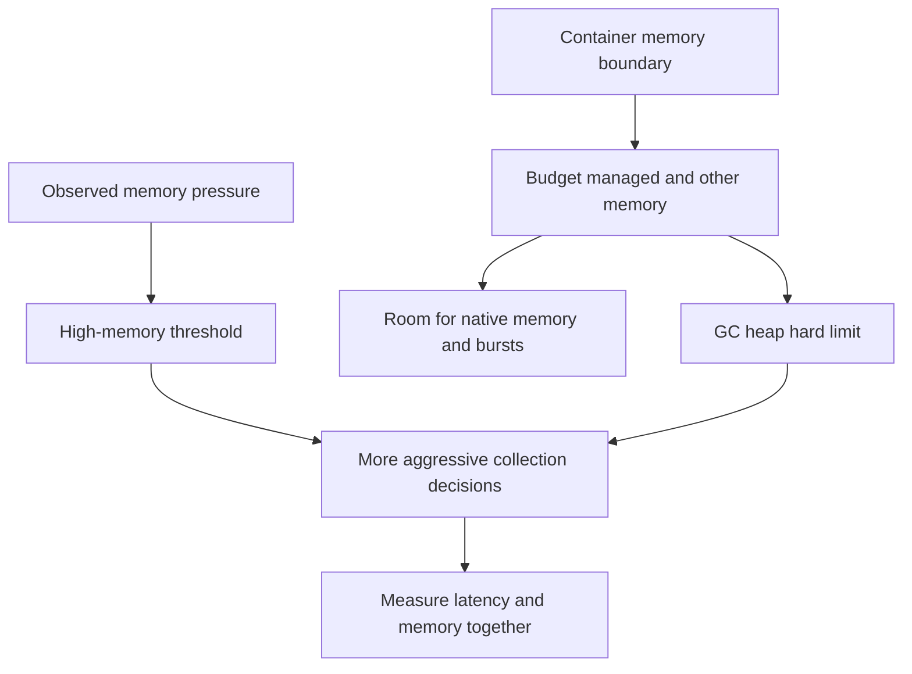

# Tune .NET Heap Limits and High-Memory Thresholds in Containers

Author: [nawazdhandala](https://www.github.com/nawazdhandala)

Tags: .NET, Garbage Collection, Kubernetes

Description: Separate the container limit, GC heap budget and high-memory trigger, verify decimal versus hexadecimal settings, and test headroom before changing production limits.

A container has a memory limit, .NET has a GC heap hard limit, and the collector also has a high-memory threshold. These controls are related, but they do not cap the same thing. Confusing them can produce a configuration that looks conservative while still allowing a container kill or unnecessary full collections.

Start by assigning each control a purpose. This guide uses .NET 10.0.15 with SDK 10.0.404. Its local probe verifies configuration parsing on macOS ARM64. Container accounting, out-of-memory behavior and latency effects still require tests in your deployment environment.

## Separate the three boundaries

The container memory limit is enforced outside the managed runtime. It covers the memory charged to that container, including more than managed objects. Kubernetes describes memory-limit enforcement in its [resource-management documentation](https://kubernetes.io/docs/concepts/configuration/manage-resources-containers/).

The GC heap hard limit bounds committed memory for the GC heap and its bookkeeping. It is not a process-RSS limit. Native libraries, stacks and other process resources still need room. The .NET [GC configuration reference](https://learn.microsoft.com/en-us/dotnet/core/runtime-config/garbage-collector) defines the byte-based limit and the alternative percentage-based setting.

The high-memory threshold tells GC when overall memory pressure warrants a more aggressive response. It does not reserve memory or change the container limit. The [HighMemoryLoadThresholdBytes API](https://learn.microsoft.com/en-us/dotnet/api/system.gcmemoryinfo.highmemoryloadthresholdbytes?view=net-10.0) describes this pressure-based behavior.



A lower threshold may change when collection reacts, but it cannot release live data or reclaim memory still owned by a native component.

## Establish a budget from observed usage

For an illustrative 512 MiB container, a 400 MiB GC budget leaves 112 MiB for other charged memory and transient demand. That is a calculation to test, not a universal recommendation. A service using large native compression buffers may need substantially more reserve.

Measure startup, peak concurrency, large requests, connection churn and diagnostic activity. Record process memory and managed heap metrics over the same windows. If the application already retains almost the proposed GC budget in live objects, little space remains for new allocations or collection bookkeeping.

Do not derive the budget from a pod total when the process runs under a different container boundary. Also check whether resource limits changed while the application stayed running. Startup settings and environment discovery need to be verified against the actual process, not only the latest deployment manifest.

Write down the intended tradeoff: a smaller managed budget to preserve native headroom, or an earlier pressure response to reduce memory peaks. Those are separate hypotheses and should normally be tested separately.

## Use the correct numeric format

For the 400 MiB example:

```text
400 × 1,048,576 = 419,430,400 decimal bytes = 0x19000000
80 percent = 80 decimal = 0x50
```

GC numeric settings use decimal values in JSON and hexadecimal values in environment variables. A bare environment value that looks decimal can therefore mean something different from what you intended.

The companion project includes this `runtimeconfig.template.json`:

```json
{
  "configProperties": {
    "System.GC.HeapHardLimit": 419430400,
    "System.GC.HighMemoryPercent": 80
  }
}
```

This template is merged into the generated runtime configuration during build. The 80-percent value is included to demonstrate parsing; it is not a recommended pressure threshold for every service. For an environment-only configuration, the corresponding settings are:

```bash
DOTNET_GCHeapHardLimit=0x19000000 \
DOTNET_GCHighMemPercent=0x50 \
dotnet /path/to/Service.dll
```

Replace the DLL path and use this only with the intended configuration source. Avoid setting the same control in several places while diagnosing it. The [tagged runtime configuration definitions](https://raw.githubusercontent.com/dotnet/runtime/v10.0.0/src/coreclr/gc/gcconfig.h) map these environment-facing names to their JSON counterparts.

## Choose bytes or percentages deliberately

An absolute limit stays the same when a container grows. A percentage scales with the memory boundary recognized by the runtime. Either can be appropriate, but a stale fixed limit after scaling can leave capacity unused, while a percentage may allocate too much managed budget for a native-heavy service.

For example, the alternative percentage configuration is `System.GC.HeapHardLimitPercent: 75` in JSON or `DOTNET_GCHeapHardLimitPercent=0x4B` in the environment. Do not combine it with the absolute limit and expect two independent caps: the absolute setting takes precedence. Per-object-heap limits have their own precedence and initialization requirements; inspect inherited settings before adding another layer.

The documented default in a memory-constrained environment is based on 75 percent, subject to a minimum. Treat that as runtime behavior to inspect, not evidence that the default fits every application.

## Verify the values inside the runtime

The companion `Program.cs` prints relevant entries from `GC.GetConfigurationVariables()`, then reads collection-based memory information. The [configuration API](https://learn.microsoft.com/en-us/dotnet/api/system.gc.getconfigurationvariables?view=net-10.0) provides a direct way to inspect the GC's settings.

```bash
dotnet build Lab.csproj -c Release
dotnet bin/Release/net10.0/Lab.dll
```

The probe explicitly requests a GC only to obtain collection-based observations in this tiny lab. Do not copy that request into a production health check.

Two separate local runs, one using the JSON values and one using only their environment equivalents, reported:

```text
GCHighMemPercent=80
GCHeapHardLimit=419430400
available=419430400
```

The probe's `available` line comes from [TotalAvailableMemoryBytes](https://learn.microsoft.com/en-us/dotnet/api/system.gcmemoryinfo.totalavailablememorybytes?view=net-10.0). It is not an operating-system free-memory reading.

The host's high-memory threshold was about 51.2 GiB, reflecting 80 percent of its 64 GiB physical memory, despite the 400 MiB GC hard limit. That local observation demonstrates that the pressure threshold is not simply 80 percent of the GC heap cap. In a container, verify the runtime's reported boundary and pressure threshold there; the host test does not validate cgroup detection.

## Evaluate one change at a time

Start with the current configuration and representative load. Record managed committed memory, live heap after collection, process/container memory, full-collection activity, request percentiles and errors. Preserve CPU limits because more frequent collection needs CPU time.

Test the proposed hard limit without changing the pressure threshold first. If managed allocation fails or collections become excessive, inspect the working set and allocation pattern. Do not immediately lower the threshold again; that may increase work without freeing enough memory.

Then evaluate a threshold change separately if the evidence suggests late reaction to pressure. Compare memory peaks and pause behavior. An earlier reaction can be useful only if its latency cost is acceptable. Keep enough healthy capacity for rollback and do not use a deliberately near-OOM production instance as the initial test.

## Make the result durable

Store the chosen configuration with the application or deployment, log the effective values at startup, and document the measured reserve for non-GC memory. Recheck after runtime upgrades, native-library changes and container resizing.

A successful setting keeps the service within its real memory budget while preserving useful throughput and latency. A correctly parsed number is only the first check; the workload determines whether that number is appropriate.
