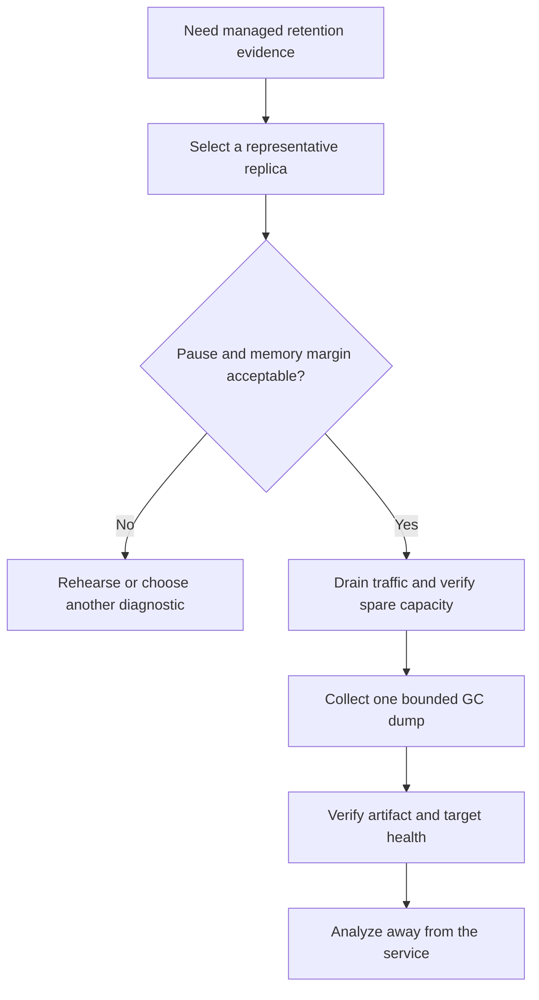

# Capture a .NET GC Dump with Less Memory and Pause Risk

Author: [nawazdhandala](https://www.github.com/nawazdhandala)

Tags: .NET, Garbage Collection, Troubleshooting

Description: Plan a bounded dotnet-gcdump capture with target-process memory headroom, a drained replica and artifact checks instead of treating collection as passive monitoring.

A GC dump can reveal which managed objects remain alive, but collecting one changes the process being investigated. It induces a generation 2 collection and gathers heap events. On a large heap, that can create a long pause; in a tight container, the diagnostic work can consume the remaining memory.

The goal is not to promise a risk-free command. It is to choose an appropriate target, reserve capacity, collect once, and verify that the result is useful. This guide pins `dotnet-gcdump` 10.0.750501. A small local capture was tested against .NET 10.0.15 on macOS ARM64 using SDK 10.0.404. No production or memory-constrained container was tested.

## Decide whether a GC dump answers the question

Use a GC dump when you need a managed object graph, type counts or retention relationships. It is not a complete process-memory dump and should not be expected to account for every native allocation or mapped page.

If the immediate question is whether allocation rate or GC frequency increased, begin with existing metrics. If the problem is a request stall, a bounded trace may answer it without a heap graph. Match the artifact to the question before adding diagnostic load to an unhealthy instance.

Microsoft's [dotnet-gcdump documentation](https://learn.microsoft.com/en-us/dotnet/core/diagnostics/dotnet-gcdump) warns that collection triggers a full generation 2 GC and can suspend large-heap applications for a long time. A generation is the runtime's grouping of objects by survival history; generation 2 contains older surviving objects. A command timeout does not promise an equally short application pause.

## Budget for both sides of collection

There are two memory consumers to consider: the target's event collection and the tool building the graph. Microsoft documents a target-side event buffer that can grow up to 256 MB, plus memory used by the tool. Do not interpret that figure as a complete capture budget or a fixed reservation.

If the tool runs inside the application container, both compete within that container's resources. Moving it to a separate diagnostic container can isolate the tool's own usage, but does not remove the work requested inside the target. The [container diagnostics guidance](https://learn.microsoft.com/en-us/dotnet/core/diagnostics/diagnostics-in-containers) explains this distinction.

Write down the target's recent peak memory, configured limit, expected traffic during capture, tool placement and output-storage capacity. If the remaining margin is uncertain, rehearse on a representative replica with the same limits first. A process already near an out-of-memory kill is a poor place to discover capture overhead.



Draining is a service-level operation, not just removing an instance from a dashboard. Verify that new requests stop arriving, in-flight work is handled according to your normal policy, and healthy replicas can carry the load.

## Prepare the exact tool ahead of time

Install the pinned release into a dedicated tool directory on the diagnostic host. This example assumes an installed SDK and a compatible runtime; `--allow-roll-forward` permits the tool to use an available newer runtime when its requested runtime is absent:

```bash
dotnet tool install dotnet-gcdump \
  --tool-path ./diagnostic-tools \
  --version 10.0.750501 \
  --allow-roll-forward
./diagnostic-tools/dotnet-gcdump --version
./diagnostic-tools/dotnet-gcdump collect --help
```

The version is published in the [official NuGet package listing](https://www.nuget.org/packages/dotnet-gcdump/10.0.750501), and the SDK options are documented under [dotnet tool install](https://learn.microsoft.com/en-us/dotnet/core/tools/dotnet-tool-install). Test the resulting executable on the intended architecture before the incident. An install that succeeds does not establish attachment permissions or enough memory for a large target.

Use the same account as the target where possible. On Linux and macOS, PID-based attachment requires compatible access to the diagnostic socket and matching `TMPDIR` configuration. In a sidecar arrangement, process-namespace visibility and shared socket storage must be designed explicitly. Do not add broad container privileges merely because attachment failed.

The [diagnostic-port documentation](https://learn.microsoft.com/en-us/dotnet/core/diagnostics/diagnostic-port) describes the endpoint and notes that disabling diagnostics prevents these tools from attaching. Resolve that configuration deliberately rather than changing production security settings during a rushed capture.

## Rehearse the workflow on a small process

The companion `Lab.csproj` and `Program.cs` build a console application that retains sixteen 1 MiB arrays and waits for a minute. It prints its PID. This is a functional rehearsal, not a model of large-heap capture overhead:

```bash
dotnet build Lab.csproj -c Release
dotnet bin/Release/net10.0/Lab.dll
```

In another shell, verify the printed PID and run one collection. Use a new output directory and filename; do not reuse evidence you need to keep:

```bash
umask 077
mkdir -p capture-review
target_pid=12345  # Replace with the verified lab or approved replica PID.
./diagnostic-tools/dotnet-gcdump collect \
  --process-id "$target_pid" \
  --output ./capture-review/selected-replica.gcdump \
  --timeout 30
```

The pinned [collection handler source](https://raw.githubusercontent.com/dotnet/diagnostics/ad724c4b85e7ae775e42f393c6e95a7557a57954/src/Tools/dotnet-gcdump/CommandLine/CollectCommandHandler.cs) confirms these options and deletes an existing output file at the selected path. Choose the path before capture, not after discovering an overwrite.

Thirty seconds is the collection timeout in this example, not a service-level latency guarantee. Record command output and the capture window. Monitor target responsiveness and memory from a separate observer; avoid simultaneously collecting several other expensive artifacts from the same replica.

## Validate the result before trusting it

The local rehearsal wrote a 37,640-byte artifact. The report identified sixteen large byte arrays and about 16.9 million managed heap bytes. Generate a report from the saved file rather than requesting another live capture:

```bash
./diagnostic-tools/dotnet-gcdump report \
  ./capture-review/selected-replica.gcdump
```

The tool warned that the .NET 10 target did not support non-lossy blocking buffering and used the older lossy mode. The [pinned heap-dumper implementation](https://raw.githubusercontent.com/dotnet/diagnostics/ad724c4b85e7ae775e42f393c6e95a7557a57954/src/Tools/dotnet-gcdump/DotNetHeapDump/EventPipeDotNetHeapDumper.cs) reconstructs the graph from runtime events. Missing events on large heaps can therefore compromise a capture; a file's existence alone is insufficient validation.

Check the exit result, warnings, readable type statistics and whether expected application objects are represented. Preserve the exact tool/runtime versions with the artifact. A successful tiny lab does not prove completeness for a much larger production graph.

## Recover the replica and analyze elsewhere

After collection, verify health and memory before returning the replica to normal traffic. Compare error rate and readiness with the pre-capture baseline. If capture failed, preserve its logs and reassess headroom instead of starting an automatic retry loop that repeatedly induces collection.

Move the artifact to an access-controlled analysis location. Compare captures only when workload phase and application state are sufficiently similar, and record that each capture itself changes heap state through induced GC. If a different diagnostic artifact is required, plan its separate resource costs before collecting it.

A good production procedure ends with both a useful artifact and a healthy service. The dump is evidence for the next investigation step; obtaining it should not become the incident's largest source of disruption.
