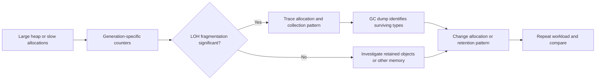

# Diagnose .NET Large Object Heap Fragmentation

Author: [nawazdhandala](https://www.github.com/nawazdhandala)

Tags: .NET, Garbage Collection, Performance

Description: Combine generation-specific counters, a bounded GC trace and a managed heap dump to distinguish LOH fragmentation from retained large objects and allocation churn.

A growing large object heap does not automatically mean a leak. It may contain live buffers, gaps left by dead buffers, or both. Those cases need different fixes: reducing retained data, changing allocation patterns, or carefully evaluating compaction.

Use three tools to answer three questions. Counters show how much space is fragmented. A trace shows when collections and sampled allocations occur. A GC dump shows which managed objects survive. This guide uses diagnostic tools 10.0.750501 with .NET 10.0.15, tested locally on macOS ARM64. It does not claim production latency measurements or a Windows container reproduction.

## Define the problem before collecting evidence

The large object heap, or LOH, stores objects above the runtime's large-object threshold. The default threshold is 85,000 bytes, and it is configurable; include object overhead when reasoning about array boundaries. The [runtime configuration documentation](https://learn.microsoft.com/en-us/dotnet/core/runtime-config/garbage-collector#large-object-heap-threshold) describes the setting.

Fragmentation is space between surviving objects that is not currently occupied by objects. It can be reused if a new allocation fits. A large total amount of free space does not establish that a suitably sized individual gap exists for the next request.

Start with the symptom that matters: increased generation 2 collections, allocation latency, memory pressure or a failed allocation. Fragmentation that remains stable while the service performs well is different from growing fragmentation during a changing buffer-size workload.



## Pin and prepare the tools

Install the same tool release for a reproducible investigation. This example assumes an SDK and a suitable runtime are installed. The roll-forward option permits use of a newer installed runtime for the diagnostic tools:

```bash
for tool in dotnet-counters dotnet-trace dotnet-gcdump; do
  dotnet tool install "$tool" --tool-path ./diagnostic-tools \
    --version 10.0.750501 --allow-roll-forward
done
```

Verify each tool's `--version` output. The commands below were exercised with that release. Use the target's account and diagnostic-socket access; PID-based attachment in containers also depends on process visibility and socket sharing. Review [container diagnostic prerequisites](https://learn.microsoft.com/en-us/dotnet/core/diagnostics/diagnostics-in-containers) before attaching from a sidecar.

Choose fresh output filenames and a representative target. Capture the normal workload first. A dump-induced collection should not accidentally become the event you later describe as an unexplained application pause.

## Measure LOH size and fragmentation together

For a bounded first capture, substitute the verified PID:

```bash
target_pid=12345
./diagnostic-tools/dotnet-counters collect \
  --process-id "$target_pid" \
  --counters System.Runtime \
  --duration 00:00:00:10 \
  --format csv --output ./loh-counters.csv
```

This records ten seconds of runtime measurements. The pinned [counter command source](https://raw.githubusercontent.com/dotnet/diagnostics/ad724c4b85e7ae775e42f393c6e95a7557a57954/src/Tools/dotnet-counters/Program.cs) includes the duration option even where a documentation synopsis omits it.

In .NET 10, inspect these metrics with `gc.heap.generation=loh`:

| Metric | Meaning |
|---|---|
| `dotnet.gc.last_collection.heap.size` | LOH size including fragmentation after the last collection |
| `dotnet.gc.last_collection.heap.fragmentation.size` | Fragmented bytes after the last collection |
| `dotnet.gc.collections` with `gc.heap.generation=gen2` | Generation 2 collection activity |
| `dotnet.gc.heap.total_allocated` | Cumulative managed allocation across the heap |

The [runtime metrics reference](https://learn.microsoft.com/en-us/dotnet/core/diagnostics/built-in-metrics-runtime) defines the generation labels and notes that these instruments start in .NET 9. Do not assume older EventCounter names and units are identical.

Compute a fragmentation fraction only from the LOH fragmentation and LOH size from the same observation. A zero-sized denominator needs explicit handling. Keep the absolute byte count too: a high percentage of a tiny heap is not necessarily operationally important.

## Rehearse with deliberate gaps

The companion lab allocates sixty-four 256 KiB arrays, drops every other reference and requests a non-compacting generation 2 collection. It keeps the remaining arrays alive while diagnostics attach. Build and run it in a development environment:

```bash
dotnet build Lab.csproj -c Release
dotnet bin/Release/net10.0/Lab.dll
```

The program prints its PID and waits long enough for a short capture. Restart it for each separate tool test. Its explicit collections are lab controls, not recommendations for application request handling.

The counter capture reported an LOH size of 16,780,824 bytes and fragmentation of 8,391,424 bytes: approximately half the area was gaps. A separately collected GC dump reported thirty-two surviving large byte arrays. Together, those observations distinguish missing live arrays from space still represented in the LOH area.

This experiment demonstrates accounting, not an allocation failure. It did not prove that any particular future allocation could not fit, and it did not benchmark the cost of those gaps.

## Capture the workload's allocation pattern

Use a short trace around the problematic workload phase:

```bash
./diagnostic-tools/dotnet-trace collect \
  --process-id "$target_pid" \
  --profile gc-verbose \
  --duration 00:00:00:10 \
  --output ./loh.nettrace
```

The documented [`gc-verbose` profile](https://learn.microsoft.com/en-us/dotnet/core/diagnostics/dotnet-trace) records collections and sampled object allocations. Collection completed successfully in the lab. Preserve the original `.nettrace`; not every converted format retains all runtime events.

In a compatible .NET trace analyzer, examine collection causes and timing alongside allocation types, sizes and stacks. Samples identify candidates, not an exact census of every allocation. Compare periods with stable buffer sizes against periods with many different sizes or long-lived buffers interspersed with short-lived ones.

Do not treat total trace duration as GC pause duration. Keep request latency or operation timing aligned with the trace, and separate intentional diagnostic collections from ordinary collection activity. Interactive trace analysis was not performed for this article; the local check verified capture completion.

## Use a GC dump for ownership, not free-space geometry

After assessing pause and memory headroom, collect one dump from an approved replica:

```bash
./diagnostic-tools/dotnet-gcdump collect \
  --process-id "$target_pid" --output ./loh.gcdump --timeout 30
./diagnostic-tools/dotnet-gcdump report ./loh.gcdump
```

The lab report identified the thirty-two surviving arrays. Investigate their owners using the managed graph when necessary. A type histogram alone does not explain every retention path, and it does not describe the size distribution of free gaps.

Remember that [GC-dump collection](https://learn.microsoft.com/en-us/dotnet/core/diagnostics/dotnet-gcdump) induces a full collection and adds memory overhead. The .NET 10 lab also emitted the lossy-buffer fallback warning. Check capture warnings and completeness before trusting a large-heap result.

## Choose a workload fix before routine compaction

Prefer evidence-driven changes: bound retained buffers, reuse a limited set of sizes, stream large payloads or shorten overlapping lifetimes. A pool can reduce churn but also increase retained memory, so measure both effects.

`LargeObjectHeapCompactionMode.CompactOnce` requests compaction at the next full blocking collection; a background generation 2 collection does not satisfy that request. The [API documentation](https://learn.microsoft.com/en-us/dotnet/api/system.runtime.gcsettings.largeobjectheapcompactionmode?view=net-10.0) explains the behavior. Evaluate it in a controlled maintenance experiment, not as an automatic response to a percentage threshold.

Repeat the original workload and compare LOH size, fragmentation, generation 2 frequency, allocation latency and throughput. The useful outcome is stable memory and predictable service performance, not an isolated screenshot of an empty-looking heap.
