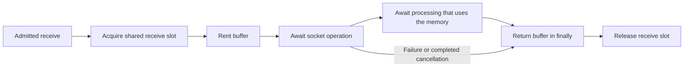

# Reduce .NET Pinned Object Heap Pressure in Socket Services

Author: [nawazdhandala](https://www.github.com/nawazdhandala)

Tags: .NET, Garbage Collection, Performance

Description: Bound socket-buffer ownership and concurrent receives, distinguish POH allocations from temporary pins, and preserve buffer lifetimes through asynchronous completion.

A socket service can retain far more buffer memory than its traffic volume suggests. Idle connections may each own a large pinned array, a custom pool may retain its peak capacity forever, or cancelled operations may leave buffers referenced by connection state.

Reducing that memory starts with ownership and concurrency, not with forcing collection. The examples here target .NET 10 and were compiled and exercised on .NET 10.0.15, macOS ARM64. A loopback test verified the receive helper and cancellation paths. No high-throughput benchmark or reduction in production POH memory is claimed.

## Separate pinned objects from the pinned object heap

Pinning prevents the garbage collector from moving an object while something needs its address. The pinned object heap, or POH, provides a separate place for objects allocated as permanently pinned. It does not automatically absorb every object that becomes temporarily pinned later.

For example, `GC.AllocateArray<byte>(length, pinned: true)` requests a pinned array. The [allocation API](https://learn.microsoft.com/en-us/dotnet/api/system.gc.allocatearray?view=net-10.0) documents that contract. Pinning an existing ordinary array does not relocate it to the POH; Microsoft's [POH design explanation](https://devblogs.microsoft.com/dotnet/internals-of-the-poh/) describes why allocation-time placement matters.

That distinction changes the investigation. A high pin count is not a measurement of POH bytes. Conversely, a large POH may reflect a deliberately retained pool even when no socket operation is currently active. Identify which allocation path owns the arrays before selecting a fix.

## Measure capacity and ownership together

For .NET 9 and later, inspect `dotnet.gc.last_collection.heap.size` and `dotnet.gc.last_collection.heap.fragmentation.size` with `gc.heap.generation=poh`. These are last-collection observations, not an immediate count of buffers currently in use. The [runtime metrics documentation](https://learn.microsoft.com/en-us/dotnet/core/diagnostics/built-in-metrics-runtime) defines the labels and their meaning.

Add application measurements that explain those bytes:

| Measurement | Question it answers |
|---|---|
| Active connections | How many owners could retain a buffer? |
| Receives currently in flight | How many buffers are actively required? |
| Rented and returned buffer counts | Are ownership transfers balanced? |
| Retained pool capacity by size | Is peak capacity being kept indefinitely? |
| Pending operations after cancellation | Are operations actually completing? |

Use capacity, not just the requested payload length. A pool may return an array larger than requested. For a custom pinned pool, 10,000 retained 64 KiB buffers already represent about 625 MiB of payload capacity before object and pool overhead. That calculation is a planning example, not a measurement from this lab.

## Bound the lifetime that needs a buffer



The buffer must remain owned until the asynchronous operation has completed. Requesting cancellation alone is not the same as completion. It must also remain owned while downstream processing reads the memory.

A common bug is to start an asynchronous receive inside a `try`, return its task, and return the array in `finally` before that task finishes. Another is to await the receive but hand a memory slice to a background worker that outlives the buffer's lease. Both can allow another operation to overwrite data still in use.

## Use a bounded ordinary-buffer path where possible

If your application uses the managed socket API, do not introduce permanently pinned arrays without a measured reason. The following helper uses ordinary pooled buffers and waits for every consumer before returning them:

```csharp
static async Task<int> ReceiveChunkAsync(
    Socket socket,
    SemaphoreSlim receiveSlots,
    Func<ReadOnlyMemory<byte>, CancellationToken, ValueTask> consume,
    CancellationToken cancellationToken)
{
    await receiveSlots.WaitAsync(cancellationToken);
    byte[]? buffer = null;
    try
    {
        buffer = ArrayPool<byte>.Shared.Rent(16 * 1024);
        int count = await socket.ReceiveAsync(
            buffer.AsMemory(0, 16 * 1024), SocketFlags.None, cancellationToken);
        if (count != 0)
            await consume(buffer.AsMemory(0, count), cancellationToken);
        return count;
    }
    finally
    {
        if (buffer is not null)
            ArrayPool<byte>.Shared.Return(buffer, clearArray: true);
        receiveSlots.Release();
    }
}
```

Import `System.Buffers` and `System.Net.Sockets`, and enable nullable reference types. Share one appropriately sized `SemaphoreSlim` across the operations whose aggregate buffer use you want to limit. Creating a fresh semaphore for every call would defeat the shared bound.

The [`ReceiveAsync` overload](https://learn.microsoft.com/en-us/dotnet/api/system.net.sockets.socket.receiveasync?view=net-10.0) accepts `Memory<byte>` and a cancellation token. The helper receives one chunk, not a complete application message. TCP can split messages across receives, and zero indicates the peer has closed gracefully for this stream-socket use case. Your framing code still needs to handle partial data.

The consumer must not retain the supplied memory after its returned `ValueTask` completes. Copy data into separately owned storage or transfer an explicit owner if work must outlive this call. The [ArrayPool return contract](https://learn.microsoft.com/en-us/dotnet/api/system.buffers.arraypool-1.return?view=net-10.0) forbids use after return and requires returning an array only once to the same pool.

Clearing on return avoids exposing retained contents to a subsequent renter when the pool keeps the array, but costs work. Measure that cost according to the data-handling requirements. The shared pool can retain returned arrays; this helper bounds active leases, not the entire process's pool capacity.

## Test completion and cancellation explicitly

The companion project creates connected loopback sockets, transfers a small payload and exercises both cancellation before slot acquisition and cancellation while a receive is pending:

```bash
dotnet build Lab.csproj -c Release
dotnet bin/Release/net10.0/Lab.dll
```

The local run received three bytes and verified that the shared slot count returned to its initial value after cancellation. It is a functional test of the example's control flow, not proof of memory savings or a load test. Run representative connection churn and slow-consumer tests before adopting the pattern.

The semaphore also needs a bounded admission policy. Unlimited callers waiting for slots can retain their own request state and create a different memory problem. Apply connection limits, timeouts and backpressure at the service boundary, and serialize reads where your protocol requires ordered handling.

## If a pinned pool is genuinely required

Some native integrations need stable addresses across calls. For those, cap the number of pinned buffers, use a small set of justified sizes, and track outstanding owners. Keep arrays reachable while native code uses them; a stable address does not by itself define ownership or keep an abandoned reference alive forever.

Trim idle capacity only when no operation can still access it. Do not treat an operation's cancellation signal as permission to release native ownership prematurely. Follow the integration's completion contract and test disconnects, timeouts and shutdown.

Compare POH size after comparable collections, retained pool capacity, active operations and latency under the same workload. A healthy result is bounded buffer memory with correct data and predictable throughput. Moving allocations away from the POH while introducing unsafe reuse would be a regression, even if the graph looked better.
