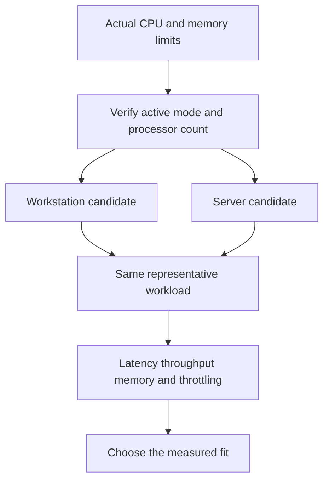

# Choose .NET Server or Workstation GC Under CPU Limits

Author: [nawazdhandala](https://www.github.com/nawazdhandala)

Tags: .NET, Garbage Collection, Kubernetes

Description: Verify the active GC mode and visible processors, then compare server and workstation GC under the service's actual CPU quota, memory budget and workload.

A service runs on a server, so server garbage collection must be the right choice. That shortcut breaks down when the service receives only a fraction of a CPU or shares a busy node with many other containers. Extra collection parallelism cannot create CPU time that the deployment does not have.

Choose the mode using the runtime's actual view of resources and a workload comparison. This guide uses .NET 10.0.15 with SDK 10.0.404. The local tests verify configuration behavior on macOS ARM64; they do not simulate Linux CPU throttling or establish which mode is faster for your service.

## Understand the decision you are making

Server GC is designed for throughput and scalability. Workstation GC has a different threading and resource model and is the default for standalone applications, although a host or project can choose otherwise. Both support background collection in modern .NET. Microsoft's [GC-mode overview](https://learn.microsoft.com/en-us/dotnet/standard/garbage-collection/workstation-server-gc) describes the distinction.

The useful question is whether collection can make productive use of the resources available to this process. A high-allocation service with several usable CPUs is a different workload from a mostly idle endpoint under a tight quota. The application name and hosting environment do not answer that question.

Keep GC mode separate from other controls. Background collection, heap limits, CPU affinity and runtime adaptation can change behavior independently. Altering several of them together makes it difficult to explain a result.

## Inspect what the running process sees

Record the runtime version, effective processor count and active GC mode at startup:

```csharp
using System.Runtime;

Console.WriteLine($"runtime={Environment.Version}");
Console.WriteLine($"processors={Environment.ProcessorCount}");
Console.WriteLine($"serverGC={GCSettings.IsServerGC}");
Console.WriteLine($"latencyMode={GCSettings.LatencyMode}");
```

`IsServerGC` reports the active mode, which is more useful than reading only the desired configuration. Its meaning is defined by the [GCSettings API](https://learn.microsoft.com/en-us/dotnet/api/system.runtime.gcsettings.isservergc?view=net-10.0).

`Environment.ProcessorCount` considers logical CPUs, affinity and CPU utilization limits according to the platform's supported behavior. A fractional utilization limit is rounded up for this integer value, and the result is established at runtime startup. See the [processor-count API documentation](https://learn.microsoft.com/en-us/dotnet/api/system.environment.processorcount?view=net-10.0).

That means an observed count of two does not prove the service can continuously consume two whole CPUs. Keep the real quota alongside the reported count. In Kubernetes, requests influence scheduling while CPU limits can impose throttling; the [resource-management documentation](https://kubernetes.io/docs/concepts/configuration/manage-resources-containers/) explains the distinction.

## Make the requested mode explicit

The companion console project contains the startup probe. Build two outputs with an explicit MSBuild property:

```bash
dotnet build Lab.csproj -c Release -o ./out/workstation \
  -p:ServerGarbageCollection=false
dotnet build Lab.csproj -c Release -o ./out/server \
  -p:ServerGarbageCollection=true

dotnet ./out/workstation/Lab.dll
dotnet ./out/server/Lab.dll
```

Inspect each generated `Lab.runtimeconfig.json`. Its `runtimeOptions.configProperties` should contain `System.GC.Server` with the corresponding boolean. These controls are documented in the [GC configuration reference](https://learn.microsoft.com/en-us/dotnet/core/runtime-config/garbage-collector).

Use the equivalent project setting for your application build rather than editing an arbitrary generated file that the next publish replaces. Also inspect deployment environment variables and runtime overrides. Most GC configuration is read at startup, so a changed setting requires a new process to evaluate.

## Reproduce the single-processor surprise

For configuration testing only, the processor-count override makes the behavior easy to inspect without changing host CPU settings:

```bash
DOTNET_PROCESSOR_COUNT=1 dotnet ./out/server/Lab.dll
DOTNET_PROCESSOR_COUNT=2 dotnet ./out/server/Lab.dll
```

Microsoft documents [`DOTNET_PROCESSOR_COUNT`](https://learn.microsoft.com/en-us/dotnet/core/compatibility/core-libraries/6.0/environment-processorcount-on-windows) as an override of the processors the runtime believes are available. It does not impose an OS CPU quota. Do not use these two commands as a container performance benchmark.

The local .NET 10.0.15 probe produced:

| Requested mode | Reported processors | Active server GC |
|---|---:|---|
| Workstation | 1 | False |
| Workstation | 2 | False |
| Server | 1 | False |
| Server | 2 | True |

The server-requested, one-processor case illustrates why the active-mode check matters. Two deployments that differ in configuration text may still run the same mode. Confirm the actual result before interpreting their performance as a server-versus-workstation comparison.

Do not force an artificially high processor count simply to make the server flag become true. That changes the runtime's assumptions without granting additional CPU capacity.

## Account for modern server-GC adaptation

In .NET 9 and later, dynamic adaptation to application sizes, or DATAS, is enabled by default. It adjusts GC resource use as the workload changes. The [configuration guide's DATAS section](https://learn.microsoft.com/en-us/dotnet/core/runtime-config/garbage-collector#dynamic-adaptation-to-application-sizes-datas) describes startup and load-transition behavior.

Consequently, an old rule of thumb based on a fixed heap arrangement may not describe .NET 10. Keep the same runtime patch and adaptation settings across the first comparison. Measure startup separately, then allow the sustained workload to settle before comparing steady-state behavior. Include a transition from light to heavy traffic because adaptation itself takes time.



## Run the comparison under the real quota

Use the same application build, runtime patch, memory limit, request mix and data for both candidates. Preserve connection and thread-pool settings. Run in the intended container environment instead of relying on the development laptop's available cores.

Test ordinary traffic, expected peak traffic and a bounded burst. Record offered work as well as completed work so a slower service cannot appear efficient merely because it accepts fewer requests. Keep the load generator outside the constrained service container.

| Evidence | What a difference may reveal |
|---|---|
| Request percentiles and error rate | Whether users benefit from the mode |
| Completed work at equal offered load | Whether throughput improved |
| CPU use and throttled intervals | Whether collection competes with application work |
| Managed heap and process memory | Whether the mode fits the memory budget |
| GC pause totals and collection counts | How collection behavior changed |
| Queue length and thread-pool delay | Whether another bottleneck dominates |

Repeat the runs and alternate their order. Avoid drawing conclusions from a single cold startup or a short burst on an otherwise idle node. A mode that wins with unlimited CPU can lose under quota contention.

## Roll out the measured choice

Select workstation GC if it meets the service target with a better measured resource tradeoff; select server GC when its throughput or latency advantage survives the actual limits. Neither result is a permanent rule for every service or future runtime version.

Canary the chosen configuration with startup verification enabled. Keep the previous artifact and settings ready, observe a full traffic cycle, and compare memory as well as response time. Revisit the decision when CPU limits, allocation behavior or runtime versions change. The outcome should be a repeatable service improvement, backed by the mode that actually ran.
