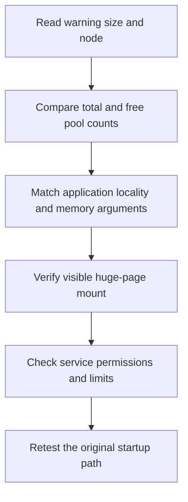

# Fix DPDK No Free Hugepages Warnings by Checking the Right Pool

Author: [nawazdhandala](https://www.github.com/nawazdhandala)

Tags: DPDK, HugePages, Troubleshooting

Description: Diagnose DPDK huge-page warnings by matching the reported size and NUMA node to available pools, visible mounts, launch settings, and service permissions.

A DPDK startup warning about free huge pages is more specific than it first appears. The message may concern one page size on one NUMA node. Another size or node can still have capacity, and initialization may continue successfully.

Before reserving more memory, capture the complete startup log and the final application outcome. The warning is a clue to compare with the application's allocation requirements, not a reason to reset all pools or delete files from a shared mount.

This guide checks behavior against the **DPDK v24.11 source tag** and the 24.11 documentation family. DPDK is the Data Plane Development Kit; its Environment Abstraction Layer, or EAL, initializes resources such as memory and devices. Distribution packages can carry changes, so record the application's actual DPDK build as part of the investigation.

## Read the size and node from the warning

The [v24.11 discovery implementation](https://raw.githubusercontent.com/DPDK/dpdk/v24.11/lib/eal/linux/eal_hugepage_info.c) emits the node-specific warning when that node's `free_hugepages` value is zero for the inspected size. The same file also has a different global availability calculation that considers reservations and reusable backing.

Do not combine those messages into one universal “RAM is exhausted” interpretation. Record the size in KiB, node identifier, nearby errors, and whether EAL initialization actually failed.

For example, a warning for 1048576 KiB pages on node 1 says nothing directly about free 2048 KiB pages on node 0. If the application uses the smaller pool successfully, the warning may not be the cause of a later device or queue setup error.

## Inventory the pools without changing them

If you have the matching DPDK source tree, its supplied helper can show the configured reservation and mounts:

```bash
python3 usertools/dpdk-hugepages.py --show
```

Run this from that source tree. The [v24.11 script](https://raw.githubusercontent.com/DPDK/dpdk/v24.11/usertools/dpdk-hugepages.py) reports configured page counts; it is not a per-process free-capacity guarantee. Its `--setup` option also clears and remounts as part of setup, so it is unsuitable as a casual diagnostic command on a shared worker.

For the free counts by node and size, save this Python 3.9+ reader as `pools.py`:

```python
import sys
from pathlib import Path
root = Path(sys.argv[1]) if len(sys.argv) == 2 else Path('/sys/devices/system/node')
print('node\tpage_kib\ttotal_pages\tfree_pages')
for pool in sorted(root.glob('node[0-9]*/hugepages/hugepages-*kB')):
    size = pool.name.removeprefix('hugepages-').removesuffix('kB')
    total = (pool / 'nr_hugepages').read_text().strip()
    free = (pool / 'free_hugepages').read_text().strip()
    print(f'{pool.parent.parent.name}\t{size}\t{total}\t{free}')
```

Run it on the Linux worker:

```bash
python3 pools.py
```

The table preserves separate rows for each node and page size. A row showing 512 total pages and zero free pages explains a different condition from a pool whose total is zero. Do not add the raw counts across sizes: one 1 GiB page is not equivalent to one 2 MiB page.

The [Linux HugeTLB guide](https://www.kernel.org/doc/html/v6.12/admin-guide/mm/hugetlbpage.html) describes these pool interfaces. Also inspect global reservations for the relevant size when available capacity is unclear. A pool's current free count can include pages already promised to mappings, and the situation can change while other applications allocate.

## Match the request to memory locality

NUMA describes memory locality within a machine. An application's workers and device queues can prefer or require memory associated with particular nodes. Having enough memory in aggregate does not establish that a node-specific request can be met.

Read the launch arguments from the service configuration or deployment manifest. Record `--socket-mem`, `--socket-limit`, core selection, and any application-specific socket choices. Do not invent a replacement command line without knowing the application's argument separator and device configuration.

In the [v24.11 EAL parameter definitions](https://raw.githubusercontent.com/DPDK/dpdk/v24.11/doc/guides/linux_gsg/linux_eal_parameters.rst), `--socket-mem` preallocates specified amounts by socket, while `--socket-limit` caps use per socket in non-legacy mode. The argument positions must match the machine's node numbering and intended allocation plan.

For a running process, read its allowed memory-node list and compare it with its actual policy. For a service that exits, inspect the configured CPU and memory restrictions in its launcher or container. Do not assume your interactive shell has the same placement as the service.



## Inspect the mount in the application's namespace

For conventional file-backed EAL operation, the correct pool must also be accessible through a suitable hugetlbfs mount. Inspect the intended path in the same mount namespace as the application:

```bash
findmnt --target /mnt/huge-2M --output TARGET,FSTYPE,OPTIONS
```

Replace the path with the actual configured huge-page directory. Expect the intended hugetlbfs filesystem and page size; a path that resolves to an ordinary parent filesystem is not evidence that the huge-page mount exists. The [findmnt manual](https://man7.org/linux/man-pages/man8/findmnt.8.html) defines this containing-filesystem lookup.

A host mount can be absent from a container's view. A mount can also expose the wrong size or have a size ceiling. Compare its options with the EAL huge-directory selection and the page-size rows you collected.

The DPDK [Linux requirements guide](https://doc.dpdk.org/guides-24.11/linux_gsg/sys_reqs.html) discusses reservation and mounting as separate preparation steps. Mounting a directory does not by itself reserve a useful pool, and reserving pages does not make the right directory visible inside a container.

## Check permissions as the service identity

Use the actual service user and groups to inspect directory access. A successful root shell test does not establish that an unprivileged service can create and access its backing files. Check security-policy denials and runtime/container restrictions if ownership looks correct.

DPDK's [non-root guidance](https://doc.dpdk.org/guides-24.11/linux_gsg/enable_func.html) separates huge-page directory access, process resource limits, and device access. Locked-memory and file-descriptor limits may matter, while VFIO device permissions are a separate issue. Correct only the constraint identified by the error; making the whole service privileged obscures the cause.

For a running process with a resolved host PID, inspect its limits read-only:

```bash
pid=12345  # Replace with the current application's host PID.
cat "/proc/$pid/limits"
```

The [proc limits interface](https://man7.org/linux/man-pages/man5/proc_pid_limits.5.html) reports that process's limits. It is more relevant than the limits of an unrelated shell.

## Preserve ownership of existing backing files

Files in the huge-page directory can belong to active DPDK processes or a coordinated primary/secondary setup. Do not remove them just because startup failed. Identify process ownership and the application's file-prefix and cleanup design first.

Memory mode matters too. The [EAL memory guide](https://raw.githubusercontent.com/DPDK/dpdk/v24.11/doc/guides/prog_guide/env_abstraction_layer.rst) distinguishes dynamic allocation from legacy behavior and documents how preallocation affects later memory release. A different mode can change the experiment enough that a successful retry no longer validates the original configuration.

Likewise, `--no-huge` switches the backing approach; it is not proof that the huge-page problem was repaired. Keep the intended memory mode during the acceptance test.

## Retest one supported correction

After fixing the demonstrated mismatch, repeat the same startup path, identity, namespace, and workload. Check successful EAL initialization and the application's required memory pools, then verify device/queue initialization separately. A disappearing warning is useful evidence, but usable application memory is the real outcome.

The pool reader was tested with synthetic nodes containing zero-free, partially free, and different-size pools. The official v24.11 helper's help output and source were checked, and shell snippets passed syntax checks. No DPDK application, Linux allocation, mount change, device binding, or performance test was executed for this article.
