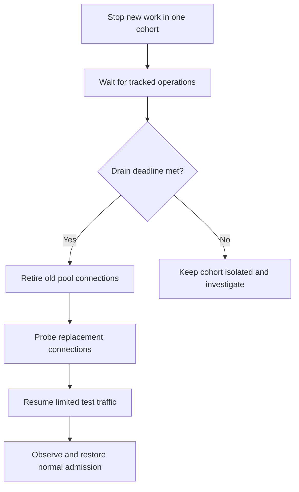

# Drain and Rebuild Database Pools After a Managed Failover

Author: [nawazdhandala](https://www.github.com/nawazdhandala)

Tags: PostgreSQL, Java, Reliability

Description: Recover a Java database pool after failover with controlled admission, bounded draining, HikariCP soft eviction, and gradual traffic restoration.

Replacing every application instance after a database failover may clear broken connections, but it can also send hundreds of new connection attempts to the recovering database. A better recovery procedure changes one application cohort at a time and checks that its work is correct before proceeding.

A connection pool is a collection of database sessions reused by application requests. Recovering it involves more than replacing sockets: requests may still own sessions, transactions may have uncertain outcomes, and background workers may keep borrowing connections while an operator thinks the service is drained.

This guide uses Java 17 and HikariCP 6.3.0 as a concrete example. The management methods are checked against that release's source. The same sequence can inform other pools, but their eviction and shutdown semantics must be checked separately.

## Confirm that replacement connections can work

Before changing the pool, verify that the database endpoint is ready for new connections from the application's network. Check name resolution, authentication, TLS trust, and a small query using the configured database account. A successful connection from an administrator's laptop does not establish the same path.

For an RDS Multi-AZ DB instance, failover updates the database endpoint's DNS record and requires clients to reestablish connections. An old application DNS cache can send replacement connections to an old address. Fix that condition before repeatedly emptying the pool. [RDS failover behavior](https://docs.aws.amazon.com/AmazonRDS/latest/UserGuide/Concepts.MultiAZ.Failover.html).

Also confirm the current error is a connection problem. A slow query, exhausted database capacity, or invalid credential does not improve merely because more sessions are created.

## Close application admission first

Choose one instance or small cohort that the remaining fleet can temporarily cover. Stop admitting new database-using work there. Include HTTP requests, queue consumers, scheduled tasks, and internal retries. Removing a web instance from a load balancer does not pause its background jobs.

Use an application-level admission gate: a control that rejects or defers new work before it obtains a database connection. Keep administrative observation and recovery probes available through a controlled path. The gate needs an owner, a visible state, and a defined way to reopen it.



Do not substitute HikariCP's `suspendPool()` for this admission gate. Its management interface documents that borrowers can block without a timeout while suspended. Creating more blocked request threads is not a controlled drain. [HikariCP 6.3.0 management interface](https://github.com/brettwooldridge/HikariCP/blob/HikariCP-6.3.0/src/main/java/com/zaxxer/hikari/HikariPoolMXBean.java).

## Give existing work a bounded opportunity to finish

Track the application's admitted operations, including work waiting to acquire a connection. Stop retry producers before deciding that the cohort is quiet. Let existing operations complete within an agreed deadline based on the service's transaction expectations.

Pool counters help explain progress, but they are point-in-time observations. HikariCP exposes active, idle, total, and waiting counts; separate samples can disagree because activity changes between reads. A momentary active count of zero is not a synchronization barrier proving no new borrower can appear. Establish that guarantee in the application lifecycle. [HikariCP monitoring guidance](https://github.com/brettwooldridge/HikariCP/wiki/MBean-%28JMX%29-Monitoring-and-Management).

If the deadline expires, keep the cohort isolated and identify what remains. A legitimate long transaction, leaked connection, and network-stalled operation need different remedies. Apply the service's tested cancellation or termination policy rather than closing arbitrary sessions from an administrative loop.

An interrupted commit can leave its outcome unknown to the client. Record its business operation ID and reconcile the durable result before replaying it. Reopening the pool does not resolve that uncertainty.

## Retire connections using the pool's supported operation

HikariCP soft eviction closes idle connections and marks borrowed ones for retirement when returned. It does not forcibly complete their transactions. This makes it useful after an application drain, while still requiring the earlier deadline and outcome handling. [Versioned eviction implementation](https://github.com/brettwooldridge/HikariCP/blob/HikariCP-6.3.0/src/main/java/com/zaxxer/hikari/pool/HikariPool.java).

The following helper belongs inside your application's controlled maintenance path. Pass the **existing, initialized** `HikariDataSource`; do not construct an unrelated pool for the operation. Before calling it, close application admission and finish the tracked drain. The helper cannot implement those application-specific responsibilities.

```java
import com.zaxxer.hikari.HikariDataSource;
import com.zaxxer.hikari.HikariPoolMXBean;
import java.sql.Connection;
import java.sql.ResultSet;
import java.sql.SQLException;
import java.sql.Statement;

public final class PoolRecovery {
    private PoolRecovery() {}

    public static void evictAndProbe(HikariDataSource dataSource)
            throws SQLException {
        if (!dataSource.isRunning()) {
            throw new IllegalStateException("Pool must be initialized and running");
        }
        HikariPoolMXBean pool = dataSource.getHikariPoolMXBean();
        if (pool == null) {
            throw new IllegalStateException("Pool management handle unavailable");
        }

        pool.softEvictConnections();

        try (Connection connection = dataSource.getConnection();
             Statement statement = connection.createStatement()) {
            statement.setQueryTimeout(5);
            try (ResultSet result = statement.executeQuery("SELECT 1")) {
                if (!result.next() || result.getInt(1) != 1) {
                    throw new SQLException("Unexpected probe result");
                }
            }
        }
    }
}
```

The management handle is available directly from the data source; this example does not require exposing a remote management endpoint. HikariCP documents that a lazily initialized data source can return a null handle before its first connection. [Data source methods](https://github.com/brettwooldridge/HikariCP/blob/HikariCP-6.3.0/src/main/java/com/zaxxer/hikari/HikariDataSource.java).

The probe borrows through the actual pool and returns its resources with Java's try-with-resources construct. `setQueryTimeout(5)` requests a five-second statement execution limit. It does not bound the preceding connection acquisition, every network failure, or the entire maintenance operation. Configure and test pool acquisition and driver connection/network timeouts separately. [Java 17 Statement contract](https://docs.oracle.com/en/java/javase/17/docs/api/java.sql/java/sql/Statement.html).

Success means this pool supplied a connection capable of the probe query. It does not prove write authorization, business correctness, or that an improperly drained borrower has disappeared. If the probe fails, leave normal admission closed and inspect the cause.

## Rebuild capacity without creating a connection surge

Soft eviction retains the pool object and lets it replenish physical connections. It is not a request to recreate the entire application data source. HikariCP's `minimumIdle` and `maximumPoolSize` influence replenishment and capacity; review them alongside the total number of application instances. [HikariCP 6.3.0 configuration](https://github.com/brettwooldridge/HikariCP/blob/HikariCP-6.3.0/README.md).

If configuration changes require a new data source, coordinate that replacement through the framework's lifecycle so all consumers move to the intended object. Do not close the old object while components still depend on it. HikariCP shutdown can abort or close active connections, so it is not equivalent to graceful draining. [Shutdown implementation](https://github.com/brettwooldridge/HikariCP/blob/HikariCP-6.3.0/src/main/java/com/zaxxer/hikari/pool/HikariPool.java).

Allow a small amount of controlled application traffic before restoring normal writers. Check successful business operations, acquisition wait time, connection creation, and database load. Expand only after those remain stable for the agreed observation window.

Repeat for the next cohort instead of applying eviction across the fleet simultaneously. Record any manual intervention and unreconciled operation. Recovery is complete when normal work succeeds reliably and its outcomes are accounted for, not when a pool counter briefly looks healthy.
