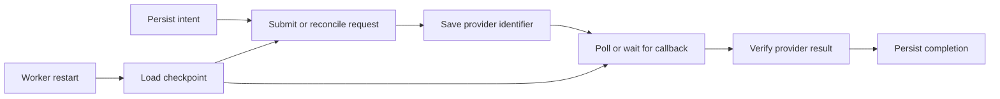

# Make Long-Running Cloud Automation Resume Safely

Author: [nawazdhandala](https://www.github.com/nawazdhandala)

Tags: AWS, Cloud Automation, Reliability

Description: Design long-running cloud workflows with durable checkpoints, bounded polling, protected callback tokens, and recovery that resumes existing operations.

A cloud API returns an operation ID, but the work takes another forty minutes. The worker that submitted it restarts after five minutes. A durable workflow should resume observing the same operation, not submit another one and hope the first disappeared.

That requires separating three things: the requested business operation, the provider's operation or resource identifier, and the workflow step currently waiting for progress. Polling and callbacks are ways to learn about completion. Neither replaces a durable record of what was requested.

## Choose how to wait

Polling periodically asks the provider for status. It works when the provider exposes a reliable status endpoint but no suitable completion event. Save the provider operation ID, next-check time, attempt count, and overall deadline. Use bounded backoff with jitter rather than keeping a worker asleep for the entire operation.

Callbacks let a worker report completion to the workflow. They reduce unnecessary status checks, but require authenticated delivery, duplicate handling, and a plan for missing or late messages.

AWS Step Functions provides request-response, supported job-waiting `.sync`, and callback `.waitForTaskToken` integrations. Support depends on the service and workflow type; adding `.sync` to an arbitrary API integration does not make it supported. See the [integration-pattern reference](https://docs.aws.amazon.com/step-functions/latest/dg/connect-to-resource.html).

For Step Functions, Standard workflows support long-running execution and callback patterns. Express workflows have a shorter duration limit and do not support those same waiting patterns. Choose based on the operation's lifetime and integration requirements, following [workflow type guidance](https://docs.aws.amazon.com/step-functions/latest/dg/choosing-workflow-type.html).

## Save checkpoints around external effects

Use a durable operation record outside the worker process:

| Field | Why it matters |
| --- | --- |
| Business operation ID | Identifies the requested action across retries |
| Request revision and parameter hash | Detects changed intent under the same identity |
| Provider operation/resource ID | Resumes observation without creating again |
| Phase and last observed status | Distinguishes submission, waiting, and verification |
| Deadline and next-check time | Bounds waiting across worker restarts |
| Attempt identity | Separates an old callback from the current wait |
| Result and verification evidence | Supports reconciliation and handoff |

Persist intent before submission. After submission, persist the provider identifier. The gap between those two writes is important: if the provider accepted the operation but the response was lost, the record may still say “submitting.”

Resolve that ambiguous state using a provider-supported idempotency mechanism or a lookup tied to the stable operation identity. If neither exists, stop for reconciliation rather than guessing that the operation never started. Workflow durability does not create a transaction spanning your database and a cloud API.



A resumed “waiting” operation goes back to observation. A resumed “submitting” operation first resolves whether submission happened.

## A concrete callback workflow

The following Amazon States Language JSON describes the callback part of a **Standard** workflow. The input must contain an existing durable `operationId`. The queue worker loads the reviewed request from the operation store using that ID.

Replace the queue URL, account, Region, and verifier function ARN with your own resources. The function suffix `:7` is an illustrative published Lambda version, not a version to deploy blindly. Prerequisites include the queue, worker, operation store, verifier function, and scoped execution/worker permissions. This definition does not create them.

```json
{
  "Comment": "Callback completion followed by independent verification",
  "QueryLanguage": "JSONPath",
  "StartAt": "DispatchAndWait",
  "TimeoutSeconds": 7200,
  "States": {
    "DispatchAndWait": {
      "Type": "Task",
      "Resource": "arn:aws:states:::sqs:sendMessage.waitForTaskToken",
      "TimeoutSeconds": 3600,
      "Parameters": {
        "QueueUrl": "https://sqs.eu-west-1.amazonaws.com/222222222222/operation-work",
        "MessageBody": {
          "operationId.$": "$.operationId",
          "taskToken.$": "$$.Task.Token"
        }
      },
      "ResultPath": "$.completion",
      "Next": "VerifyOperation"
    },
    "VerifyOperation": {
      "Type": "Task",
      "Resource": "arn:aws:states:::lambda:invoke",
      "TimeoutSeconds": 60,
      "Parameters": {
        "FunctionName": "arn:aws:lambda:eu-west-1:222222222222:function:verify-operation:7",
        "Payload": {
          "operationId.$": "$.operationId",
          "completion.$": "$.completion"
        }
      },
      "ResultPath": "$.verification",
      "End": true
    }
  }
}
```

The first task sends the operation ID and a Step Functions task token to SQS, then waits up to an hour. `ResultPath` preserves the original input while placing callback output under `completion`. The second task independently verifies the provider result.

These fields follow the documented [SQS callback integration](https://docs.aws.amazon.com/step-functions/latest/dg/connect-sqs.html) and [JSONPath task parameters](https://docs.aws.amazon.com/step-functions/latest/dg/state-task.html). The verifier must raise an exception when the operation is unconfirmed or inconsistent. Merely returning `{"verified": false}` would still be a successful Lambda invocation in this definition. The [Lambda integration documentation](https://docs.aws.amazon.com/step-functions/latest/dg/connect-lambda.html) explains function-error handling.

The example intentionally has no automatic resubmission retry. A timeout stops the workflow; it does not cancel an already-running provider operation. Reconciliation must determine its actual state before any resumption or compensation.

## Return the token without treating it as an operation ID

A callback token identifies a waiting workflow task. It is not the business operation ID, the provider's job ID, or an API pagination token. Keep it out of ordinary logs and restrict access to the queue and stored task-attempt records.

Once the worker has durably recorded its result, it can use this Python 3.11 helper. It was tested with Boto3 **1.40.76** and stubbed SDK responses. Pass an authorized Step Functions client and the token received for the current task attempt.

```python
import json


def report_completion(client, task_token, operation_id, resource_id):
    payload = json.dumps({
        'operationId': operation_id,
        'resourceId': resource_id,
    }, separators=(',', ':'))
    return client.send_task_success(taskToken=task_token, output=payload)
```

`SendTaskSuccess` requires a JSON-encoded output string. Expired or already-closed tasks can return `TaskTimedOut`; invalid tokens and permission failures must be handled separately. See the [callback API](https://docs.aws.amazon.com/step-functions/latest/apireference/API_SendTaskSuccess.html). Callbacks require a principal in the same AWS account as the waiting task, as described in the integration-pattern documentation.

A lost callback response is another ambiguous outcome. Inspect workflow and operation records before treating a later rejection as failure of the underlying cloud operation. Never attach an old token to a new attempt merely because the business operation ID is unchanged.

## Make the queue and workflow recover together

Standard SQS queues can deliver a message more than once. Workers must deduplicate the business operation and coordinate ownership before starting external effects. See [at-least-once delivery](https://docs.aws.amazon.com/AWSSimpleQueueService/latest/SQSDeveloperGuide/standard-queues-at-least-once-delivery.html).

The queue's visibility timeout is separate from the workflow's task timeout. If a worker keeps a message while working, manage visibility within the service limits. If it acknowledges after a durable handoff, the operation store must drive subsequent progress. Neither strategy should leave the only operation identifier in worker memory. See [SQS visibility timeout](https://docs.aws.amazon.com/AWSSimpleQueueService/latest/SQSDeveloperGuide/sqs-visibility-timeout.html).

For a polling implementation, persist `nextCheckAt` and schedule a new observation. Step Functions `Wait` states can wait until a timestamp through `TimestampPath`; only one wait-time form is allowed per state. See the [Wait-state reference](https://docs.aws.amazon.com/step-functions/latest/dg/state-wait.html).

Test recovery at the awkward boundaries: after provider acceptance, before identifier persistence, after result persistence, and after callback acceptance with a lost response. Also test a deadline expiring while the provider keeps running. Completion should mean the correct operation was independently verified and recorded, not just that a worker survived long enough to print “done.”
