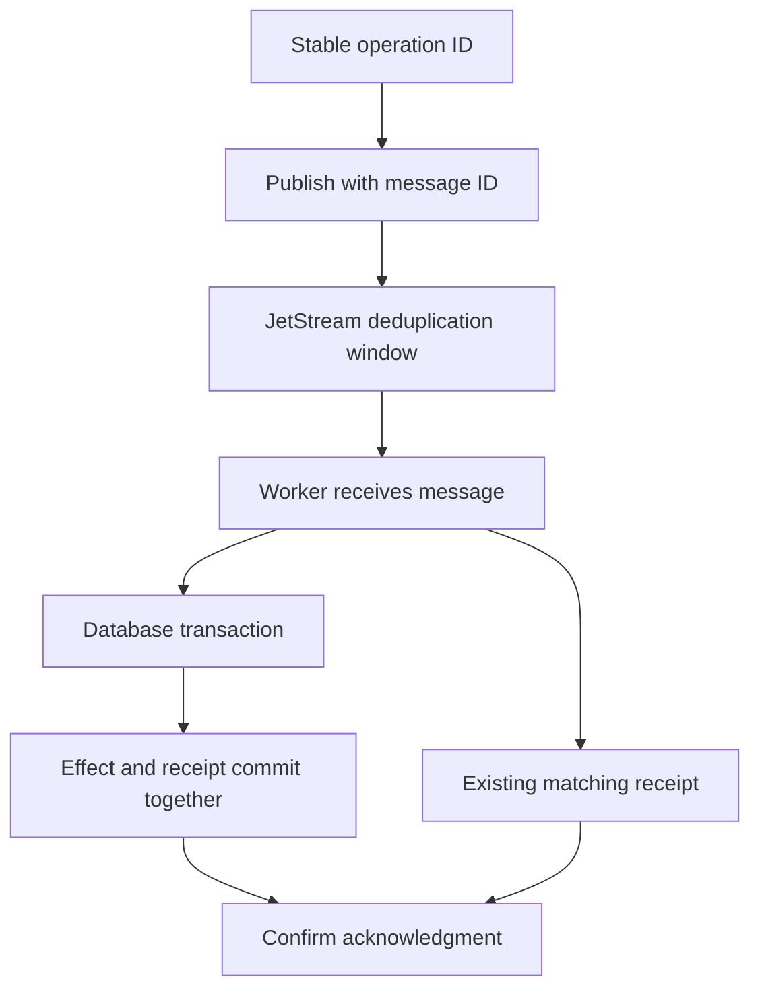

# Build Effectively-Once Processing with NATS JetStream

Author: [nawazdhandala](https://www.github.com/nawazdhandala)

Tags: NATS, Messaging, Python, SQLite

Description: Combine stable publish IDs, confirmed acknowledgments, and an atomic database receipt to prevent repeated JetStream deliveries from repeating business effects.

“Exactly once” becomes ambiguous when a message broker and a business database are separate systems. A message may be stored once but delivered twice. A worker may update the database once and then lose its acknowledgment. The useful application goal is usually narrower: repeated deliveries of one operation should produce one committed business effect.

This is effectively-once processing. It combines protections at different boundaries instead of assuming one broker option covers the entire workflow.

The local example was tested with **NATS Server 2.11.4**, **nats-py 2.10.0**, **Python 3.11**, and SQLite **3.54.1**. It verified duplicate publications, redelivery after reopening the database, and transactional rollback. It did not simulate power loss or a distributed database cluster.

## Give each layer a precise responsibility

| Protection | What it addresses | What it does not address |
|---|---|---|
| Stable `Nats-Msg-Id` | Duplicate publications within the stream's deduplication window | Retries after that window or duplicate business effects |
| Confirmed acknowledgment | Uncertainty about whether the server processed the consumer acknowledgment | Atomicity with an external database |
| Transactional operation receipt | Repeated application of the same business operation | External effects outside that transaction |

The [publishing guide](https://docs.nats.io/learn/jetstream/publishing) explains JetStream publish acknowledgments and message IDs. Keep the same ID when retrying the same operation. Generating a new ID on every timeout defeats publish deduplication.

Store the operation identity with the payload or producer's durable work record before the first publication. If the process restarts, it must recover that same identity. A publish timeout is an uncertain outcome, not proof that the stream rejected the message.



## Publish with a stable operation ID

In an existing asynchronous Python application, `js` below is the connected client's JetStream context. The destination stream must already capture `operations`. Install the pinned client in a virtual environment with `pip install nats-py==2.10.0`.

```python
job = {"operation_id": "operation-1", "amount": 7}
payload = json.dumps(job).encode()
ack = await js.publish("operations", payload,
    headers={"Nats-Msg-Id": job["operation_id"]})
```

Import `json`, check exceptions, and retain the returned publish result for diagnostics. The fixed operation ID is a lab value; real producers need a unique durable ID per business operation. Never reuse an ID for a different operation.

Deduplication does not validate that two publications with the same ID contain the same business meaning. Treat ID generation and reuse as an application contract. Also choose the stream's deduplication window based on your expected retry horizon and resource budget, rather than assuming it lasts forever.

## Commit the effect and receipt in one database transaction

The example business operation adds an integer amount to a counter. The `processed` table is a durable receipt that records which operation IDs already affected that counter. Both changes must commit together.

Initialize a **new disposable database**, not an existing application database:

```python
import sqlite3

db = sqlite3.connect("worker.db", isolation_level=None)
db.executescript("""
CREATE TABLE counter(id INTEGER PRIMARY KEY, total INTEGER NOT NULL);
INSERT INTO counter VALUES(1, 0);
CREATE TABLE processed(id TEXT PRIMARY KEY, digest TEXT NOT NULL);
""")
```

The explicit transaction mode is intentional. `BEGIN IMMEDIATE` obtains SQLite's write transaction before checking the receipt, so concurrent writers cannot both decide that an operation is new and then apply it independently. SQLite permits one writer at a time; see its [transaction documentation](https://www.sqlite.org/lang_transaction.html).

Use this handler for the counter and receipt together:

```python
import hashlib
import json


def apply_once(db, job):
    operation_id = job["operation_id"]
    amount = job["amount"]
    if not isinstance(operation_id, str) or not operation_id:
        raise ValueError("operation_id must be nonempty")
    if type(amount) is not int:
        raise ValueError("amount must be an integer")
    digest = hashlib.sha256(json.dumps(job, sort_keys=True,
        separators=(",", ":")).encode()).hexdigest()
    db.execute("BEGIN IMMEDIATE")
    try:
        prior = db.execute("SELECT digest FROM processed WHERE id = ?",
                           (operation_id,)).fetchone()
        if prior:
            if prior[0] != digest:
                raise ValueError("operation ID reused with different content")
            db.commit()
            return False
        updated = db.execute("UPDATE counter SET total = total + ? WHERE id = 1",
                             (amount,))
        if updated.rowcount != 1:
            raise RuntimeError("counter row missing")
        db.execute("INSERT INTO processed(id, digest) VALUES (?, ?)",
                   (operation_id, digest))
        db.commit()
        return True
    except Exception:
        db.rollback()
        raise
```

The first delivery returns `True` after committing both the counter update and receipt. A later delivery with the same ID and content returns `False` without changing the counter. Reusing the ID with different content raises an error instead of silently treating a different operation as complete.

The digest uses a deterministic JSON encoding for this small payload contract. Define normalization carefully for your real schema; changes in optional fields, numeric representation, or schema version may need an explicit compatibility rule.

Parameterized SQL keeps values separate from statements. The [Python sqlite3 documentation](https://docs.python.org/3.11/library/sqlite3.html) covers parameters, explicit commits, and rollbacks. If either the update or receipt insertion fails, this function rolls back the transaction and leaves the message unacknowledged.

An in-memory set is not equivalent to the receipt table. It disappears on restart and cannot coordinate independent workers. In production, the business effect and receipt must share the same transactional database boundary; giving each replica an unrelated local SQLite file would not deduplicate across the pool.

## Confirm the acknowledgment after the commit

Connect the database handler to a received JetStream message:

```python
async def handle_message(db, msg):
    job = json.loads(msg.data)
    applied = apply_once(db, job)
    await msg.ack_sync(timeout=2)
    return applied
```

In [nats-py 2.10.0](https://github.com/nats-io/nats.py/blob/v2.10.0/nats/aio/msg.py), `ack_sync` waits for the server to process the acknowledgment. This is the acknowledgment-confirmation step sometimes called a double acknowledgment.

If the database commit succeeds but this call times out, report the uncertain acknowledgment and let the normal retry policy operate. A later delivery will find the durable receipt and avoid applying the effect again. If the database function fails, the acknowledgment call is never reached.

The synchronous SQLite work is intentionally small for this demonstration. A production asynchronous worker needs a database access design with bounded operation times and suitable concurrency. Do not let a long database lock wait consume the entire consumer acknowledgment deadline.

## Test the failure boundaries, not just the happy path

The local test performed these checks in a disposable stream and database:

- Publishing the same ID twice immediately returned the original stream sequence for the duplicate.
- The first delivery committed the counter update but was deliberately left unacknowledged.
- After the database connection was closed and reopened, redelivery found the receipt and left the counter at seven.
- Publishing again after a shortened lab deduplication window created a new stream record, but the database still prevented a second effect.
- Reusing the operation ID with a different amount was rejected.
- An injected failure during receipt insertion rolled back the preceding counter update too.

These checks demonstrate why transport deduplication and business idempotency complement each other. The test omitted an acknowledgment deliberately; it did not inject network-packet loss or terminate the machine during a commit.

## Keep the guarantee within its boundary

A database transaction cannot atomically include sending an email or charging a third-party payment service. For those operations, use an appropriate durable handoff and the external service's idempotency mechanism, then reconcile uncertain outcomes. Merely writing a local receipt before an external call can falsely record success; writing it afterward can leave a duplicate-effect window.

Receipt retention is also part of the contract. If you delete a receipt while old messages or producer retries can still return, the operation can be applied again. Size that retention against replay, backup restoration, and retry horizons, not just the stream's ordinary deduplication window.

Finally, distinguish duplicate detection from error suppression. A malformed payload, conflicting operation identity, or database failure needs a retry or quarantine policy. Only an existing matching successful receipt is grounds to skip the business mutation and acknowledge completion. That distinction turns repeated delivery from a dangerous surprise into an expected, testable part of processing.
