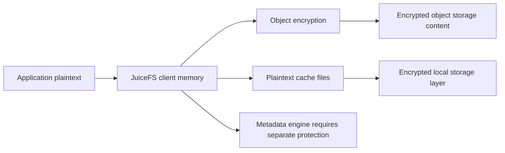

# Encrypt JuiceFS Objects and Protect Plaintext in the Client Cache

Author: [nawazdhandala](https://www.github.com/nawazdhandala)

Tags: JuiceFS, Security, Storage

Description: Combine JuiceFS object encryption with encrypted cache storage, guarded startup, and recoverable keys without assuming every local copy is protected.

Enabling JuiceFS encryption does not make every copy of a file encrypted. The client decrypts data to serve applications, and its local cache can contain plaintext. An encrypted object bucket therefore does not, by itself, protect a stolen client disk.

For **JuiceFS Community Edition 1.4.2**, design two separate protections: client-side encryption for uploaded objects and storage encryption underneath every persistent cache directory. Then account for metadata, process memory, application temporary files, and backups. Each has a different exposure path.

## Draw the boundaries before choosing settings

JuiceFS encrypts data before uploading it to object storage. Its built-in encryption does not encrypt filenames and other filesystem metadata, and decrypted data exists in client memory. The official [versioned encryption guide](https://github.com/juicedata/juicefs/blob/v1.4.2/docs/en/security/encryption.md) explicitly identifies the local cache as unencrypted and recommends an encrypted filesystem or block device underneath it.



The local storage layer protects stored blocks while its encryption key is unavailable. Once unlocked, the mounted filesystem exposes plaintext to authorized processes. This does not protect against a compromised running client that can access the mount or obtain its keys.

Keep transport encryption separate too. HTTPS protects the connection to object storage, and the metadata engine needs its own authenticated TLS connection. Neither encrypts cache files at rest. Server-side bucket encryption is another independent layer and does not remove the client-cache requirement.

## Plan a new encrypted volume

For this release, enable JuiceFS encryption when creating the filesystem. Do not assume an existing unencrypted volume can be converted by changing a mount flag. A migration to a new encrypted volume needs its own data-copy, validation, and cutover plan.

Before creation, reserve an unused metadata destination and an appropriate object-storage location. Arrange access through your normal secret-management mechanism. Record the volume identity, encryption algorithm, key recovery location, and metadata-backup process without putting secrets in the operational checklist.

Here is a staging example using **OpenSSL 3.6** and JuiceFS 1.4.2. Run it in Bash from a restricted directory on approved encrypted storage. The key filename must be new; the explicit guard avoids replacing an existing key.

```bash
umask 077
KEY_FILE="$PWD/juicefs-staging-key.pem"
if [ -e "$KEY_FILE" ]; then
  echo 'Choose a new key filename; existing key was not changed.' >&2
  exit 1
fi
openssl genrsa -aes256 -out "$KEY_FILE" 2048
```

OpenSSL prompts for a passphrase and writes an encrypted RSA private key. The AES option here protects the key file itself. The JuiceFS data-encryption algorithm is selected separately below. OpenSSL documents these options in its [genrsa reference](https://docs.openssl.org/3.6/man1/openssl-genrsa/).

The following placeholders require deliberate replacement: `metadata.example.internal`, database `9`, the bucket endpoint, and the volume name. Database 9 must be reserved and unused. Configure metadata authentication and object credentials through the approved environment or credential mechanism before running the command.

```bash
read -r -s -p 'Private-key passphrase: ' JFS_RSA_PASSPHRASE
printf '\n'
export JFS_RSA_PASSPHRASE

juicefs format --no-update \
  --storage s3 \
  --bucket https://juicefs-staging.objects.example.internal \
  --encrypt-rsa-key "$KEY_FILE" \
  --encrypt-algo aes256gcm-rsa \
  rediss://metadata.example.internal:6379/9 encrypted-staging
```

`--no-update` prevents this example from updating an existing volume's configuration; it does not establish that you selected the intended destination. Confirm the new volume's identity and successful initialization before proceeding. The supplied encrypted private-key content is stored in metadata. The passphrase is needed by subsequent clients to use it. The [tagged format implementation](https://github.com/juicedata/juicefs/blob/v1.4.2/cmd/format.go) connects the encryption configuration to the object-storage wrapper.

An environment variable avoids putting the passphrase directly in command arguments, but it remains a secret in the process environment. Do not print it or enable shell tracing. For a service, use a restricted secret-injection mechanism rather than an interactive shell. Clear the interactive variable after the client that needs it has been started.

## Put the cache on an independently encrypted mount

Have the platform team provision and verify an encrypted local filesystem before configuring JuiceFS. For example, `/srv/juicefs-cache` could be a separately mounted filesystem backed by an approved encrypted device. This article does not provide disk-formatting commands: the selected device and its existing contents must be established first.

On Linux, inspect where the directory actually resides:

```bash
findmnt --target /srv/juicefs-cache \
  --output TARGET,SOURCE,FSTYPE,OPTIONS
```

Expect the intended mount and source device, not an accidental fallback to the root filesystem. `findmnt` reports the filesystem serving a path; it does not independently certify encryption or key policy. Compare the output with the provisioned device's encryption configuration. See the [findmnt manual](https://man7.org/linux/man-pages/man8/findmnt.8.html).

For this layout, use a startup guard before launching a foreground mount:

```bash
if ! mountpoint -q /srv/juicefs-cache; then
  echo 'Required cache filesystem is not mounted.' >&2
  exit 1
fi

juicefs mount \
  --cache-dir /srv/juicefs-cache/encrypted-staging \
  --cache-size 10240 \
  rediss://metadata.example.internal:6379/9 /mnt/encrypted-staging
```

Prepare the application mountpoint and cache permissions for the service account beforehand. The encrypted cache filesystem must already be verified, and the process must receive the same key passphrase. The cache size is an illustrative **10GiB** limit expressed in MiB.

The guard checks only whether the exact directory is a mountpoint, as defined by [util-linux mountpoint](https://github.com/util-linux/util-linux/blob/v2.41.2/sys-utils/mountpoint.1.adoc). It cannot detect the wrong filesystem mounted there. A production service needs both correct device identification and startup dependencies that prevent JuiceFS from starting before the encrypted storage is available.

## Include every persistent plaintext location

Check every client, not just the first node. Multiple cache directories require the same protection individually. Kubernetes mount pods need cache paths backed by appropriately protected node storage; encrypting a container image does not accomplish that.

Include writeback staging if writeback is enabled. Those blocks may be the only pending copy of recent writes, so do not delete or relocate that directory as routine cache cleanup. Drain and stop affected clients through the supported workflow before changing cache placement.

Also inventory application scratch space, swap, crash dumps, and backups. Moving future cache writes to an encrypted device does not retroactively protect old cache files on the previous device. Handle their retention and disposal according to the storage medium and your data policy.

## Prove recovery as well as confidentiality

In staging, write a recognizable test file and read it from another client with an empty cache and the correct secrets. Verify its hash. Then test that an incorrectly configured client cannot open the encrypted volume successfully. Check startup refusal with the cache mount unavailable; it must not silently write into the underlying directory.

Keep the original encryption key recoverable independently of the running metadata service, with its passphrase protected separately. Retain compatible metadata and object backups and rehearse a clean-client recovery. Replacing a lost key with a newly generated key does not recover existing ciphertext.

Local validation for this guide confirmed that JuiceFS 1.4.2 accepts an OpenSSL-generated encrypted key when formatting a disposable SQLite-backed volume and rejects an incorrect passphrase. It did not mount JuiceFS or test Linux disk encryption. Those deployment checks remain essential before calling the full storage path protected.
