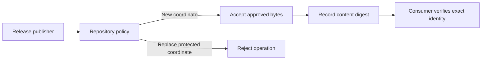

# Enforce Immutability for Maven, Packages, and Container Tags

Author: [nawazdhandala](https://www.github.com/nawazdhandala)

Tags: Artifact Management, Maven, npm, Docker, Security

Description: Match immutability controls to Maven releases, package versions, and container tags, then verify denied replacement and preserved artifact identity in staging.

An immutable release means a consumer can ask for the same identity tomorrow and receive the same intended bytes. That promise breaks differently across artifact formats. A Maven release can be redeployed, a package registry can implement unexpected overwrite behavior, and a container tag can move to a different manifest.

Start by naming the identity you want to protect. Then configure the repository's enforcement rule and test it using the publishing identity. A filename convention, checksum sidecar, or polite instruction to CI is not enough.

## Define the protected coordinate

| Format | Identity to protect | Common confusion |
| --- | --- | --- |
| Maven release | Repository plus group, artifact, version, classifier and extension | Treating `-SNAPSHOT` as a fixed release |
| npm package | Registry, package name and version | Treating a mutable distribution tag as a version |
| Container image | Registry/repository and protected tag mapping | Assuming a tag is already content-addressed |
| Content reference | Artifact or manifest digest | Assuming immutable identity guarantees indefinite availability |

Maven commonly abbreviates coordinates as group, artifact, and version, but classifier and extension also matter. Its [artifact documentation](https://maven.apache.org/repositories/artifacts.html) notes that identical coordinates can exist in different repositories. Different bytes at those coordinates can therefore create a problem even when each repository separately prevents overwrites.

For containers, distinguish an image index from its platform-specific manifests. A multi-platform tag can resolve to an index digest, while the runtime selects a child manifest for its architecture. Record which object your approval and comparison refer to.

## Give Maven releases their own write policy

In Nexus Repository, configure the hosted release repository's deployment policy to **Disable redeploy**, and keep normal build publishers away from permissions that delete content or change repository configuration. The [configurable-fields documentation](https://help.sonatype.com/en/configurable-repository-fields.html) describes the policy: the same component cannot be deployed again.

Use separate snapshot and release repositories with appropriate version policies. A snapshot is a development resolution model with changing metadata and timestamped builds; do not apply a release immutability assumption to the base `1.4.0-SNAPSHOT` coordinate. Preserve exact resolved inputs when reproducibility matters.

For a release, protect the complete publication set: the main artifact, POM, classifiers, checksums, and any required signatures. If publication fails halfway through, do not grant overwrite rights as the default repair. Determine which files exist and whether their digests match the intended release, then use the repository's supported staging or recovery procedure.

In Artifactory, the permissions model separates deployment from Delete/Overwrite and documents withholding Delete to prevent release overwrites. Its exception for non-unique Maven snapshots is another reason to separate development and release behavior. See [Artifactory permissions](https://docs.jfrog.com/administration/docs/permissions).

## Do not generalize public npm rules to every private server

The public npm registry treats a published package-name/version combination as unique and does not permit reuse even after unpublishing. That behavior is documented in the [npm unpublish policy](https://docs.npmjs.com/policies/unpublish/).

A private npm-compatible repository is a different implementation with its own deployment and deletion policies. Verify its behavior rather than assuming protocol compatibility guarantees the public registry's policy. Test the same package name and version with a changed tarball using a disposable staging namespace.

Also distinguish versions from npm distribution tags such as `latest` or `next`. Consumers using a moving label have chosen a mutable selection mechanism even if the individual package versions never change. Record the resolved version and integrity value in the approved build inputs. Deprecation or a new fixed release is usually a clearer response to a bad package than trying to replace its bytes.

## Protect container tag mappings explicitly

Harbor supports project-level tag immutability rules. For a dedicated release project, a simple policy is to match all repositories and all tags with `**`. In the 2.14-series interface, add the rule under the project's Policy → Tag Immutability page, with both selectors set to matching. Review the [versioned Harbor rule documentation](https://goharbor.io/docs/2.14.0/working-with-projects/working-with-images/create-tag-immutability-rules/).

Use a supported patched release. Harbor's [multi-selector advisory](https://github.com/goharbor/harbor/security/advisories/GHSA-27f2-qg57-2gwg) identifies fixes including **2.14.5**, **2.15.3**, and **2.13.6**. Affected versions evaluated only the first selector in certain automation-created rules; the advisory distinguishes those rules from the single-pattern UI representation. Check the installed patch level and the actual stored rule, not just its display name.

Keep development tags in another project if they intentionally move. Avoid a broad project policy followed by ad hoc exceptions nobody tests. Harbor combines separate immutability rules with OR logic, so matching any rule is enough to protect a tag; an exception in one rule does not necessarily undo another matching rule.



Immutability and retention must agree. Blocking tag replacement does not replace backup planning, and digest references are useful only while the referenced content remains available. Review deletion, retention, replication, and administrator access alongside the release policy.

## Inspect the tag's current manifest without changing it

This read-only check uses the **OCI Distribution Specification 1.1.1** manifest endpoint with **curl 8.7.1** and **Python 3.9.6**. It compares the raw returned manifest bytes with a SHA-256 digest from an approved release record. The [distribution specification](https://github.com/opencontainers/distribution-spec/blob/v1.1.1/spec.md) defines manifest retrieval and media-type negotiation.

Set the registry URL and a protected curl configuration containing a valid, read-scoped registry token. This example assumes token acquisition has already happened; it does not implement the registry authentication challenge flow. Replace the repository and tag path. Run in a fresh working directory because it writes `observed-manifest.json`.

```bash
set -euo pipefail
: "${REGISTRY_URL:?approved HTTPS registry URL without trailing slash}"
: "${REGISTRY_CURL_CONFIG:?protected curl configuration with a valid registry token}"
: "${EXPECTED_DIGEST:?digest from the approved release record}"
curl --config "$REGISTRY_CURL_CONFIG" --fail-with-body \
  --silent --show-error --connect-timeout 10 --max-time 30 \
  --header 'Accept: application/vnd.oci.image.index.v1+json, application/vnd.oci.image.manifest.v1+json, application/vnd.docker.distribution.manifest.list.v2+json, application/vnd.docker.distribution.manifest.v2+json' \
  "$REGISTRY_URL/v2/payments/api/manifests/1.4.0" \
  --output observed-manifest.json
python3 - <<'PY'
import hashlib, os, re
from pathlib import Path
expected = os.environ["EXPECTED_DIGEST"]
if not re.fullmatch(r"sha256:[0-9a-f]{64}", expected):
    raise SystemExit("expected a full sha256 manifest digest")
actual = "sha256:" + hashlib.sha256(Path("observed-manifest.json").read_bytes()).hexdigest()
if actual != expected:
    raise SystemExit("tag resolved to an unexpected manifest")
print("Observed tag matches the approved manifest digest")
PY
```

Do not reformat the JSON before hashing it. The expected digest must refer to the same returned representation, particularly when comparing an index with a child manifest. A successful comparison establishes the current mapping only. It does not prove future replacement is blocked, validate all referenced layers, or verify signatures.

## Prove enforcement with a disposable staging release

For each format, publish artifact A at a test coordinate and record its digest. Attempt to publish different bytes B at the same coordinate using the ordinary release publisher. Expect rejection and confirm a fresh reader still retrieves A. Use a clean client cache so cached bytes cannot conceal a server-side replacement.

Test deletion and recreation separately, with the identity that normally performs cleanup. Also test concurrent publication to a new coordinate: only the permitted result should become authoritative. Do not run these mutation tests against an existing production release.

The local checks for this article exercised only the read-only manifest script against a controlled HTTP fixture. Exact bytes passed; changed bytes, a missing object, and a malformed expected digest failed. No Nexus, npm registry, Artifactory, or Harbor enforcement was executed. Treat the staging replacement tests as the evidence required before claiming your release namespace is immutable.
