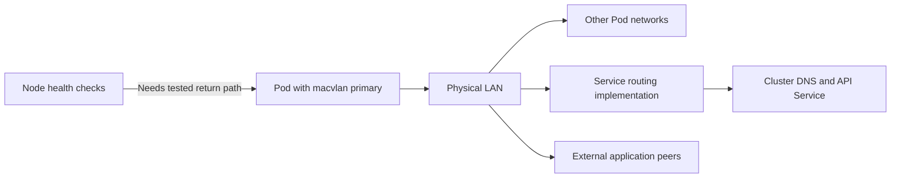

# Evaluate a Single Macvlan Primary Interface for Multus Pods

Author: [nawazdhandala](https://www.github.com/nawazdhandala)

Tags: Multus, Kubernetes, Networking

Description: Assess whether macvlan can serve as a Pod's only primary network by checking cluster routing, Services, DNS, node access, address allocation, and policy enforcement.

A workload needs direct access to a physical LAN, and a second interface feels unnecessary. Could Multus give it only a macvlan interface and use that as its primary network?

Multus can select different primary network configurations, but selecting macvlan is only the beginning. A primary network must support the paths the cluster and application rely on. An interface that can reach a LAN gateway may still be unreachable from the node running its health checks or unable to reach cluster DNS.

This guide evaluates the design using **Multus v4.3.1** and the **CNI plugins v1.8.0 macvlan implementation**. It provides inspection steps and a scoped selection fragment, rather than a cluster-wide replacement manifest. No live primary-network migration was performed.

## Define what “single interface” means

Here, single means one non-loopback Pod network interface, conventionally `eth0`, with macvlan providing the primary Pod address. It does not mean a normal primary interface plus a macvlan attachment that happens to carry the default route.

Those designs have different consequences. With two interfaces, cluster traffic can retain the original network path. With one macvlan interface, the LAN and its routing must carry every required path, or another explicitly designed mechanism must provide it.



This diagram is an acceptance model, not proof that these routes exist. Kubernetes describes the expected Pod and node communication relationships in its [networking model](https://kubernetes.io/docs/concepts/services-networking/). Your implementation must supply them for the workloads and components you intend to run.

## Separate primary selection from extra attachments

In Multus's `delegates` configuration, the first delegate supplies the Pod IP. With `clusterNetwork`, that network supplies it instead. `clusterNetwork` takes precedence over `delegates`; adding macvlan to a secondary attachment list does not replace the primary. These behaviors are documented in the [v4.3.1 configuration guide](https://github.com/k8snetworkplumbingwg/multus-cni/blob/v4.3.1/docs/configuration.md) and [usage guide](https://github.com/k8snetworkplumbingwg/multus-cni/blob/v4.3.1/docs/how-to-use.md).

For an isolated evaluation where the administrator has already defined a complete alternative cluster network as a NetworkAttachmentDefinition, Multus documents this Pod annotation:

```yaml
metadata:
  annotations:
    v1.multus-cni.io/default-network: macvlan-primary-lab
```

This fragment selects an existing, administrator-reviewed primary network named `macvlan-primary-lab`. It does not create its addressing, routes, policy, or credentials. Resolve the definition according to your Multus namespace configuration, and verify its contents before creating the Pod.

The annotation is different from `k8s.v1.cni.cncf.io/networks`, which requests additional attachments. Also review `defaultNetworks`, other attachment annotations, and admission mutations. Selecting a macvlan primary does not suppress every independently configured secondary network. Count the resulting interfaces instead of assuming the selection creates exactly one.

## Check the physical network contract

Macvlan gives interfaces distinct MAC addresses while sharing a parent link. Confirm that the switch, virtualization platform, or cloud network permits those additional addresses. A design that depends on an unsupported anti-spoofing exception should fail evaluation before a production rollout.

Specify the intended parent explicitly in the reviewed network configuration. If it is omitted, the macvlan plugin can select the default-route interface, which may be the management network rather than the intended data LAN. Confirm the parent exists on every eligible node and that MTU, VLAN membership, and switch configuration agree. The [macvlan reference](https://www.cni.dev/plugins/current/main/macvlan/) documents these fields and constraints.

Plan IP address ownership across the whole LAN. Per-node allocation alone does not establish uniqueness between nodes sharing a subnet. Reserve the allocation pool outside other DHCP or static assignments and test rescheduling, cleanup, and node-loss reconciliation. A primary address conflict can affect both application traffic and the cluster's ability to identify endpoints.

## Evaluate node access before application throughput

Linux macvlan normally isolates a child interface from its parent host interface. Docker's [macvlan documentation](https://docs.docker.com/engine/network/drivers/macvlan/) describes this kernel behavior. It is relevant even when Kubernetes created the interface.

That matters for node-originated probes, local agents, and services bound only to a node address. A successful connection from another machine on the LAN does not establish same-node reachability. Decide whether the design includes an appropriately routed host-side macvlan interface or another supported path, and test it independently. Do not assume replacing an HTTP probe with an exec probe repairs the underlying network contract.

Use this acceptance table to keep the decisions explicit:

| Path | Evidence required | Typical design gap |
| --- | --- | --- |
| Pod to same-node and other-node Pods | Connections to known listeners in both directions | Missing routing or host isolation |
| Node to its Pod | Actual node-originated probe succeeds | Parent-child macvlan restriction |
| Pod to ClusterIP Service | Application request reaches a ready endpoint | Service implementation does not handle the path |
| Pod to cluster DNS | Internal name resolves reliably | Resolver address unreachable |
| External peer to Pod | Request and reply use intended network | Return route or switch MAC restrictions |
| Disallowed traffic | Negative test is denied | Assumed policy enforcement absent |

## Collect a baseline and compare the experiment

Run the following read-only commands against a normal baseline Pod and then the staging macvlan-primary Pod. The test image needs `ip` from iproute2 and `cat`; substitute your namespace and Pod names.

```bash
kubectl -n REPLACE_NAMESPACE get pod REPLACE_POD -o wide
kubectl -n REPLACE_NAMESPACE exec REPLACE_POD -- ip -brief address
kubectl -n REPLACE_NAMESPACE exec REPLACE_POD -- ip route show
kubectl -n REPLACE_NAMESPACE exec REPLACE_POD -- cat /etc/resolv.conf
```

Record the Kubernetes Pod IP, interface address, default route, more-specific routes, and DNS server address. Then inspect route selection for an actual cluster DNS IP:

```bash
kubectl -n REPLACE_NAMESPACE exec REPLACE_POD -- \
  ip route get REPLACE_CLUSTER_DNS_IP
```

`ip route get` performs a route lookup; it does not send a successful DNS request or prove return-path reachability. Its behavior is documented in the [ip-route manual](https://man7.org/linux/man-pages/man8/ip-route.8.html). Follow it with the cluster's normal DNS and application checks. Kubernetes provides a [DNS troubleshooting sequence](https://kubernetes.io/docs/tasks/administer-cluster/dns-debugging-resolution/) for inspecting resolver configuration and DNS endpoints.

Do not confuse a valid resolver file with a reachable resolver. Likewise, kube-proxy or another Service implementation being installed somewhere in the cluster does not demonstrate that this particular macvlan path traverses the needed forwarding rules.

## Require evidence for policy and operations

The basic macvlan plugin creates network connectivity; it is not itself a Kubernetes NetworkPolicy enforcement engine. Kubernetes notes that [NetworkPolicy requires a supporting network implementation](https://kubernetes.io/docs/concepts/services-networking/network-policies/). Verify the enforcement component on the proposed primary path with allowed and denied traffic tests.

Finally, exercise Pod recreation, placement on another eligible node, DNS during startup, health checks, and deletion cleanup. Keep ordinary system workloads on their established network during the experiment. Rollback should recreate the controlled test workload with its previous primary selection, not delete a live interface from a running production Pod.

Choose the single-interface design only when these results meet your requirements and the team can maintain its routing and address lifecycle. If the goal is simply access to one LAN service, retaining the established primary network and adding macvlan may require less operational change. The deciding evidence is complete connectivity and control, not a smaller interface count.
