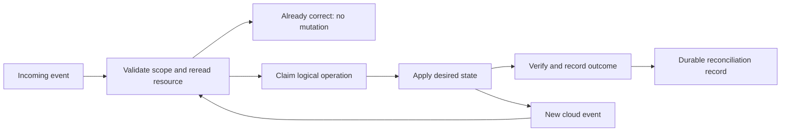

# Stop Cloud Remediation Loops with Idempotency and State Checks

Author: [nawazdhandala](https://www.github.com/nawazdhandala)

Tags: AWS, Cloud Automation, Reliability

Description: Prevent event-driven remediation from triggering itself repeatedly with current-state reconciliation, durable operation keys, recovery records, and bounded suppression.

A rule detects a tag change and invokes a function to repair tags. The repair generates another tag-change event, which invokes the function again. Each invocation appears successful, but the system keeps spending money to repeat its own work.

EventBridge explicitly warns about rules that can [trigger themselves indefinitely](https://docs.aws.amazon.com/eventbridge/latest/userguide/eb-event-patterns.html). The solution is more than filtering duplicate event IDs. You need a handler that converges on a desired state, a durable record of logical operations, and a recovery path for uncertain outcomes.

This guide uses a deliberately small repair: maintain an automation-owned tag describing whether an EBS volume has a nonempty `Owner` tag. It does not invent an owner, change access permissions, or delete resources.

## Separate repeated delivery from a new event caused by repair

A delivery retry can carry the same event again. A successful repair can generate a new event with a different identifier. Deduplicating the first case does not prevent the second.

[EventBridge retry policy](https://docs.aws.amazon.com/eventbridge/latest/userguide/eb-rule-retry-policy.html) governs retriable delivery failures and supports a dead-letter queue for undelivered events. A dead-letter queue, or DLQ, retains failed deliveries for investigation. Target execution retries and application recovery are separate boundaries; document which component owns each retry.



The feedback arrow is expected. It becomes harmless only when the next evaluation finds nothing to change.

## Filter narrowly, then reread the resource

For an EC2 tag-change workflow, filter the event source, event type, API event names, account, and region. CloudTrail API events have their own [delivery prerequisites](https://docs.aws.amazon.com/eventbridge/latest/userguide/eb-service-event-cloudtrail.html), including a logging trail. Verify those prerequisites and test sample events before deploying a rule.

A handler should validate resource identifiers and use an explicitly selected account and region. Reject unrelated resource types. Do not assume the event body is the current resource state: another actor may have changed tags after the event was emitted.

You can exclude your automation role from selected rules as an additional safeguard, using the actual event identity fields and supported [event-pattern operators](https://docs.aws.amazon.com/eventbridge/latest/userguide/eb-event-patterns-content-based-filtering.html). But identity filters alone are fragile: another remediation role or a forwarded event can change the shape. Keep state-based convergence in the handler even when self-generated events are filtered.

## Make a successful repair become a no-op

The following Python example uses Boto3 1.40.76 and was tested with SDK stubs. Supply an EC2 client already configured for the reviewed account and region, and one approved volume identifier:

```python
MARKER = 'AutomationOwnerTagStatus'

def reconcile_marker(ec2, volume_id):
    rows = ec2.describe_volumes(VolumeIds=[volume_id])['Volumes']
    if len(rows) != 1 or rows[0]['VolumeId'] != volume_id:
        raise RuntimeError('Unexpected volume response')
    tags = {tag['Key']: tag.get('Value', '') for tag in rows[0].get('Tags', [])}
    desired = 'present' if tags.get('Owner', '').strip() else 'missing'
    if tags.get(MARKER) == desired:
        return {'changed': False, 'desired': desired}
    ec2.create_tags(Resources=[volume_id], Tags=[{'Key': MARKER, 'Value': desired}])
    return {'changed': True, 'desired': desired}
```

`present` means only that the tag contains non-whitespace text; it does not certify that the value is a legitimate owner. The function owns only `AutomationOwnerTagStatus` and leaves all other tags untouched. AWS documents that [CreateTags overwrites only the specified keys](https://docs.aws.amazon.com/AWSEC2/latest/APIReference/API_CreateTags.html).

If the first invocation writes `missing`, the event caused by that write leads to a fresh read. Once that read observes the marker, the next invocation returns `changed=False` without another mutation. If the owner later adds a value, the desired marker becomes `present`.

The read and tag write are not an atomic transaction. A concurrent owner update or a stale service read can temporarily leave the marker behind. This example tolerates that because the marker is informational and later reconciliation corrects it. Do not apply that reasoning to irreversible actions. Keep a periodic reconciliation pass so correctness does not depend on receiving every event.

Avoid writing a new timestamp tag on every invocation. That guarantees a difference even when the business state is already correct and defeats convergence.

## Deduplicate the operation, not just its delivery envelope

An operation key should identify the account, region, resource, policy version, remediation episode, and desired result. A remediation episode is one tracked occurrence of a problem, created durably when the problem is first observed. Repeated deliveries share the episode; a genuinely new occurrence can receive a new one.

```python
import hashlib
import json

def operation_key(account, region, volume_id, episode, desired):
    identity = [account, region, volume_id, 'owner-tag-v1', episode, desired]
    return hashlib.sha256(json.dumps(identity, separators=(',', ':')).encode()).hexdigest()
```

This stable encoding avoids ambiguous string concatenation. Validate and normalize identifiers before calling it. Do not generate a random episode for every delivery, or duplicates will never meet. Conversely, a permanent key containing only resource and policy can suppress a valid repair months later when the problem returns.

Store the operation's state, owner, attempt, desired result, observed resource facts, timestamps, and request identifiers. A conditional DynamoDB put using `attribute_not_exists` on the partition key can create the initial claim without overwriting an existing record; the [PutItem reference](https://docs.aws.amazon.com/amazondynamodb/latest/APIReference/API_PutItem.html) documents that condition.

A conditional write coordinates the record. It does not make the cloud API call and database update one transaction. Workers must inspect existing operation state rather than treating every duplicate as completed.

## Design the crash windows explicitly

| Interruption | Recovery action |
|---|---|
| Claim saved, API not called | Reconcile the resource before retrying the abandoned attempt |
| API succeeds, response is lost | Read current state; do not assume failure |
| API succeeds, completion record fails | Reconcile and complete the existing operation record |
| Completion exists, new drift occurs | Evaluate current state and open a new episode if appropriate |

For the tag setter, retrying the same desired value is naturally repeatable, although it may create another event. A notification, payment, or destructive action needs a stronger service-specific idempotency mechanism or human reconciliation of an uncertain result.

If you use expiring worker leases, consider a worker that continues after losing its lease. A lease expiry alone cannot prevent that old worker from calling an external API. Use fencing where the destination supports it, or design a serialized, repeatable action and a reconciliation protocol that remains safe when attempts overlap.

## Suppress repeated noise without hiding new state

A suppression window can limit repeated notifications or expensive investigations for the same episode. Persist the next eligible evaluation time and the reason for suppression. Continue accepting new evidence and arrange a later reconciliation, rather than dropping events forever during the window.

Differentiate a repeated observation from changed conditions: a repaired owner tag, a new policy version, or an active exemption can invalidate the pending action. Re-read those facts before mutation even if a previous evaluation approved it.

DynamoDB time to live, or TTL, is suitable for eventually removing old records. It is not an exact suppression timer or lock expiry mechanism. AWS states that [expired TTL items can remain for days](https://docs.aws.amazon.com/amazondynamodb/latest/developerguide/TTL.html). Compare timestamps in application logic and use conditional updates for state transitions. Never wait for background deletion to decide that an action is eligible.

## Test convergence and recovery before enabling writes

Begin with recorded events and a read-only plan. Test duplicate delivery, an event generated by the repair, an owner update during processing, stale reads, an API timeout after success, an abandoned claim, and a new episode after prior completion. Monitor mutation count per resource, no-op rate, unresolved operations, suppression age, and DLQ depth.

The local tests for this article verified five marker cases, stable and isolated operation keys, and permission-error propagation using Boto3 stubs. No AWS resources were tagged, no DynamoDB table was used, and no EventBridge rule was deployed. The dedupe store, leases, event filters, and crash recovery remain integration work. Keep a worker kill switch and a scoped canary deployment so an unexpected feedback loop can be stopped without losing its evidence.
