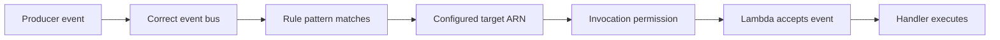

# Debug an Enabled EventBridge Rule That Never Invokes Lambda

Author: [nawazdhandala](https://www.github.com/nawazdhandala)

Tags: EventBridge, AWS Lambda, Troubleshooting

Description: Trace an enabled EventBridge rule through event matching, target aliases, permissions, and delivery metrics to find why Lambda is not running.

An enabled rule is a configuration state, not evidence that an event reached your function. The event might have entered another bus, missed the pattern, targeted an old alias, or failed permission checks. Looking only for application logs makes these cases look identical.

Start with one event and follow its route. This guide covers an EventBridge event-bus rule targeting a Lambda function in the same account and Region. The examples use the default bus and a function alias named `prod`. EventBridge Scheduler and Pipes have different configuration surfaces; do not apply these commands to them unchanged.

## Separate the checkpoints

An Amazon Resource Name, or ARN, identifies an AWS resource. Record the event bus, rule ARN, target ARN, and alias before changing anything. A similarly named function in another Region is still a different resource.



The final two boxes are separate. An asynchronous invocation can succeed at accepting an event before function code runs. That acceptance does not prove business processing succeeded. [Lambda asynchronous invocation](https://docs.aws.amazon.com/lambda/latest/dg/invocation-async.html) explains this queue boundary.

## Capture the rule and every target

Use Bash, Python 3, and an authenticated AWS CLI v2 session with read access to the relevant EventBridge, Lambda, and CloudWatch configuration. The command inputs here were checked locally with AWS CLI 2.38.1; no AWS delivery test was performed for this article.

Replace these example names and Region with your deployment values. Keep diagnostic files private because target configurations can contain constant input payloads.

```bash
umask 077
REGION='eu-west-1'
RULE='orders-ready'
BUS='default'
FUNCTION='orders-worker'
ALIAS='prod'

aws events describe-rule \
  --name "$RULE" --event-bus-name "$BUS" \
  --region "$REGION" --output json > rule.json

aws events list-targets-by-rule \
  --rule "$RULE" --event-bus-name "$BUS" \
  --region "$REGION" --output json > targets.json
```

Inspect `rule.json` for `Arn`, `State`, and `EventPattern`. Inspect every entry in `targets.json`, not just the first. Confirm the target ARN ends in the intended function and qualifier, such as `function:orders-worker:prod`. An enabled rule with no targets has nothing to invoke. These are the documented [describe-rule](https://docs.aws.amazon.com/cli/latest/reference/events/describe-rule.html) and [list-targets-by-rule](https://docs.aws.amazon.com/cli/latest/reference/events/list-targets-by-rule.html) operations.

Also record `RoleArn`, `Input`, `InputPath`, `InputTransformer`, `RetryPolicy`, and `DeadLetterConfig` when present. Input transformations affect what the handler receives; they do not change whether the original event matched the rule. A handler expecting the complete event might receive only a selected detail object.

## Test the actual event shape

Save a sanitized copy of the event as `event.json`. Use the complete EventBridge envelope, including `id`, `account`, `source`, `time`, `region`, `resources`, and `detail-type`. Include the real `detail` structure. Do not substitute the producer's request body if EventBridge wraps it differently.

Extract the deployed pattern and test it without delivering an event:

```bash
python3 - <<'PY'
import json
from pathlib import Path
rule = json.loads(Path('rule.json').read_text())
pattern = json.loads(rule['EventPattern'])
Path('pattern.json').write_text(json.dumps(pattern) + '\n')
PY

aws events test-event-pattern \
  --event-pattern file://pattern.json \
  --event file://event.json \
  --region "$REGION"
```

The expected response is `{"Result": true}`. A false result sends you back to field names, values, types, and the event envelope. The [test-event-pattern command](https://docs.aws.amazon.com/cli/latest/reference/events/test-event-pattern.html) calls AWS to evaluate matching; it neither publishes the event nor proves the producer used the correct bus.

If the rule has only a schedule expression, there is no event pattern to extract. Investigate its schedule instead. After a rule or target change, allow propagation before interpreting a controlled new event; AWS documents this delay in its [troubleshooting guide](https://docs.aws.amazon.com/eventbridge/latest/userguide/eb-troubleshooting.html).

## Check the alias and the permission path

For the example alias target, inspect both its version mapping and its policy:

```bash
aws lambda get-alias \
  --function-name "$FUNCTION" --name "$ALIAS" \
  --region "$REGION" --output json

aws lambda get-policy \
  --function-name "$FUNCTION" --qualifier "$ALIAS" \
  --region "$REGION" --query Policy --output text > policy.json
```

The alias result identifies `FunctionVersion` and any routing configuration. Verify that this is the deployed code you intended to observe. `Policy` is returned as a JSON string, so the text query writes its contents for inspection. See [get-alias](https://docs.aws.amazon.com/cli/latest/reference/lambda/get-alias.html) and [get-policy](https://docs.aws.amazon.com/cli/latest/reference/lambda/get-policy.html).

For an unqualified function target, omit `--qualifier`; for a numeric version target, use that version. A missing policy is diagnostic information, not automatically a reason to create one.

Current [EventBridge permissions documentation](https://docs.aws.amazon.com/eventbridge/latest/userguide/eb-use-resource-based.html) supports either an IAM execution role on a Lambda target or a resource-based policy. If `RoleArn` is configured, inspect that role's trust and invocation permissions for the exact target. This is separate from the Lambda runtime execution role, which governs what the handler can access after it starts.

For a target without `RoleArn`, inspect the function's resource policy. The expected grant permits `events.amazonaws.com` to perform `lambda:InvokeFunction`, constrained to this rule's ARN. Check the qualifier as carefully as the name. An alias-specific permission requires the caller to invoke that alias ARN, as described by [AddPermission](https://docs.aws.amazon.com/lambda/latest/api/API_AddPermission.html).

If that exact grant is missing, the following is a **configuration change**, not an inspection command. Prefer making the equivalent change in the infrastructure code that owns the function. Review the existing statements first and choose a unique statement ID.

```bash
RULE_ARN=$(python3 -c \
  'import json; print(json.load(open("rule.json"))["Arn"])')

aws lambda add-permission \
  --function-name "$FUNCTION" --qualifier "$ALIAS" \
  --statement-id 'AllowOrdersReadyRuleProd' \
  --action 'lambda:InvokeFunction' \
  --principal 'events.amazonaws.com' \
  --source-arn "$RULE_ARN" \
  --region "$REGION"
```

This adds one scoped statement. It does not repair a wrong target, replace existing statements, or resolve an execution-role problem. Read the policy again afterward and reconcile the change with your deployment definition.

## Read delivery metrics without overstating them

For this default-bus example, query a recent UTC interval containing your event. Replace the illustrative times; use a wider period for older data.

```bash
aws cloudwatch get-metric-statistics \
  --namespace AWS/Events --metric-name FailedInvocations \
  --dimensions Name=RuleName,Value="$RULE" \
  --start-time '2026-11-20T10:00:00Z' \
  --end-time '2026-11-20T10:15:00Z' \
  --period 60 --statistics Sum \
  --region "$REGION" --output json
```

Repeat for the relevant metric names below. CloudWatch does not guarantee chronological ordering of returned datapoints; compare timestamps, not array positions. The CLI's [metric statistics reference](https://docs.aws.amazon.com/cli/latest/reference/cloudwatch/get-metric-statistics.html) also documents retention and period constraints.

| Evidence | Next investigation |
|---|---|
| No matching-event evidence | Producer destination, pattern, account, Region, and observation window |
| `MatchedEvents` increases | Confirm which target should receive that match |
| `InvocationAttempts` or `RetryInvocationAttempts` increases | Inspect target permission, availability, and delivery retry settings |
| `FailedInvocations` increases | Investigate permanent delivery failures and any configured target dead-letter queue |
| `SuccessfulInvocationAttempts` increases | Move to Lambda acceptance, execution metrics, and application evidence |

`FailedInvocations` excludes attempts still being retried and deliveries that later succeed. It is emitted only when nonzero. An empty graph therefore does not establish success. Metrics are best-effort evidence, not a complete event ledger. The documented `AWS/Events` metrics here apply to the default/classic bus path; newer Custom Event Bus observability uses `AWS/EventsV2`. Confirm your bus type and metric dimensions before reusing this query. [EventBridge monitoring reference](https://docs.aws.amazon.com/eventbridge/latest/userguide/eb-monitoring.html).

## Close the incident with one traceable event

After correcting the identified mismatch, use an approved staging event or a production-safe canary that the application explicitly handles without unwanted side effects. Give it a unique business correlation ID and retain its submission time. Verify matching, target delivery, the resolved Lambda version, and the application's completion record.

A console Lambda test bypasses the EventBridge route. Missing logs alone also cannot establish that the function never ran. If delivery succeeds but processing fails, investigate Lambda's asynchronous handling separately instead of repeatedly widening EventBridge permissions. Close the incident when the same identifiable event has evidence across the intended route, and preserve the corrected configuration in code.
