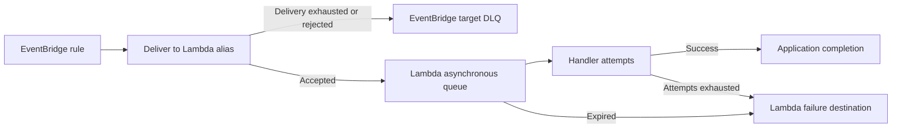

# EventBridge Delivered but Lambda Failed: Put Recovery at the Right Boundary

Author: [nawazdhandala](https://www.github.com/nawazdhandala)

Tags: EventBridge, AWS Lambda, AWS SQS

Description: Separate EventBridge delivery failures from Lambda processing failures, configure an alias-specific failure destination, and verify both recovery paths.

Your EventBridge rule delivered an order event, but the order never appeared downstream. The rule's dead-letter queue is empty. That can be entirely consistent: Lambda accepted the event, then the handler timed out while processing it.

A dead-letter queue, or DLQ, retains work that a service cannot complete. The important question is which service owns the failure. Adding a queue to EventBridge does not automatically capture every later Lambda error.

This guide uses a same-account EventBridge event-bus rule and a Lambda alias named `prod`. It configures a separate standard Amazon SQS queue for Lambda failure records. It does not cover SQS-triggered Lambda functions, whose event source mapping has a different retry model.

## Draw the two failure paths



EventBridge's target DLQ covers unsuccessful delivery to a target. It cannot observe arbitrary failures that happen after Lambda accepts an asynchronous event. Lambda queues accepted events and processes them separately. [EventBridge DLQ documentation](https://docs.aws.amazon.com/eventbridge/latest/userguide/eb-rule-dlq.html) and [Lambda asynchronous invocation](https://docs.aws.amazon.com/lambda/latest/dg/invocation-async.html) describe these boundaries.

Keep the two queues distinct even if one team owns both. Names such as `orders-delivery-failures` and `orders-processing-failures` make their purpose clearer than `orders-dlq-1` and `orders-dlq-2`.

| Recovery mechanism | What it preserves | Who sends it |
|---|---|---|
| EventBridge target DLQ | Undelivered event plus diagnostic message attributes | EventBridge |
| Lambda asynchronous on-failure destination | Invocation record with request and response context | Lambda, using the function execution role |
| Lambda asynchronous DLQ | Original event content with failure attributes, rather than the full invocation record | Lambda, using the function execution role |

For this walkthrough, choose the Lambda destination because processing diagnostics are useful. Lambda also supports a traditional DLQ for discarded asynchronous events. Choose deliberately and document the expected record format; these mechanisms are not interchangeable message envelopes. [Lambda retained invocation records](https://docs.aws.amazon.com/lambda/latest/dg/invocation-async-retain-records.html).

## Inspect the qualifier that receives events

An alias points to a published Lambda version. Configuration on another alias can leave your actual target unprotected. First compare the EventBridge target ARN with the function and alias you intend to configure.

The examples require Bash, AWS CLI v2, and permissions to inspect these resources. Replace all names, account IDs, and Region values. Command inputs were checked locally with AWS CLI 2.38.1; no cloud resources were changed for this article.

```bash
umask 077
REGION='eu-west-1'
FUNCTION='orders-worker'
ALIAS='prod'

aws events list-targets-by-rule \
  --rule 'orders-ready' --event-bus-name 'default' \
  --region "$REGION" --output json > targets-before.json

aws lambda get-function-event-invoke-config \
  --function-name "$FUNCTION" --qualifier "$ALIAS" \
  --region "$REGION" --output json > async-before.json
```

The target should identify `function:orders-worker:prod`. Read its `DeadLetterConfig` and `RetryPolicy` separately from Lambda's `DestinationConfig`, `MaximumRetryAttempts`, and `MaximumEventAgeInSeconds`. A not-found response from the Lambda configuration query means you need to investigate the selected configuration scope, not assume a processing destination exists. See [get-function-event-invoke-config](https://docs.aws.amazon.com/cli/latest/reference/lambda/get-function-event-invoke-config.html).

Preserve the original configuration before editing. Prefer an infrastructure-code change when a deployment system owns these resources.

## Give each sender permission to its own queue

Provision two standard SQS queues in the rule's Region, with retention appropriate to your incident response time. Use your organization's encryption and access controls. Neither example queue is FIFO.

For the EventBridge target DLQ, merge a statement like this into the queue's existing resource policy. Replace the example account, rule, and queue identifiers. Do not replace unrelated policy statements.

```json
{
  "Sid": "AllowOrdersRuleFailureDelivery",
  "Effect": "Allow",
  "Principal": {"Service": "events.amazonaws.com"},
  "Action": "sqs:SendMessage",
  "Resource": "arn:aws:sqs:eu-west-1:123456789012:orders-delivery-failures",
  "Condition": {
    "ArnEquals": {
      "aws:SourceArn": "arn:aws:events:eu-west-1:123456789012:rule/orders-ready"
    }
  }
}
```

This authorizes the specified rule to write delivery failures. Attach the queue ARN to that target's `DeadLetterConfig` through the owning deployment. When using `PutTargets`, preserve the intended target ID, ARN, transformations, and other settings, and inspect `FailedEntryCount` and individual failures. An API request can partially fail. [PutTargets reference](https://docs.aws.amazon.com/cli/latest/reference/events/put-targets.html).

For the Lambda destination queue, grant the function execution role `sqs:SendMessage` on `orders-processing-failures`. That is a role permission, not the EventBridge service-principal statement above. Review explicit denies, queue policy restrictions, and any customer-managed encryption-key permissions as well. A correctly named queue with an unauthorized sender still loses the recovery path.

## Configure the Lambda failure destination

Save this as `destination.json`, replacing the ARN with your processing queue:

```json
{
  "OnFailure": {
    "Destination": "arn:aws:sqs:eu-west-1:123456789012:orders-processing-failures"
  }
}
```

For an existing asynchronous configuration, update only the intended options:

```bash
aws lambda update-function-event-invoke-config \
  --function-name "$FUNCTION" --qualifier "$ALIAS" \
  --destination-config file://destination.json \
  --region "$REGION"

aws lambda get-function-event-invoke-config \
  --function-name "$FUNCTION" --qualifier "$ALIAS" \
  --region "$REGION" --output json > async-after.json
```

Confirm the returned failure destination and verify that the other settings, including any success destination, remain as intended. The [update operation](https://docs.aws.amazon.com/cli/latest/reference/lambda/update-function-event-invoke-config.html) is intended for changing selected configuration. If you are creating configuration for the first time, use `put-function-event-invoke-config` with the complete intended settings. Unlike update, put replaces existing configuration; do not use it casually to add a destination. [Lambda configuration guidance](https://docs.aws.amazon.com/lambda/latest/dg/invocation-async-configuring.html).

Choose retry and event-age settings from the business deadline. Retrying an expired reservation may be worse than retaining it for review. Function errors normally receive two additional attempts; throttling and service errors have a different retry path. Setting function-error retries to zero does not establish exactly-once processing. Duplicate delivery remains possible, so a stable business operation ID must protect side effects. [Lambda asynchronous error handling](https://docs.aws.amazon.com/lambda/latest/dg/invocation-async-error-handling.html).

## Rehearse both failures safely

Use an isolated rule, test alias, and queues without production consumers. Keep the test payload free of customer data. Give each test a unique correlation ID that survives any EventBridge input transformation.

1. **Delivery failure:** point only the isolated target at a deliberately nonexistent test function, with its delivery DLQ already configured. Submit a matching test event through your normal test producer. Expect EventBridge diagnostic attributes such as `ERROR_CODE`, `RULE_ARN`, and `TARGET_ARN` in that queue. Do not remove a production permission to provoke this test.
2. **Processing failure:** restore the isolated target to a real test alias whose handler deliberately raises an exception before external side effects. Deliver another event. After the configured attempts are exhausted, expect an invocation record in the Lambda failure destination. The EventBridge delivery DLQ should not be the recovery mechanism for this handler error.
3. **Successful processing:** use a harmless valid event. Confirm the application completion record and ensure your monitoring can distinguish this outcome from acceptance alone.

These are proposed acceptance tests, not tests performed for this article. Do not assume the first handler exception immediately creates a failure record; retries and event age affect when it appears.

## Monitor the recovery path itself

A destination can fail too. Alert on Lambda `DestinationDeliveryFailures`; use `DeadLetterErrors` if you selected Lambda's traditional DLQ. Track `Errors`, `Throttles`, and asynchronous backlog signals alongside them. A quiet error graph is not proof that every expected event arrived. [Lambda metric definitions](https://docs.aws.amazon.com/lambda/latest/dg/monitoring-metrics-types.html).

Also monitor EventBridge delivery-to-DLQ failures and queue age, not just message count. Assign an owner and a response deadline shorter than queue retention. Failure records can contain the original payload and error details, so limit access and avoid dumping them wholesale into job logs.

Recovery should begin by identifying the boundary and inspecting whether any business effect already succeeded. A timeout after a database commit can leave completed work behind. Preserve the record, reconcile the operation ID, and replay only through a reviewed recovery path. Two well-defined queues make that investigation possible; neither queue alone guarantees safe replay.
