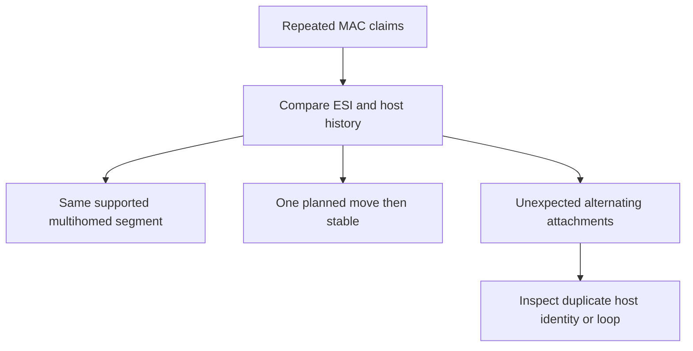

# Diagnose EVPN MAC Moves: Host Mobility, Loops, or Multihoming?

Author: [nawazdhandala](https://www.github.com/nawazdhandala)

Tags: VXLAN, BGP, Troubleshooting

Description: Build an EVPN MAC-move timeline, compare mobility sequences and Ethernet Segment Identifiers, and distinguish valid host moves from duplicate identities or loops.

An EVPN log reports that a MAC moved again. That can mean a planned virtual-machine migration completed, two active machines share an address, or a loop is repeatedly delivering the same source traffic through different attachments. The message identifies a change in observed reachability; it does not identify the cause.

Collect a timeline before clearing duplicate flags or changing detection thresholds. The useful evidence is which segment and port claimed the MAC, which EVPN advertisement followed, and whether those observations match a real host operation.

The read-only examples use **FRRouting 10.2.1** and **iproute2 6.12.0** references. Platform-specific examples are explicitly labeled. No live move, loop, or multihoming experiment was performed for this article.

## Give the MAC a segment and an owner

Start with the affected MAC, its VNI, and the intended host attachment. A VNI identifies the VXLAN segment. The same MAC value in two isolated tenants is not automatically a duplicate within one forwarding domain.

Record whether the address belongs to an ordinary workload, a deliberately shared gateway, or a multihomed server. Shared infrastructure identities need their documented handling; applying an ordinary single-homed workload rule to them can create a false alarm.

For the example, investigate workload MAC `02:00:00:00:00:12` in VNI `10100`. Record its current host identity, previous attachment, and any migration or NIC-replacement event. Do not rely on the network's latest claim as the authoritative inventory.

An Ethernet Segment Identifier, or ESI, identifies an attachment segment in EVPN. Several leaves can legitimately serve the same multihomed segment. A single-homed attachment normally uses an all-zero ESI. [EVPN Ethernet segments](https://www.rfc-editor.org/rfc/rfc7432.html).

## Read the advertisement and the local interpretation

On each leaf involved, use an account authorized for `vtysh`:

```bash
vtysh -c 'show bgp l2vpn evpn route detail type macip'
vtysh -c 'show evpn mac vni 10100 mac 02:00:00:00:00:12'
vtysh -c 'show evpn mac vni 10100 duplicate'
```

Replace the VNI and MAC. Find all relevant Type 2 advertisements, then compare the local MAC entry and duplicate listing. Preserve next hops, ESI, sequence information, local-versus-remote status, and timestamps. The tagged source defines these command forms. [FRR EVPN route commands](https://raw.githubusercontent.com/FRRouting/frr/frr-10.2.1/bgpd/bgp_evpn_vty.c), [FRR MAC display commands](https://raw.githubusercontent.com/FRRouting/frr/frr-10.2.1/zebra/zebra_vty.c).

A MAC Mobility sequence helps distinguish newer location information from older information. It is not a timestamp or a universal count of physical host migrations. RFC 7432 treats learning on the same nonzero Ethernet segment differently from a move to another segment. Compare ESI and sequence together. [MAC mobility procedures](https://www.rfc-editor.org/rfc/rfc7432.html#section-15).

A sequence that increases once during an approved move and then stabilizes is useful evidence. It still needs to agree with the host event and actual forwarding. A stable wrong entry is not a successful migration.

## Build a timeline that can separate the explanations

Use logs and bounded snapshots from the involved leaves. This table is an illustrative investigation record, not captured output:

| Time | Observed claimant | Sequence | Host-operation evidence |
| --- | --- | ---: | --- |
| 10:00:00 | Leaf A, old attachment | 7 | Host running on old hypervisor |
| 10:00:12 | Leaf B, new attachment | 8 | Approved move completes |
| 10:00:13 onward | Leaf B remains selected | 8 | Old attachment stopped |

Contrast that with A/B/A/B claims continuing while both supposed host attachments remain active. That pattern warrants an identity or loop investigation. Do not choose a universal “too many moves” threshold from this example; use the deployed detection policy and expected workload behavior.



Record clock differences between devices. If timestamps are not synchronized, use event ordering and shared packet observations rather than asserting millisecond causality from separate logs.

## Distinguish all-active multihoming from movement

For a deployment using EVPN multihoming, inspect the segment state:

```bash
vtysh -c 'show evpn es detail'
vtysh -c 'show evpn es-evi vni 10100 detail'
```

Compare the ESI, local attachment, remote segment peers, and VNI membership. These displays are present in FRR 10.2.1. [Tagged Ethernet-segment commands](https://raw.githubusercontent.com/FRRouting/frr/frr-10.2.1/zebra/zebra_vty.c).

The same server reachable through two leaves of the same all-active segment is not equivalent to two unrelated single-homed servers claiming its MAC. Verify the intended bond or link aggregation and the physical cabling at both ends. LACP, the Link Aggregation Control Protocol, helps coordinate a supported aggregated attachment; inspect its partner identities with the platform's tools.

For a concrete platform constraint, Cumulus Linux 5.10 builds its ESI from an Ethernet-segment MAC and local segment identifier, and requires consistent segment identity for the links to the same server. Its documentation also lists unsupported multihoming layouts. Do not assume any downstream switched network is a supported substitute for a multihomed end host. [Cumulus 5.10 multihoming requirements](https://docs.nvidia.com/networking-ethernet-software/cumulus-linux-510/Network-Virtualization/Ethernet-Virtual-Private-Network-EVPN/EVPN-Multihoming/).

A miswired server, different ESIs for the same intended segment, or reused identity across unrelated segments can make advertisements describe a topology that does not match the cables. Fix that mismatch through the fabric owner; do not force route selection to conceal it.

## Look for the actual local learning path

On Linux leaves, inspect the relevant bridge and ports:

```bash
bridge fdb show br br10100
bridge -d link show master br10100
```

Use the real bridge name and retain the target MAC's port and state. Compare snapshots on the involved leaves. In a VLAN-aware design, include the appropriate VLAN context when examining the FDB. [iproute2 bridge inspection](https://raw.githubusercontent.com/iproute2/iproute2/v6.12.0/man/man8/bridge.8).

If the MAC keeps appearing on unexpected local ports, compare controlled captures and the physical topology. Repeated copies of the same frame, increasing broadcast traffic, and alternating source-MAC learning strengthen a loop hypothesis. None alone proves a loop: mirrored captures, legitimate retransmissions, and multiple observation points can create similar-looking evidence.

For duplicate host identity, verify the NIC MAC on each candidate host and whether both can transmit. A cloned VM left running at the old location is a different repair from a cabling loop. Keep the identity investigation tied to the particular segment.

## Interpret duplicate flags and freeze policy accurately

A duplicate flag does not universally mean forwarding was stopped. Some implementations can report a duplicate without functional action, while configured freeze behavior changes subsequent updates. For example, Cumulus Linux 5.10 documents reporting-only behavior by default and a separate freeze option. [Cumulus duplicate detection behavior](https://docs.nvidia.com/networking-ethernet-software/cumulus-linux-510/Network-Virtualization/Ethernet-Virtual-Private-Network-EVPN/EVPN-Enhancements/).

That release also lists duplicate address detection as unsupported with EVPN multihoming. An empty duplicate table is therefore not a universal certificate that a multihomed topology is correct. Check the supported feature combination and the actual detection configuration.

Do not begin by increasing thresholds or disabling detection. That can hide continuing churn. Preserve the reported condition, remove the demonstrated cause, and only then follow the platform's documented recovery procedure for the affected entry.

## Verify stability after the correction

Use the authorized owner to stop the unintended duplicate workload or correct the faulty attachment. For suspected loops, isolate the demonstrated faulty path through the approved network procedure rather than shutting arbitrary uplinks.

Afterward, confirm the expected segment identity, stable selected location, and application delivery in both directions. Observe long enough to cover the configured detection window and the workload's relevant lifecycle event. If a planned move is part of acceptance, perform one controlled staging move and verify that the old attachment stops claiming the MAC.

Local checks for this article covered tagged command definitions, shell syntax, and diagram structure. They did not execute FRR, prove a physical topology, or simulate a production duplicate-detection policy.
