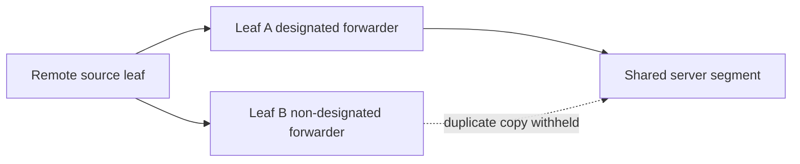

# Trace Missing BUM Traffic in EVPN Multihoming

Author: [nawazdhandala](https://www.github.com/nawazdhandala)

Tags: VXLAN, BGP, Troubleshooting

Description: Diagnose EVPN multihoming broadcast loss by comparing Ethernet segment identity, designated-forwarder state, service membership, and split-horizon behavior.

Known unicast traffic reaches a multihomed server, but broadcasts from another leaf do not. Both server links are up, and the VXLAN endpoints are reachable. That combination points toward a different forwarding decision from ordinary unicast: which leaf is allowed to deliver flooded overlay traffic onto the shared server attachment?

EVPN multihoming deliberately filters some copies. The diagnostic task is to determine whether the expected copy reaches the server and unwanted copies are suppressed. Removing every filter can turn one missing packet into a loop.

This guide uses **Cumulus Linux 5.10** read-only NVUE examples and the EVPN standards. NVUE is that platform's configuration and inspection interface. The procedure is scoped to a supported all-active server attachment using ingress replication. It is not a generic configuration recipe for every switch vendor or multicast underlay.

## Separate designated forwarding from split horizon

BUM means broadcast, unknown-unicast, and multicast traffic. An Ethernet segment is a shared attachment represented by an Ethernet Segment Identifier, or ESI. A multihomed server can connect that segment to more than one leaf.

The designated forwarder, or DF, controls delivery of flooded traffic arriving from the overlay onto the shared segment. This prevents multiple leaves from delivering duplicate copies to the same attachment. DF election depends on the segment's participating devices and the applicable election rules; inspect the deployed algorithm and service scope rather than guessing from a device's name. [DF election framework](https://www.rfc-editor.org/rfc/rfc8584.html).

Split horizon answers another question: did this traffic originate from a segment that must not receive a reflected copy? In VXLAN, the mechanism cannot rely on the MPLS ESI label used by MPLS-based EVPN. RFC 8365 describes using knowledge of shared segments and the originating tunnel endpoint to prevent reflection. [VXLAN split-horizon procedure](https://www.rfc-editor.org/rfc/rfc8365.html#section-8.3.1).



This shows an ingress-replication case where both leaves receive a copy. It is not an instruction to require two copies under every optimization or replication design. One successful server delivery is the goal. All-active known-unicast forwarding can use different mechanisms, so a working unicast flow does not prove that the DF path works. [EVPN multihoming forwarding](https://www.rfc-editor.org/rfc/rfc7432.html).

## Establish the intended segment membership

Write down the server bond, both physical attachments, ESI, Layer 2 VNI, and the leaf VTEP addresses. A VTEP is the VXLAN tunnel endpoint. Confirm the server is actually attached through the supported bond or aggregation model.

On both Cumulus leaves, inspect:

```bash
nv show evpn multihoming esi
nv show evpn vni 10100 multihoming esi
```

Replace VNI 10100. The first view lists segments; the second ties the investigation to the failing service. Compare the same ESI on both leaves, not merely two operational bonds with similar names. [Cumulus 5.10 segment inspection](https://docs.nvidia.com/networking-ethernet-software/cumulus-linux-510/Network-Virtualization/Ethernet-Virtual-Private-Network-EVPN/EVPN-Multihoming/).

Build a compact evidence table:

| Check | Leaf A | Leaf B |
| --- | --- | --- |
| Intended ESI present | Record | Record |
| Correct server attachment | Record | Record |
| Failing VNI associated | Record | Record |
| Remote segment peer visible | Record | Record |
| Current DF state | Record | Record |

Different ESIs for the same intended attachment can produce inconsistent forwarding assumptions. Conversely, reusing one ESI for unrelated attachments tells the control plane they belong together when they do not. Verify the cables and server-side identities before editing a policy to fit incorrect observations.

## Compare control-plane discovery and operational state

Inspect the segment information learned through BGP:

```bash
nv show evpn multihoming bgp-info esi
```

Compare it with the operational segment view. Record remote peer identities, service membership, and inconsistency indications. A local configured ESI does not establish that the other leaf's segment advertisements arrived. [Cumulus BGP segment information](https://docs.nvidia.com/networking-ethernet-software/cumulus-linux-510/Network-Virtualization/Ethernet-Virtual-Private-Network-EVPN/EVPN-Multihoming/).

EVPN has separate route types for Ethernet auto-discovery, host reachability, inclusive multicast participation, and Ethernet segment discovery. For this investigation, successful host Type 2 exchange is not a replacement for the segment and flooded-traffic information. Follow missing advertisements from their origin through BGP policy to the receiving device. [EVPN route roles](https://www.rfc-editor.org/rfc/rfc7432.html).

If the two leaves see different participants, resolve that difference before trying to force a winner. If they agree on participants but disagree on forwarding responsibility, compare the election configuration, capabilities, and transition state.

Capture these views close together in time. A snapshot taken during reconvergence can differ from a steady-state snapshot without proving a persistent split election. Record the triggering link or configuration event.

## Verify that the elected leaf can deliver the service

For Cumulus 5.10, the documented preference-based choice uses the highest DF preference for the Ethernet segment. Confirm the actual preference and designated-forward state on the involved devices. Do not apply that platform rule as a universal description of every EVPN election algorithm. [Cumulus DF preference](https://docs.nvidia.com/networking-ethernet-software/cumulus-linux-510/Network-Virtualization/Ethernet-Virtual-Private-Network-EVPN/EVPN-Multihoming/).

Now inspect the elected leaf's server-facing path: bond readiness, VLAN admission, operational forwarding state, and the failing VNI's local mapping. A correct election cannot compensate for the winner lacking the intended VLAN on its attachment.

This explains a useful failure pattern: Leaf B's access link works for unicast, but Leaf A is the designated forwarder and its local service attachment is wrong. Making B forward every flooded copy would hide the failed attachment instead of fixing it.

Use one identifiable staging broadcast from a remote segment. Observe whether it reaches the elected leaf's underlay, crosses the intended decapsulation/bridge path, and arrives at the server. Verify the non-DF behavior separately. Do not infer the final delivery solely from a control-plane status flag.

## Check uplink roles and split-horizon classification

Cumulus Linux 5.10 requires the appropriate interfaces to be designated as multihoming uplinks for its DF and split-horizon filters. Its documentation warns that omitting this classification can cause duplicate traffic or reflection onto the same Ethernet segment. Review the approved configuration on every actual fabric-facing path. [Cumulus multihoming uplink requirements](https://docs.nvidia.com/networking-ethernet-software/cumulus-linux-510/Network-Virtualization/Ethernet-Virtual-Private-Network-EVPN/EVPN-Multihoming/).

Do not label an arbitrary server-facing link as an uplink to make a counter change. Match interface roles to the physical topology and the platform's supported design.

For split horizon, test traffic originating from the shared server attachment as well as traffic arriving from a remote leaf. The server-originated packet should reach its legitimate remote destinations without returning as a reflected copy through its other attachment. Direction matters: a drop that is correct for reflection prevention may be wrong for unrelated remote traffic.

Review LACP bypass state if used. Cumulus documents different segment advertisement and filter behavior while a bond is in bypass. Treat that as a distinct operating state, especially during boot or link negotiation, rather than comparing it directly with steady-state all-active results.

## Use the first failed observation to choose the repair

| Observation | Focus |
| --- | --- |
| Intended ESI or VNI absent | Attachment and service configuration |
| Peer views disagree | Segment advertisement and import path |
| DF receives packet but server does not | Winner's local service path and filtering |
| Server receives duplicate remote copies | DF agreement and effective filter roles |
| Server-originated traffic reflects back | Split-horizon identity and uplink classification |

Avoid disabling DF or split-horizon protection as a general repair. Correct the demonstrated identity, membership, or interface-role problem through the network owner.

Then test remote-to-server BUM delivery, server-to-remote delivery, lack of reflection, and known unicast traffic. Include a controlled attachment failure and recovery in staging when failover is part of the acceptance requirement. Record convergence observations without promising a timing bound that was not measured.

Local validation for this article checked the documented command forms, shell syntax, and diagram structure. No switch, election, hardware filter, LACP transition, or packet-forwarding test was executed.
