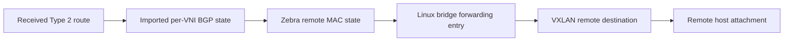

# EVPN Type 2 Route Present but Host Unreachable: Trace the FDB

Author: [nawazdhandala](https://www.github.com/nawazdhandala)

Tags: VXLAN, BGP, Linux

Description: Follow one remote EVPN MAC from FRR's global BGP table through per-VNI state and Linux forwarding entries, without confusing neighbor resolution with bridging.

Finding a host's EVPN route is encouraging, but it is not the end of a connectivity investigation. The route might belong to a segment this leaf does not import. It might lose route selection. Or the control plane might know the correct remote endpoint while the kernel lacks the forwarding entry needed to send a packet there.

Follow one host identity through each representation. This article uses **FRRouting 10.2.1** and **iproute2 6.12.0** command references, with a simple Linux bridge and one VXLAN device per VNI. It covers single-homed hosts in one Layer 2 segment. Routed overlays, hardware-offloaded switches, and EVPN multihoming require additional checks.

## Identify exactly what the Type 2 route contains

EVPN means Ethernet VPN. Its Type 2 route advertises a MAC address and can also advertise an IP address bound to that MAC. A MAC-only advertisement is valid; do not diagnose every missing IP field as a broken route. [EVPN MAC/IP advertisement format](https://www.rfc-editor.org/rfc/rfc7432.html).

Assume the failing destination has these identities:

| Field | Example |
| --- | --- |
| Workload MAC | `02:00:00:00:00:12` |
| Workload IPv4 | `10.20.0.12` |
| Layer 2 VNI | `10100` |
| Remote VTEP | `192.0.2.102` |
| Local bridge | `br10100` |
| Local tunnel device | `vxlan10100` |

A VNI is the VXLAN segment identifier. A VTEP is the tunnel endpoint that carries traffic for a remote host. Replace these examples with the intended attachment from your inventory, not merely the values currently displayed by the faulty system.

Write down the expected remote leaf and the last known host move. Without that context, a completely consistent set of tables can still point to the wrong location.



The diagram is an investigation order. Each arrow needs evidence; the presence of an earlier entry does not prove a later entry exists.

## Compare global and per-VNI BGP views

Run these read-only commands on the receiving leaf's Linux shell. The account needs permission to use `vtysh`, FRR's command interface:

```bash
vtysh -c 'show bgp l2vpn evpn route type macip'
vtysh -c 'show bgp l2vpn evpn route vni 10100 type macip'
```

The first shows Type 2 routes across the EVPN table. The second narrows the inspection to the local VNI. Both forms are defined in the **10.2.1 tagged command source**. Locate the example MAC and record its next hop and path status in each view. [FRR EVPN commands](https://raw.githubusercontent.com/FRRouting/frr/frr-10.2.1/bgpd/bgp_evpn_vty.c).

If the route appears only in the global view, examine the local segment's import policy and VNI association. Route targets control import; a matching MAC or VNI number in an advertisement does not replace that policy check. Record the advertised target and the configured import set before changing either.

If several paths exist, identify which path is selected and whether it points to the intended VTEP. A route received from a reflector can have a next hop that is a different device. Preserve path attributes and movement history when two leaves claim the same MAC. Clearing tables immediately discards useful evidence.

FRR's BGP documentation distinguishes the global and per-VNI displays. Use the tagged syntax above for this version rather than assuming every abbreviated form from another release is accepted. [FRR 10.2 BGP inspection](https://docs.frrouting.org/en/stable-10.2/bgp.html).

## Inspect Zebra's view of the segment and MAC

Zebra is FRR's component that coordinates routing information with the operating system. Check what it knows:

```bash
vtysh -c 'show evpn vni 10100'
vtysh -c 'show evpn mac vni 10100 mac 02:00:00:00:00:12'
```

Confirm the VNI's local interface associations and whether the MAC is treated as remote with the expected VTEP. If the MAC is marked local, investigate why the local bridge learned or retained that identity. The source defines both commands explicitly. [FRR 10.2.1 Zebra display commands](https://raw.githubusercontent.com/FRRouting/frr/frr-10.2.1/zebra/zebra_vty.c).

When BGP and Zebra disagree, preserve their outputs and review daemon logs around the same timestamp. Check whether the relevant daemons communicate and whether the network interfaces existed when the update arrived. Do not replace the missing controller-owned state with a permanent manual MAC entry as the first response.

FRR discovers Linux interface configuration through Netlink, the kernel's networking interface. It does not create the required bridges and VXLAN devices on your behalf. A route can therefore arrive before the local interface layout is usable. [FRR EVPN interface responsibilities](https://docs.frrouting.org/en/stable-10.2/evpn.html).

## Check both forwarding decisions in Linux

The forwarding database, or FDB, maps Ethernet destination MACs to forwarding locations. With a traditional Linux bridge and VXLAN device, inspect the bridge-facing decision and the tunnel destination:

```bash
bridge fdb show br br10100
bridge fdb show dev vxlan10100
bridge link show master br10100
ip -d link show dev vxlan10100
```

For the target MAC, the bridge should direct remote traffic toward the tunnel port. The VXLAN-side entry should identify the intended remote VTEP. Read the entry's context: `master` refers to the bridge's handling, while `self` refers to the specified device's handling. An all-zero flood entry is not the same as a specific unicast MAC entry. [iproute2 bridge and FDB reference](https://raw.githubusercontent.com/iproute2/iproute2/v6.12.0/man/man8/bridge.8).

Also verify bridge membership and the tunnel's VNI, local address, and destination port. If using a VLAN-aware bridge instead of this article's simple topology, include the relevant VLAN membership and filtering in the investigation.

A missing kernel entry despite a remote MAC in Zebra narrows the problem to local programming or interface readiness. FRR's remote-MAC installation function checks the bridge association and VNI information before submitting a dataplane operation. Inspect the corresponding errors rather than assuming BGP receipt guarantees successful installation. [FRR remote MAC installation](https://raw.githubusercontent.com/FRRouting/frr/frr-10.2.1/zebra/zebra_evpn_mac.c).

On a hardware-offloaded platform, kernel state still does not prove the switch ASIC programmed the entry. Use that platform's hardware inspection procedure as an additional stage.

## Keep IP neighbor state separate from the FDB

An IP neighbor table maps an IP address to a link-layer address. It is not a replacement for the bridge's MAC-to-port decision. For a design that uses an SVI or neighbor suppression, inspect the relevant binding:

```bash
vtysh -c 'show evpn arp-cache vni 10100'
ip neigh show dev br10100
```

An SVI is a Layer 3 interface for the segment. The second command is appropriate only if that bridge is the relevant interface in your design. A pure Layer 2 transit bridge need not have the same neighbor entries as the workload that originates traffic. Inspect the sender's own neighbor table too. [Linux neighbor semantics](https://man7.org/linux/man-pages/man8/ip-neighbour.8.html).

If the workload is still resolving the destination IP, unicast forwarding to that destination MAC may not have started. Investigate address resolution and any suppression policy separately. A valid MAC-only route does not promise an IP binding suitable for every suppression scenario.

## Prove the remaining packet path

Once the tables agree, follow one controlled request through the source workload interface, sending VTEP, receiving VTEP, and remote workload interface. Compare the inner destination MAC, VNI, and outer VTEP address with the evidence sheet.

If traffic reaches the remote tunnel but not the remote workload, inspect that leaf's local MAC attachment and access port. If the request arrives but the response does not return, repeat the same investigation for the reverse direction. A correct outbound FDB cannot repair a different return-path fault.

After the approved correction, recheck the same MAC and send representative application traffic. Keep the before-and-after evidence. This article's shell syntax and tagged command definitions were checked locally; no FRR daemon, Linux VXLAN fabric, or live forwarding test was run.
